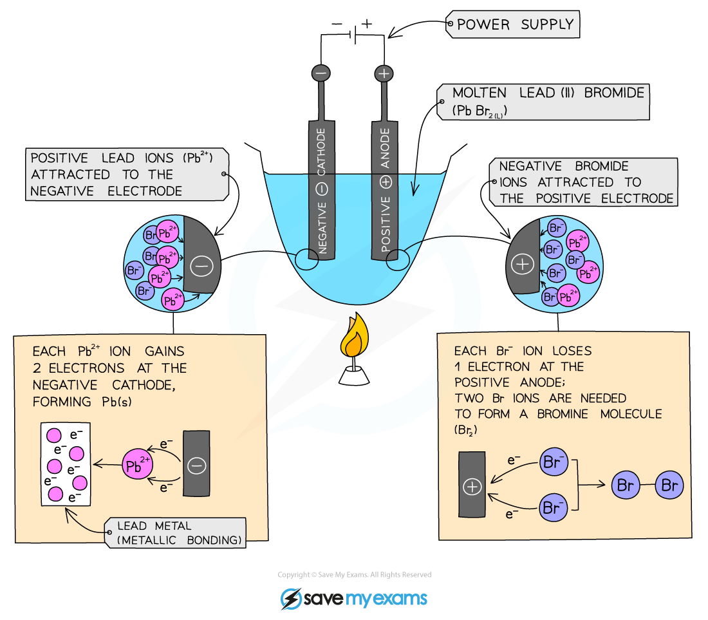

# Electrolysis of Molten Compounds

## Electrolysis of molten lead(II) bromide

> **Spec point** — `spcpt_SC4DBjDqdf9k89WJ` · Identify the products formed at the electrodes and describe the observations made during the electrolysis of: 
molten lead(II) bromide 

## Electrolysis of molten lead(II) bromide

#### Method:

- Add lead(II) bromide into a beaker and heat it so it will turn molten, allowing ions to be free to move and conduct an electric charge
- Add two graphite rods as the electrodes and connect this to a power pack or battery
- Turn on the power pack or battery and allow electrolysis to take place
- Negative bromide ions move to the positive electrode (**anode**) and each loses one electron to form bromine molecules. There is bubbling at the anode as brown **bromine gas is given off**
- Positive lead ions move to the negative electrode (**cathode**) and gain electrons to form a **grey lead metal **which deposits on the surface of the electrode

***Diagram showing the electrolysis of lead(II) bromide***

> **Exam Hint**
> **Remember: **Electrodes need to be inert such as graphite or platinum so that they don’t participate in a side reaction with the electrolyte.

## Predicting the products

> **Spec point** — `spcpt_Hr4hqm7SMVspg8W4` · Predict the identity of the products at each electrode for the electrolysis of a binary compound in the molten state

## Predicting the products

- A binary ionic compound is one consisting of just two elements joined together by ionic bonding
- When these compounds undergo electrolysis, they always produce their corresponding elements
- To predict the products made at each electrode, first identify the ions
- The **positive** ion will migrate towards the **cathode** and the **negative **ion will migrate towards the **anode **
- Therefore, the **cathode** product will always be the **metal,** and the product formed at the **anode **will always be the **non-metal**

> **Worked Example**
> Identify the product formed at the anode and cathode during the electrolysis of molten potassium chloride.
> 
> **Answer:**
> 
> - The ions present are potassium (K+) and chloride (Cl-)
> - The chloride ions are attracted to the anode and form chlorine gas
> - The potassium ions are attracted to the cathode and form potassium metal
