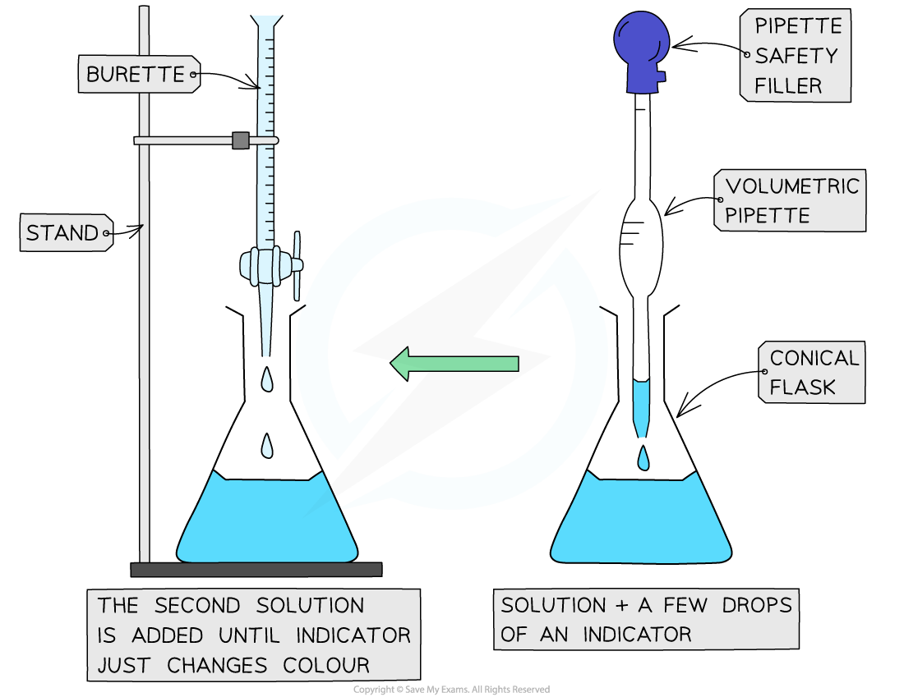
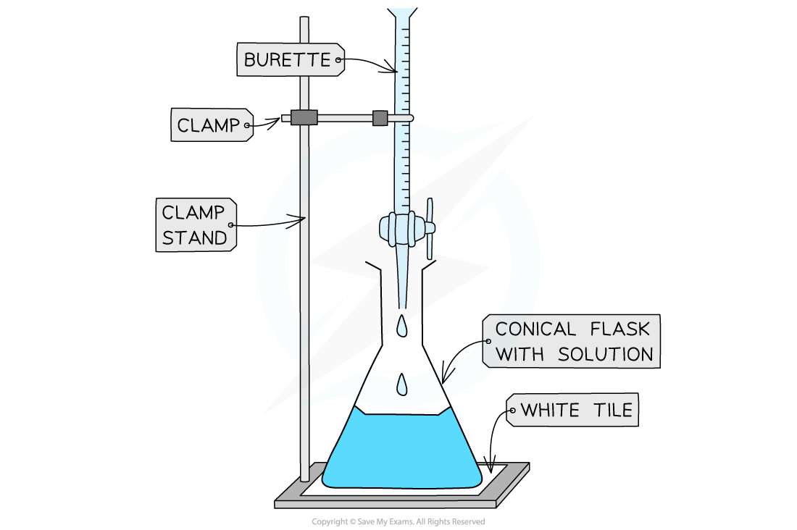

# Acid-Base Titrations

## Acid-base titrations

> **Spec point** — `spcpt_q8cCgPVKCNdZVRjj`

## Acid-base titrations

- Titrations are a method of analysing the **concentration** of solutions
- They can determine exactly how much alkali is needed to neutralise a quantity of acid – and vice versa
- Titrations can also be used to [prepare salts](https://www.savemyexams.com/igcse/science/cie/co-ordinated-sciences-double-award/23/chemistry/revision-notes/acids-bases-and-salts/preparation-of-salts/preparing-soluble-salts/)

#### Apparatus

- 25 cm3 volumetric pipette
- Pipette filler
- 50 cm3 burette
- 250 cm3 conical flask
- Small funnel
- 0.1 mol / dm3 sodium hydroxide solution
- Sulfuric acid of unknown concentration
- A suitable indicator
- Clamp stand, clamp & white tile

***The steps in performing a titration***

### Method

1. Use the pipette and pipette filler and place exactly 25 cm3 sodium hydroxide solution into the conical flask
2. Using the funnel, fill the burette with hydrochloric acid placing an empty beaker underneath the tap. Run a small portion of acid through the burette to remove any air bubbles
3. Record the starting point on the burette to the nearest 0.05 cm3
4. Place the conical flask on a white tile so the tip of the burette is inside the flask
5. Add a few drops of a suitable indicator to the solution in the conical flask
6. Perform a rough titration by taking the burette reading and running in the solution in 1 – 3 cm3 portions, while swirling the flask vigorously
7. Quickly close the tap when the end-point is reached

  - The endpoint is when one drop causes a sharp colour change
8. Record the volume of hydrochloric acid added, in a suitable results table as shown below

  - Make sure your eye is level with the meniscus
9. Repeat the titration with a fresh batch of sodium hydroxide
10. As the rough end-point volume is approached, add the solution from the burette one drop at a time until the indicator just changes colour
11. Record the volume to the nearest 0.05 cm3
12. Repeat until you achieve two concordant results (two results that are within 0.1 cm3 of each other) to increase accuracy

|   | Rough titre | Titre 1 | Titre 2 | Titre 3 |
|---|---|---|---|---|
| Final reading (cm3) |   |   |   |   |
| First reading  (cm3) |   |   |   |   |
| Titre  (cm3) |   |   |   |   |

> **Exam Hint**
> Common errors during a titration include:
> 
> - Not removing the funnel from the burette
> 
>   - This can lead to some liquid dripping into the burette and cause false / high readings
> - Not filling the jet space of the burette
> 
>   - The jet space is the part of the burette after the tap
>   - Not filling this space can lead to false readings
> - Reading the volume from the burette incorrectly
> 
>   - Readings should be taken from the bottom of the meniscus
>   - **Careful:** The scale on the burette has 0.0 cm3 at the top and 50 cm3 (typically) at the bottom

### Indicators

- **Indicators** are used to show the endpoint in a titration
- Wide range indicators such as litmus are not suitable for titration as they do not give a sharp colour change at the endpoint

  - However, methyl orange and phenolphthalein are very suitable
- Some of the most common indicators with their corresponding colours are shown below:

#### Common acid-base indicators

| **Indicator** | **Colour in acid** | **Colour in alkali** | **Colour in neutral** |
|---|---|---|---|
| **Litmus solution** | Red | Blue | Purple |
| **Red litmus paper** | Stays red | Turns blue | No change |
| **Blue litmus paper** | Turns red | Stays blue | No change |
| **Methyl orange** | Red | Yellow | Orange |
| **Phenolphthalein** | Colourless | Pink | Colourless |
| **Thymolphthalein** | Colourless | Blue | Colourless |
