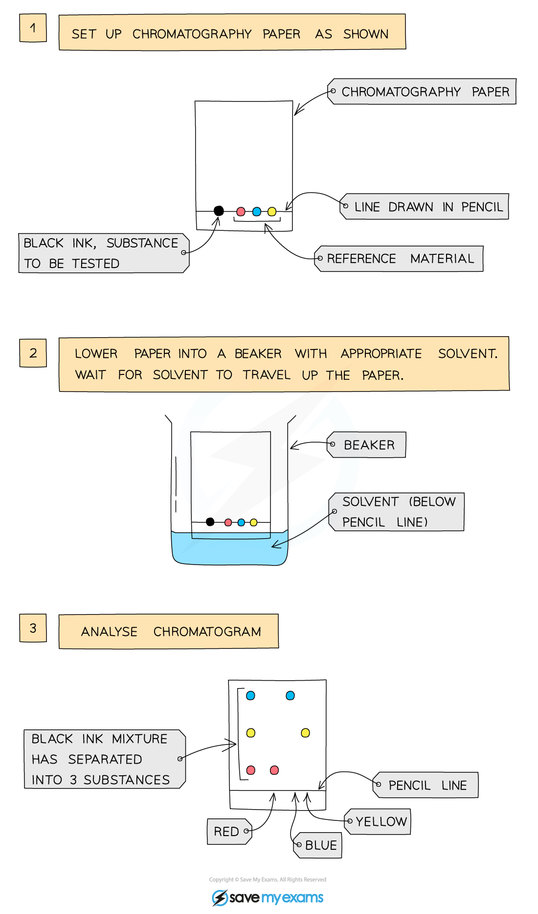

# Paper Chromatography

## Paper chromatography

> **Spec point** — `spcpt_MVWqykYw7gj7Pwnb`

## Paper chromatography

- Chromatography is used to separate mixtures of soluble coloured substances and to help identify them
- The components have **different** **solubilities** in a given solvent

  - Substances that are more soluble in the solvent travel further up the paper
  - For example, different coloured inks that have been mixed to make black ink

### How to carry out chromatography

- A **pencil** **line** is drawn on chromatography paper and spots of the sample are placed on it

  - A pencil is used for this as ink would run into the chromatogram along with the samples
- The paper is then lowered into the solvent container

  - Make sure that the pencil line sits **above** the level of the solvent so the samples do not wash into the solvent
  - The solvent used is usually **water **but it can be other substances such as **ethanol**
- The solvent travels up the paper by **capillary action**, carrying some of the coloured substances with it
- Different substances have different solubilities so they will travel at different rates, causing the substances to spread apart

### How to carry out chromatography

*The pigments in ink can be analysed using paper chromatography*

## Interpret simple chromatograms

> **Spec point** — `spcpt_FKHGbMkzqQvCw6v4`

## Interpret simple chromatograms

- Chromatograms are used to identify substances by comparing them with known reference samples
- It is common practice to include a known compound as a reference spot

  - This can help match up to an unknown spot or set of spots in order to identify it
- Pure substances will produce only **one spot** on the chromatogram
- Impure substances will produce **more than one spot** on the chromatogram
- If two or more substances are the same, they will produce identical chromatograms
- If the substance is a **mixture**, it will separate on the paper to show the **different** **components** as **separate** spots

### Example chromatogram results

***The brown ink has separated showing a spot of red ink, blue ink and yellow ink***

*** ***

- We can draw several **conclusions** from this chromatogram:

  - The brown ink is a mixture as there are three dots
  - Red, yellow and blue are pure as there is only one dot for each
  - The brown ink contains red, blue and yellow as the dots are in line with one another horizontally

> **Exam Hint**
> Chromatograms in exams will be in black and white so to identify whether a mixture contains a known sample, the dots need to be in line with one another horizontally

## Retention factor (Rf) values

> **Spec point** — `spcpt_KJMXNxfmMb7Tr2Rx`

## Retention factor (Rf) values

**Extended tier only**

- *R*f values are used to **identify** the components of mixtures
- The *R*f value of a particular compound is always the same

  - However, it does depend on the solvent used
  - If the solvent is changed then the *R*f value changes
- Calculating the *R*f value allows chemists to **identify unknown substances** because it can be compared with the *R*f values of known substances under the same conditions
- The retention factor, *R*f, is calculated by the equation:

***R*****f**** = **$\frac{\mathrm{distance} \mathrm{moved} \mathrm{by} \mathrm{substance}}{\mathrm{distance} \mathrm{moved} \mathrm{by} \mathrm{solvent}}$

- The *R*f value:

  - Is a ratio
  - Has no units
  - Will always be** less** than 1

> **Worked Example**
> A student obtained the following chromatogram when carrying out chromatography.
> 
> 
> 
> Calculate the *R*f value of the substance.
> 
> **Answer:**
> 
> - The *R*f value of the substances in the chromatogram above can be calculated by:
> 
>   - *R*f = $\frac{\mathrm{distance} \mathrm{moved} \mathrm{by} \mathrm{substance}}{\mathrm{distance} \mathrm{moved} \mathrm{by} \mathrm{solvent}}$ = $\frac{3}{6}$ = 0.5

> **Exam Hint**
> When you calculate *R*f values in exams, make sure to use your ruler carefully to measure the distance moved by the solvent and the substance as mark schemes can be strict about the values accepted for these.
