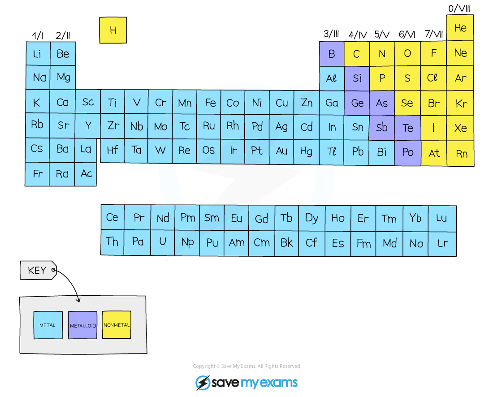

# Properties of Metals

## Physical properties of metals & non-metals

> **Spec point** — `spcpt_KHxS6rsDcDm6rMFN`

## Physical properties of metals & non-metals

- The Periodic Table contains over 100 different elements
- They can be divided into two broad types:

  - **Metals**
  - **Non-metals**
- Most of the elements are metals and a small number of elements display properties of both types

  - These elements are called **metalloids** or **semimetals**

***The metallic character diminishes moving left to right across the Periodic Table***

### Properties of metals

- Conduct **heat** and **electricity **

  - This is because metals have delocalised electrons that are able to move through the metal structure
- Are **malleable** (can be hammered and made into different shapes) and **ductile** (can be drawn into wires)

  - This is because the layers of positive metal ions, in the metal structure, are able to slide over each other

- Usually have **high** melting and boiling points

  - This is because there is a strong electrostatic attraction between the positive metal ions and delocalised electrons ([metallic bond](https://www.savemyexams.com/igcse/science/cie/co-ordinated-sciences-double-award/23/chemistry/revision-notes/atoms-elements-and-compounds/giant-structures/metallic-bonding/))
  - This strong attraction / bond requires lots of energy to break

### Properties of non-metals

- Do **not** conduct heat and electricity

  - This is because all of the electrons are involved in covalent bonding
  - One exception to this is [graphite](https://www.savemyexams.com/igcse/science/cie/co-ordinated-sciences-double-award/23/chemistry/revision-notes/atoms-elements-and-compounds/giant-structures/diamond-and-graphite/)
- Are **brittle** when solid and easily break up

  - They are not malleable or ductile
  - One exception to this is graphite
- **Low** melting and boiling points

  - Many non-metals are gases at room temperature
  - This is because they have weak forces between molecules
  - These weak intermolecular forces do not require a lot of energy to overcome
  - Exceptions to this include [diamond](https://www.savemyexams.com/igcse/science/cie/co-ordinated-sciences-double-award/23/chemistry/revision-notes/atoms-elements-and-compounds/giant-structures/diamond-and-graphite/)

## Chemical properties of metals

> **Spec point** — `spcpt_T3Bh5jRhtCTmNdFP`

## Chemical properties of metals

- The chemistry of metals is studied by analysing their reactions with water, dilute acid and oxygen
- Based on these reactions, a ***reactivity series*** of metals can be produced

### Reactions of metals with water

- Some metals react with water, either warm or cold, or with steam
- Metals that react with cold water form a metal hydroxide and hydrogen gas

**metal + water →  metal hydroxide + hydrogen**

- For example, calcium:

**Ca (s) + 2H****2****O (l) → Ca(OH)****2**** (aq) + H****2**** (g)**

- Metals that react with steam form a metal oxide and hydrogen gas

**metal + water →  metal oxide + hydrogen**

- For example, zinc:

**Zn (s) + H****2****O (g) → ZnO (s) + H****2**** (g)**

### Reactions of metals with acids

- Most [metals react with acids](https://www.savemyexams.com/igcse/science/cie/co-ordinated-sciences-double-award/23/chemistry/revision-notes/acids-bases-and-salts/the-characteristic-properties-of-acids-and-bases/properties-of-acids-and-bases/), such as HCl
- When acids and metals react, the hydrogen atom in the acid is replaced by the metal atom to produce a salt and hydrogen gas

**metal + acid → salt + hydrogen**

- For example, iron:

**Fe (s) + 2HCl (aq) → FeCl****2**** (aq) + H****2**** (g)**
