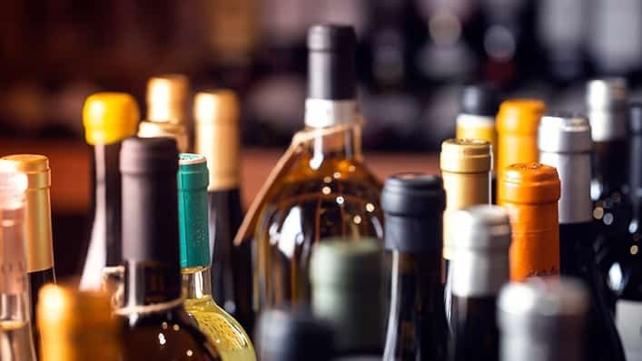

# Alcohols

## Alcohols

> **Spec point** — `spcpt_j5MgFktDwkjVkZ7Z`

## Alcohols

- All alcohols contain the hydroxyl (**-OH**) functional group which is the part of alcohol molecules that is responsible for their characteristic reactions
- Alcohols are a homologous series of compounds that have the general formula **C****n****H****2n+1****OH**
- They differ by one -CH2 in the molecular formulae from one member to the next

#### Table showing the first three alcohols

| **Name** | **Formula** | **Displayed formula** |
|---|---|---|
| Methanol | CH3OH |  |
| Ethanol | C2H5OH |  |
| Propanol | C3H7OH |  |

### Uses and reactions of alcohol

- Ethanol (C2H5OH) is one of the most important alcohols

  - Ethanol can also be represented by its structural formula CH3CH2OH
- It is the type of alcohol found in **alcoholic drinks** such as wine and beer
- It is also used as **fuel **for cars and as a **solvent**
- Ethanol will undergo complete combustion and burn in excess oxygen to produce carbon dioxide and water

C2H5OH (l) + 3O2 (g) → 2CO2 (g) + 3H20 (l)

***Alcohol is used to make drinks, as a fuel and in solvents***

**Photo by ****[NHS Better Health](https://www.nhs.uk/better-health/drink-less/)**
