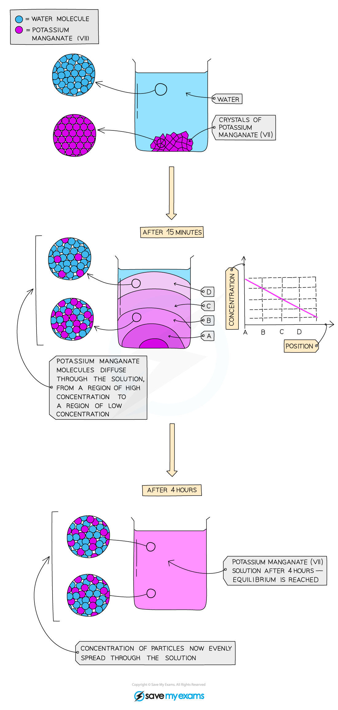
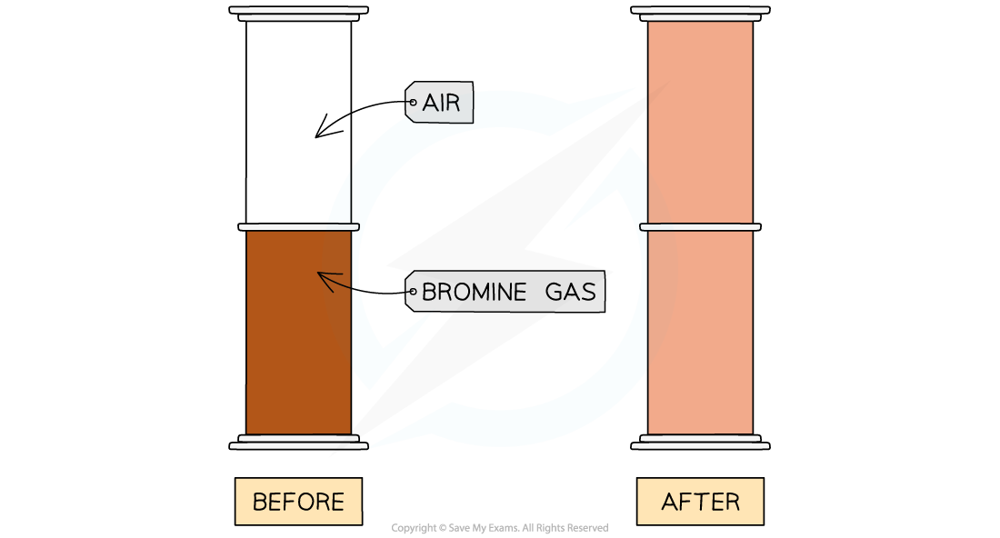
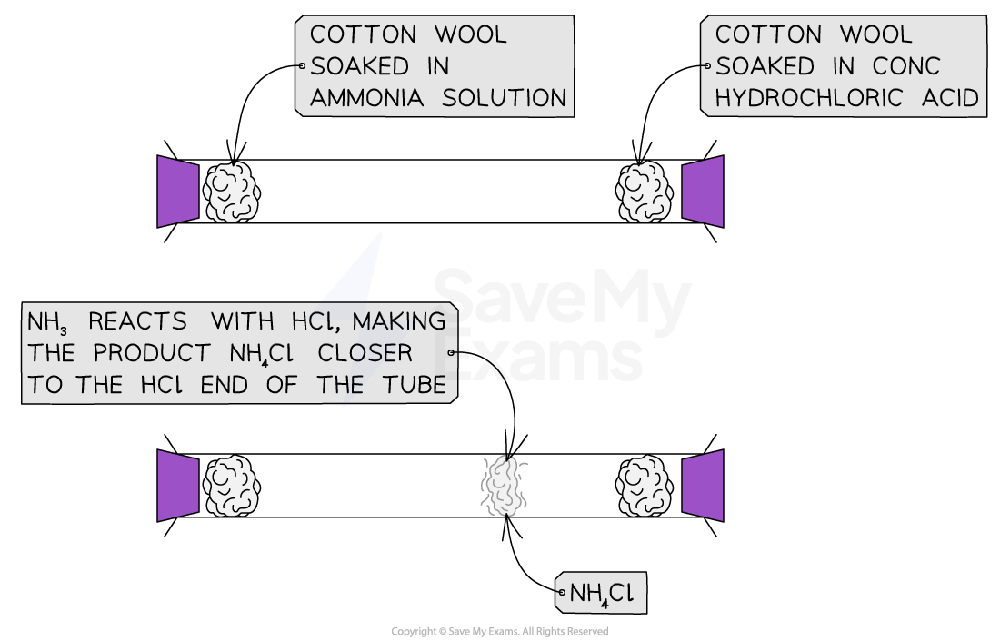

# Diffusion

## Diffusion

> **Spec point** — `spcpt_S7cqwb4cyGpmZ8R2` · Describe & explain diffusion in terms of kinetic particle theory

## Diffusion

- Diffusion occurs in gases and liquids, due to the random motion of their particles
- It is where particles move from an area of **high concentration **to an area of **low concentration**
- Eventually the concentration of particles is **even** as the particles are evenly spread throughout the available space
- Diffusion happens on its own and no energy input is required

  - Although, it occurs faster at higher temperatures because the particles have more kinetic energy

### Diffusion in liquids

- Potassium manganate(VII), KMnO4 , in water is a typical demonstration of diffusion in liquids:

***Diffusion of potassium manganate(VII), KMnO******4 ******, in water. After a few hours, the concentration of KMnO******4 ******is the same throughout the solution***

### Diffusion in gases

- Diffusion is **faster** in gases than in liquids

  - This is because gaseous particles have more energy and move faster than liquid particles
- For example, the diffusion of bromine gas and air:

***Bromine diffuses until it is evenly spread throughout the container***

- At the start, the orange-brown bromine gas is in an area of high concentration
- It diffuses from an area of high concentration to an area of low concentration
- After 5 minutes, the bromine gas will have diffused from the bottom jar until it is evenly spread throughout both containers

  - The same can be said for the air, although it is less obvious as it is colourless

> **Exam Hint**
> When you are talking about diffusion, you should (where appropriate) include:
> 
> - Ideas about areas of high and low concentration
> - The energy / movement of the particles

## Diffusion & Molecular Mass

> **Spec point** — `spcpt_KwXxwQyHDPRx2xd6` · Describe & explain the effect of relative molecular mass on the rate of diffusion of gases

## Diffusion & molecular mass

#### Extended tier only

### How molecular mass affects diffusion

- At the same temperature, different gases do not diffuse at the same rate.
- This is due to the difference in their **relative molecular masses**
- Gases with a lower relative molecular mass are "lighter" which means that they:

  - Travel faster
  - Travel further in the same amount of time
- The reverse argument is true for gases with a high relative molecular mass, they:

  - Travel slower
  - Do not travel as far in the same amount of time
- For example, the reaction between ammonia and hydrogen chloride

#### Diffusion of ammonia and hydrogen chloride

- Ammonia gas and hydrogen chloride gas react together to form solid ammonium chloride

**NH****3**** (g) + HCl (g) → NH****4****Cl (s)**

- The *M*r of ammonia is 17, while the *M*r* *of hydrogen chloride is 36.5

  - This means that ammonia will travel faster and further than hydrogen chloride
  - Therefore, the ammonium chloride will form nearer to the hydrogen chloride
  
    - This is seen as a white "smoke" ring inside the gas tube

***Ammonia molecules have less mass than HCl molecules so they diffuse faster and the product forms closer to the HCl end***
