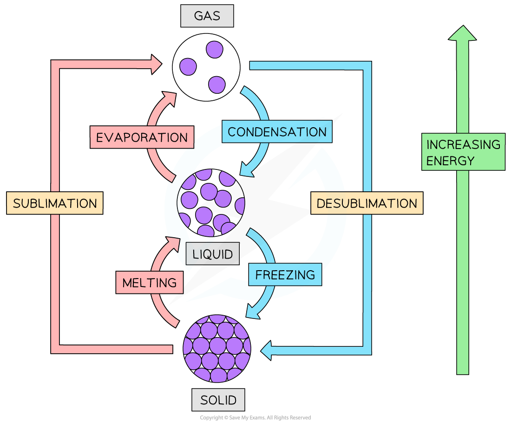
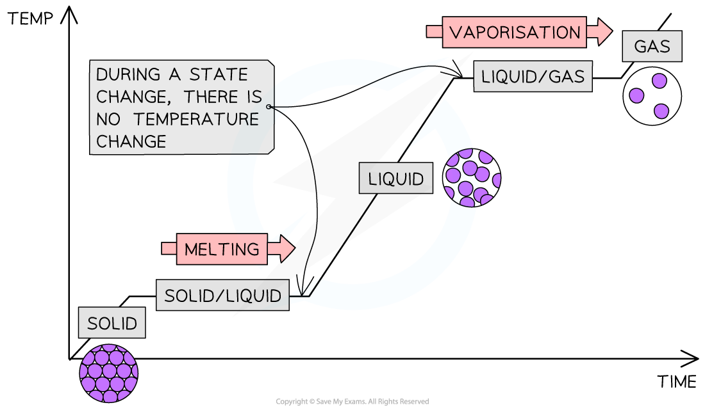
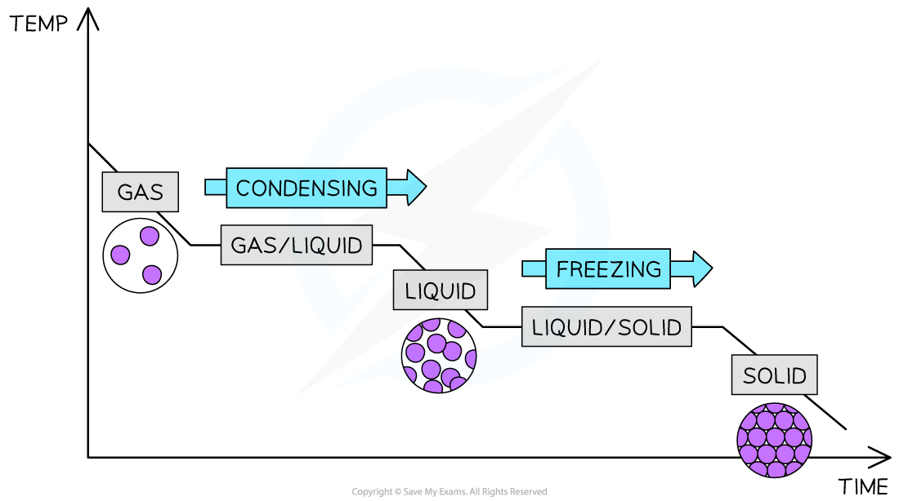

# States of Matter

## State changes

> **Spec point** — `spcpt_92kPkXwDqDR9JPB7`

## State changes

- **State changes** occur when:

  - Solids become liquids
  - Liquids become gases
  - Gases become liquids
  - Liquids become solids
- Each state change requires a change in the energy, arrangement and movement of the particles

#### The state changes

***The inter-conversions / state changes are shown in relation to energy***

### Melting

- Melting is when a solid changes into a liquid
- Requires heat energy which transforms into **kinetic** energy, allowing the particles to move
- Occurs at a specific temperature known as the ***melting point*** (m.p.)

### Freezing

- Freezing is when a liquid changes into a solid
- This is the reverse of melting and occurs at exactly the **same** **temperature** as melting, hence the melting point and freezing point of a pure substance are the same. Water, for example, freezes and melts at 0 ºC
- Requires a significant decrease in temperature (or loss of thermal energy) and occurs at a specific temperature

### Boiling

- Boiling is when a liquid changes into a gas
- Requires heat which causes bubbles of gas to form **below** the surface of a liquid, allowing for liquid particles to escape from the surface and within the liquid
- Occurs at a specific temperature known as the ***boiling point*** (b.p.)

### Evaporation

- Evaporation occurs when a liquid changes into a gas and occurs over a **range** of temperatures
- Evaporation occurs only at the **surface** of liquids where high energy particles can escape from the liquid's surface at **low** temperatures, below the b.p. of the liquid
- The larger the surface area and the warmer the liquid surface, the more quickly a liquid can evaporate

### Condensation

- Condensation occurs when a gas changes into a liquid on cooling and it takes place over a **range** of temperatures
- When a gas is cooled its particles lose energy and when they bump into each other they lack the energy to bounce away again, instead they group together to form a liquid

> **Exam Hint**
> Questions on the particle theory of matter show interconversion of states with a reversible arrow: ⇌, which means that the process can go forwards and backwards.
> 
> Read the question carefully and pick the direction of the change in state that the question refers to.

## State Changes & Kinetic Theory

> **Spec point** — `spcpt_GqbwFhsFbbKWPR4C`

## State changes & kinetic theory

#### Extended tier only

- When substances are heated, the particles **absorb** thermal energy which is converted into kinetic energy

  - This is the basis of the kinetic theory of matter
- Heating a solid causes its particles to vibrate more

  - As the temperature increases, the particles vibrate so much that the solid **expands** until the structure breaks
  - This is when the solid **melts **into a liquid
- Heating a liquid causes its particles to move more and spread out

  - Some particles at the surface gain sufficient energy to overcome the intermolecular forces
  - This is when a liquid starts to **evaporate**
  - When the boiling point is reached, all of the particles gain enough energy to escape and the liquids **boils **into a gas

- These changes in state can be shown on a graph called a **heating curve**:

***A heating curve showing the states, state changes and temperature changes as time progresses***

- Cooling down a gas has the reverse effect and this would be called a **cooling** **curve**:

***A cooling curve is like a heating curve, but is the mirror image***

- Heating and cooling curves are used to show how changes in temperature affect changes of state
- The horizontal sections occur when there is a change of state but there is no change in temperature
