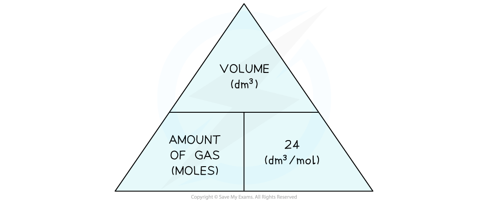
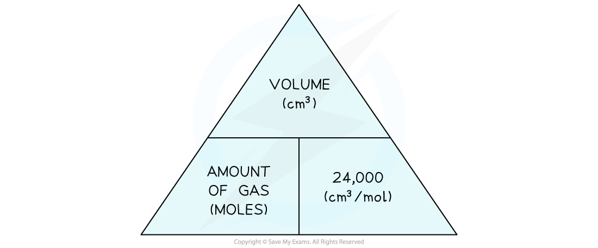

# The Mole

## The mole & the Avogadro Constant

> **Spec point** — `spcpt_xwpFjNWjWb7mvCGv` · State that the mole, mol, is the unit of amount of substance and that one mole contains 6.02 × 1023 particles, e.g. atoms, ions, molecules; this number is the Avogadro constant

## The mole & the Avogadro Constant

#### Extended tier only

- Chemical amounts are measured in moles
- The mole, symbol mol, is the SI unit of **amount of substance**
- One mole of a substance contains the same number of the stated particles

  - This can be atoms, molecules or ions
- One mole contains **6.02 x 10****23** particles; this number is known as the **Avogadro Constant**

- For example:

  - One mole of sodium (Na) contains 6.02 x 1023 atoms of sodium
  - One mole of hydrogen (H2) contains 6.02 x 1023 molecules of hydrogen
  - One mole of sodium chloride (NaCl) contains 6.02 x 1023 formula units of sodium chloride

- The mass of 1 mole of a substance is known as the **molar mass**

  - For an element, it is the same as the **relative atomic mass** written in grams
  - For a compound, it is the same as the **relative molecular** or **formula mass** in grams

## The mole & volume of gas

> **Spec point** — `spcpt_rQw9qc9pNRFRyPKB` · Use the molar gas volume, taken as 24dm3 at room temperature and pressure, r.t.p., in calculations involving gases

## The mole & volume of gas

#### Extended tier only

### Molar volumes of gas

- **Avogadro’s Law** states that at the same **temperature** and **pressure**, equal amounts of gases occupy the **same volume** of space

  - e.g. 1 mole of hydrogen gas occupies the same volume as 1 mole of methane gas
- At room temperature and pressure, the volume occupied by one mole of any gas was found to be **24** **dm****3** or** 24,000** **cm****3**

  - This is known as the **molar gas volume at RTP**
  - RTP stands for “room temperature and pressure” and the conditions are **20 ºC** and **1 atmosphere** (atm)
- From the molar gas volume, the following formula triangles can be derived:

#### Molar gas volume (dm3) formula triangle

***This shows the relationship between moles of gas, volume in dm******3****** and the molar volume***

- If the volume is given in cm3 instead of dm3, then divide by 24,000 instead of 24:

#### Molar gas volume (cm3) formula triangle

***This shows the relationship between moles of gas, volume in cm******3 ******and the molar volume***

- The formula can be used to calculate the number of moles of gases from a given volume or vice versa

  - Simply cover the one you want and the triangle tells you what to do
- For example, to find the volume of a gas:

  - **Volume = Moles x Molar Volume**

#### Examples of Converting Moles to Volume Table

| **Gas** | **Amount (moles)** | **Volume** |
|---|---|---|
| **Hydrogen** | 3 | (3 x 24) = 72 dm3  (3 x 24000) = 72000 cm3 |
| **Carbon dioxide ** | 0.25 | (0.25 x 24) = 6 dm3  (0.25 x 24000) = 6000 cm3 |
| **Oxygen** | 5.4 | (5.4 x 24) = 129.6 dm3  (5.4 x 24000) = 129600 cm3 |
| **Ammonia** | 0.02 | (0.02 x 24) = 0.48 dm3  (0.02 x 24000) = 480 cm3 |

- For example, to find the number of moles of a gas:

  - **Moles = Volume ÷ Molar Volume**

#### Examples of Converting Volume to Moles Table

| **Gas** | **Volume ** | **Moles** |
|---|---|---|
| **Methane** | 225.6 dm3 | (225.6 ÷ 24) = 9.4 mol |
| **Carbon monoxide ** | 7.2 dm3 | (7.2 ÷ 24) = 0.3 mol |
| **Sulfur dioxide** | 960 dm3 | (960 ÷ 24) = 40 mol |
| **Oxygen** | 1200 cm3 | (1200 ÷ 24000) = 0.05 mol |

> **Exam Hint**
> - You are not expected to know the value of Avogadro's constant
> - But, you do need to know the equation as well as how to use and re-arrange it
