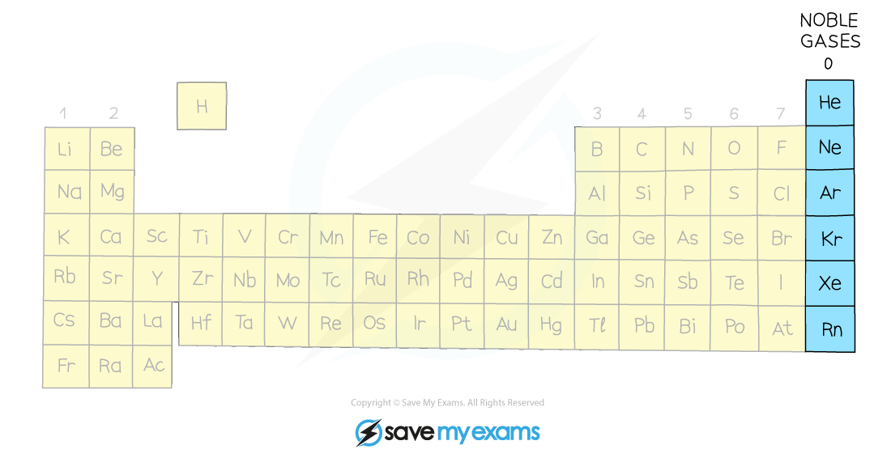

# Noble Gases

## Noble gases properties & electronic configuration

> **Spec point** — `spcpt_SV5GMQXv6Z2vTHsF` · Describe the Group VIII noble gases as unreactive, monatomic gases and explain this in terms of electronic configuration

## Noble gases properties & electronic configuration

- The noble gases are in Group VIII

*The noble gases are located at the right of the Periodic Table*

- The noble gases:

  - Are **non-metals **
  - Are **monoatomic**
  
    - This means that they are made of a single atom
  - Are **colourless**
  - Are **gaseous**
  - Have very **low** **melting** and **boiling** points
  - Are unreactive / ***inert***

### Why the noble gases are inert

- The Group VIII noble gases have **full outer shells**
- Electronic configurations of the noble gases:

  - He: 2
  - Ne: 2,8
  - Ar: 2,8,8
  - Kr: 2,8,18,8
  - Xe: 2,8,18,18,8
- This means that the noble gases have no need to gain or lose electrons
- These electronic configurations are **extremely** **stable**
- As a result, noble gases do not easily form bonds with other elements
