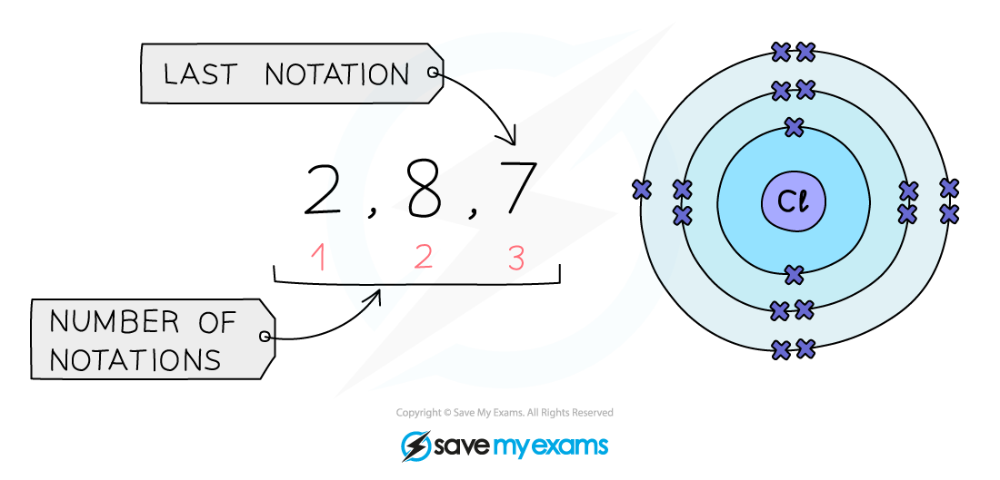
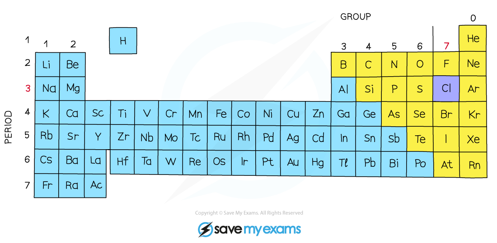

# Periodic Trends

## The metallic character of elements

> **Spec point** — `spcpt_ZZzXCWPXkR3q3B4R`

## The metallic character of elements

- The metallic character of the elements **decreases** as you move across a period on the Periodic Table, from **left** **to** **right**, and it **increases** as you move down a Group
- This trend occurs due to atoms more **readily** **accepting** electrons to fill their outer shells rather than losing them to have the previous, already full, electron shell as their outer shell
- Metals occur on the **left-hand** side of the Periodic Table and non-metals on the **right-hand** side
- Between the metals and the non-metals lie the elements which display some properties of **both**
- These elements are referred to as ***metalloids*** or semi-metals

**Properties of metals and non-metals**

| **Property** | **Metal** | **Non-metal** |
|---|---|---|
| **Electron arrangement** | 1-3 outer shell electrons (more in Periods 5+ 6) | 4-7 electrons in the outer shell |
| **Bonding** | metallic | covalent |
| **Electrical conductivity ** | good conductors | poor conductors |
| **Type of oxide ** | basic oxide | acidic oxides |
| **Reaction with acids** | many react with acids | do not react with acids |
| **Physical characteristics** | malleable high melting and boiling point | brittle low melting and boiling point |

***A zig-zag line in this diagram separates the metals on the left, from the non-metals on the right***

## Periodic trends & electronic Configuration

> **Spec point** — `spcpt_pQ3xqvj3wD3DdFt3`

## Periodic trends & electronic Configuration

- The ***electronic configuration*** is the arrangement of electrons into shells for an atom

  - E.g. the electronic configuration of carbon is 2,4
- There is a link between the electronic configuration of the elements and their position on the Periodic Table
- The number of notations in the electronic configuration will show the number of occupied shells of electrons the atom has, showing the** period**
- The last notation shows the number of outer electrons the atom has, showing the **group **number

**Example**:  Electronic configuration of **chlorine**:

***The electronic configuration of chlorine as it should be written***

**Period: **The red numbers at the bottom show the number of notations which is 3, showing that a chlorine atom has 3 shells of electrons.

**Group: **The final notation, which is 7 in the example, shows that a chlorine atom has 7 outer electrons and is in Group VII

***The position of chlorine on the Periodic Table***** **

- Elements in the same group in the Periodic Table have **similar chemical properties**
- When atoms collide and react, it is the **outermost electrons** that interact
- The similarity in their chemical properties stems from having the **same number **of electrons in their outer shell
- For example, both lithium and sodium are in Group 1 and can react with elements in Group 7 to form an ionic compound by reacting in a similar manner
- As you look down a group, a full shell of electrons is added to each subsequent element

  - Lithium's electronic configuration: 2,1
  - Sodium's electronic configuration: 2,8,1
  - Potassium's electronic configuration: 2,8,8,1

> **Exam Hint**
> Electronic configurations can be shown with the numbers separated by commas or by full stops. In this course commas are used, but you will often see full stops used elsewhere. Both are accepted.

## Identifying Trends

> **Spec point** — `spcpt_2MC49r6ZqhvjVY7x`

## Identifying Trends

**Extended tier only**

- Using given information about elements, we can identify trends in properties
- An example of when this might be used is to determine the trend in reactivity of Group 1 metals
- The table below shows the reactions of the first three elements in Group 1 with water

**Observations of lithium, sodium, and potassium with water**

| **Element** | **Reaction** | **Observations** |
|---|---|---|
| Li | lithium  + water   →   lithium hydroxide  +  hydrogen  2Li (s)  +  2H2O (l)   →   2LiOH (aq)  +   H2 (g) | - Relatively slow reaction - Fizzing - Lithium moves on the surface of the water |
| Na | sodium + water   →   sodium hydroxide  +  hydrogen  2Na (s)  +  2H2O (l)   →   2NaOH (aq)   +   H2 (g) | - More vigorous fizzing - Moves rapidly on the surface of the water - Dissolves quickly |
| K | potassium  + water   →   potassium hydroxide  +  hydrogen  2K (s)  +  2H2O (l)   →   2KOH (aq)  +   H2 (g) | - Reacts more vigorously than sodium - Burns with a lilac flame - Moves very rapidly on the surface - Dissolves very quickly |

- The observations show that reactivity of the Group 1 metals increases as you go down the group
- Using this information we can predict the trend going further down Group 1 for the elements rubidium, caesium and francium
- As the reactivity of alkali metals increases down the group, rubidium, caesium and francium will react more vigorously with air and water than lithium, sodium and potassium
- Lithium will be the **least** reactive metal in the group at the top, and francium will be the **most** reactive at the bottom
- Francium is rare and radioactive so is difficult to confirm predictions

| **Element** | **Observations** |
|---|---|
| Rb | - Explodes with sparks |
| Cs | - Violent explosion due to rapid production of heat and hydrogen |
| Fr | - Too reactive to predict |

> **Exam Hint**
> For the extended course you may be asked to identify other trends in chemical or physical properties of Group 1 metals, given appropriate data.
> 
> Firstly, ensure that the metals and associated data are written in either descending or ascending order according the their position in the Group. Then look for general patterns in the data.
