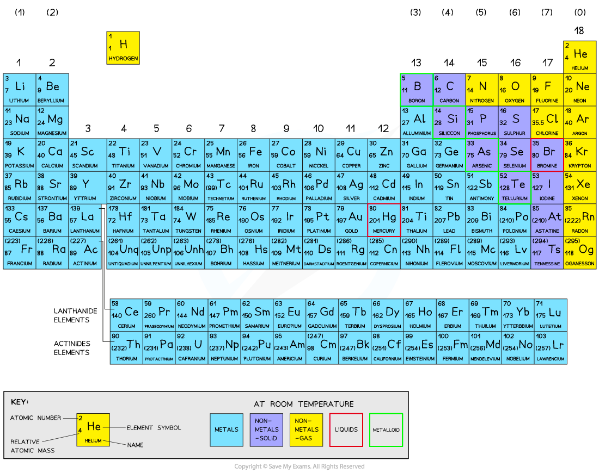

# The Periodic Table

## The Periodic table

> **Spec point** — `spcpt_cX76CVJV4P2KBGxW` · Describe the Periodic Table as an arrangement of elements in periods and groups and in order of increasing proton number/ atomic number 
Describe the relationship between group number and the charge of the ions formed from elements in that group

## The Periodic table

- There are over 100 chemical elements which have been isolated and identified

  - Each element has one proton **more** than the element preceding it
  - This is done so that elements end up in columns with other elements which have similar properties
  - Elements are arranged on the periodic table in order of **increasing atomic number**
  - The table is arranged in vertical columns called **groups** and in rows called **periods**

### The period number

- Periods are the horizontal rows that show the number of shells of electrons an atom has and are numbered from 1 - 7
- Elements in Period 2 have two electron shells, elements in Period 3 have three electron shells

### The group number

- Groups are the vertical columns that show how many outer electrons each atom has
- They are numbered from 1-7 with a final group called Group 0 (instead of Group 8)
- Group 4 elements have atoms with 4 electrons in the outermost shell, Group 6 elements have atoms with 6 electrons in the outermost shell and so on
- The group number can help determine the charge that metal and non-metal ions form
- For metals, the group number corresponds to the number of electrons it will lose to achieve a full outer shell and the charge of the metal ion

  - Sodium is in **Group 1, **it will lose 1 electron and form an ion with a **1+ charge**
  - Magnesium is in** Group** 2, it will lose 2 electrons and form an ion with a **2+ charge**

- For non-metals in Group 7 and 6, they will gain 1 and 2 electrons respectively to gain a full outer shell

  - E.g. non-metals in** Group 7 **gain 1 electron to** **form ions with a **1- charge**
  - Non-metals in **Group 6** gain 2 electrons to form ions with a **2- charge**

#### The Periodic Table

***All elements are arranged in the order of increasing atomic number from left to right***

> **Exam Hint**
> The group number is always labelled on the periodic table but the period number isn't.
> 
> Don't forget that hydrogen and helium are in Period 1.
