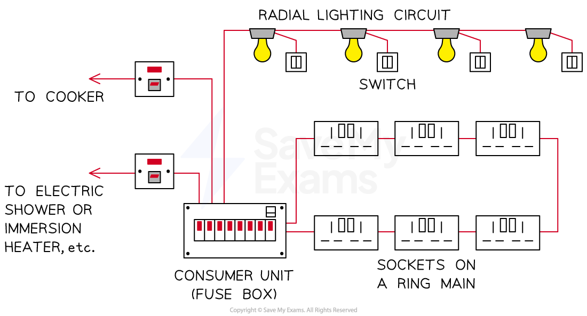

# Electrical Safety

## Mains circuits

> **Spec point** — `spcpt_yxXhrqMCRZtjwTyr`

## Mains Circuits

- All electrical appliances are connected to the mains supply
- In order to protect the user or the device, there are several safety features built into domestic appliances, including:

  - double insulation
  - earthing
  - fuses
  - circuit breakers

### Double insulation

- The conducting part of a wire is usually made of copper or some other metal

  - If this comes into contact with a person, this poses a risk of electrocution

- For this reason, wires are covered with an insulating material, such as rubber

***The conducting part of a wire is covered in an insulating material for safety***

- Some appliances do not have metal cases and so there is no risk of them becoming electrified
- Such appliances are said to be **double insulated**, as they have two layers of insulation:

  - Insulation around the wires themselves
  - A non-metallic case that acts as a second layer of insulation

- Double insulated appliances do not require an earth wire or have been designed so that the earth wire cannot touch the metal casing

### Earthing

- Many electrical appliances have metal cases
- This poses a potential safety hazard:

  - If a live wire (inside the appliance) came into contact with the case, the case would become electrified and anyone who touched it would risk being electrocuted
- The earth wire is an additional safety wire that can reduce this risk
- If this happens:

  - The earth wire provides a** low resistance path to the earth**
  - It causes a **surge of current in the earth wire** and hence also in the live wire
  - The high current through the fuse causes it to **melt and break**
  - **This cuts off the supply of electricity to the appliance**, making it safe

## Fuses & trip switches

> **Spec point** — `spcpt_YBcdM7D4xNNNZVZm`

## Fuses & trip switches

- **Fuses** and **trip switches** (circuit breakers) are safety devices designed to **cut off the flow of electricity **to an appliance if the current becomes **too large** (due to a fault or a surge)

### Fuses

- **Fuses **are used to protect **individual appliances**
- Fuses are located in the **plug**
- Fuses usually consist of a glass cylinder containing a thin metal **wire**
- A fuse without an earth wire **protects **the circuit and the cabling for a double-insulated appliance
- If the current in the wire becomes too large:

  - The wire **heats up** and **melts**
  - This causes the wire to **break**, breaking the **circuit **and **stopping **the **current**

#### Circuit symbol of a fuse

***The circuit symbol for a fuse has a wire running through it (not to be confused with a resistor)***

- Fuses have **ratings**, which signify the **maximum current **that can flow through the fuse wire without it melting
- If the current **exceeds **that value, the fuse **wire melts** and the **individual appliance** is **disconnected **from the mains supply
- Fuses come in values of **3 A**, **5 A** and **13 A**
- The correct fuse to use is the value just above the current required for the appliance

#### Choosing the correct fuse

- Suppose an appliance uses 3.1 amps

  - A 3 amp fuse would be **too small** - the fuse would blow as soon as the appliance was switched on
  - A 13 amp fuse would be **too large** - it would allow an extra 10 amps to pass through the appliance before it finally blew
  - A 5 amp fuse would be the **most appropriate** choice, as it is the next size up

### Trip switches

- The current enters the house at the **consumer unit **(sometimes referred to as a 'fuse box')
- The consumer unit consists of a series of **trip switches** (or circuit breakers) which control the amount of current supplied to each circuit within the house

  - When the current is too high the switch 'trips' (automatically flicks to the off position)
  - This stops the current flowing in that circuit

#### Example of a domestic circuit

***The consumer unit distributes current to all the circuits in the house***

- The main **advantages **of trip switches are:

  - they provide protection from current surges or faults
  - they can be reset when the problem is fixed

## Video of Fuses

> **Spec point** — `spcpt_JcGWXCs3JRvtYThb`

##
