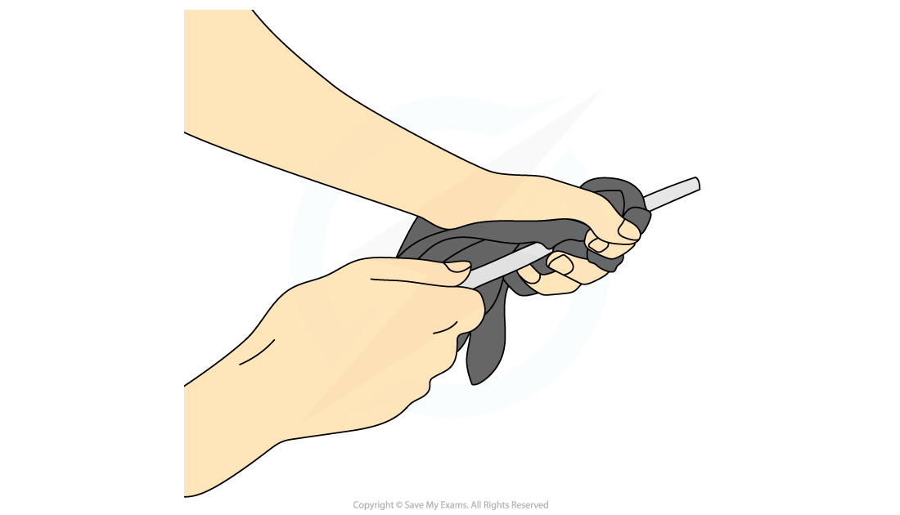
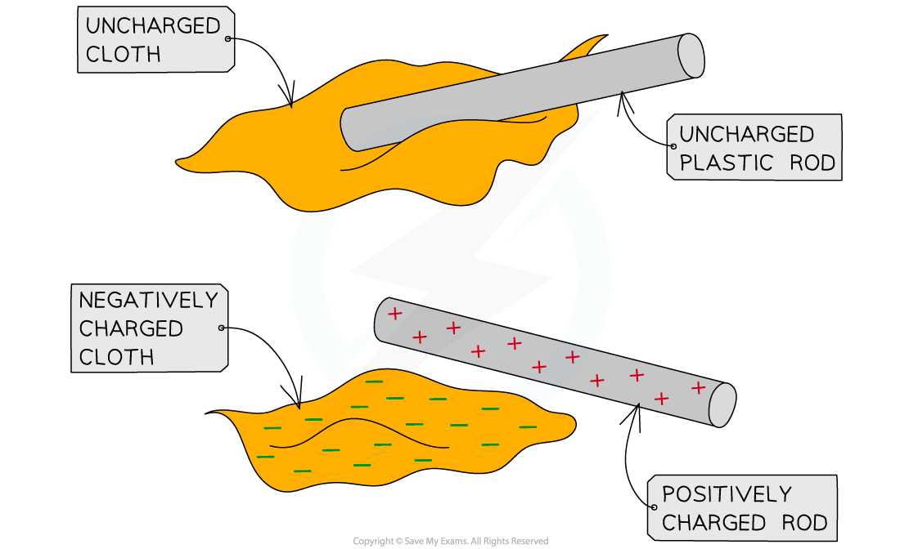
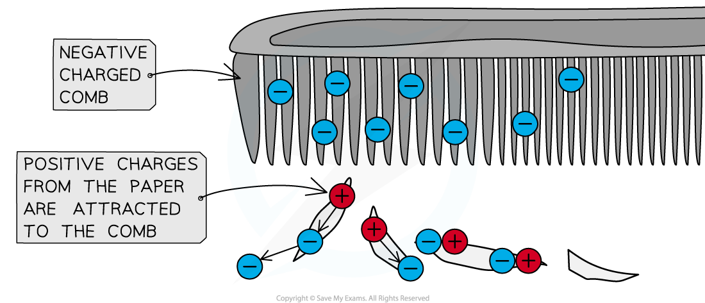
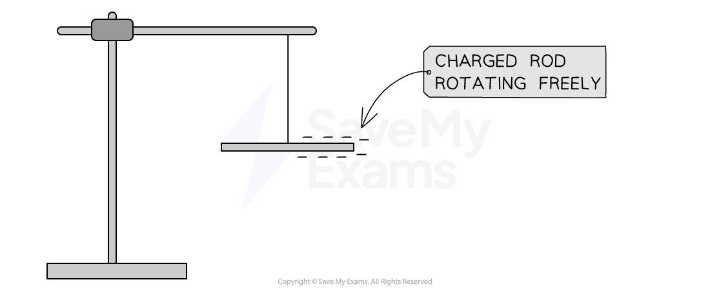
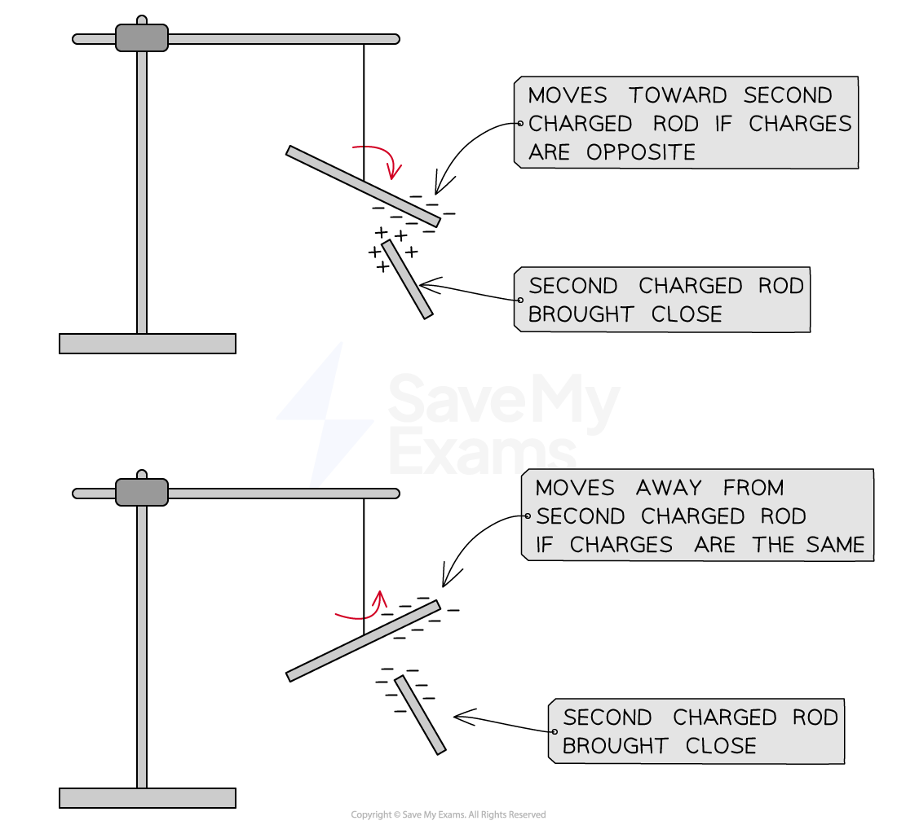

# Charging by Friction

## Charging by friction

> **Spec point** — `spcpt_KWMbShGTNdKCnY6T`

## Charging by friction

- When certain insulating solids are rubbed against each other, they can become **electrically charged**

  - This is called **charging by friction**

- The charges remain on the insulators and cannot immediately flow away

  - One gains a net **positive charge** and the other gains a net **negative charge**

- An example of this is a plastic or polythene rod being charged by rubbing it with a cloth

  - Both the rod and cloth are insulating materials

#### Charging solids by friction

***A plastic rod may be given a charge by rubbing it with a cloth***

### Movement of electrons

- Charging by friction occurs due to the movement of **electrons**
- When an acetate (plastic) rod is rubbed with a cloth, negatively charged electrons are **transferred** from the rod to the cloth

  - The cloth has **gained** electrons, so it becomes **negatively** charged
  - The rod has **lost **electrons, so it becomes **positively** charged

#### Transfer of electrons by friction

***When electrons are rubbed onto a cloth, it gives the cloth a negative charge and leaves the rod with a positive charge***

> **Exam Hint**
> At this level, if you are asked to explain how charge is gained or lost, you must reference **electrons**. If an object gains electrons, it gains negative charge, and if it loses electrons, it loses negative charge (and hence, gains positive charge)
> 
> Remember when charging by friction, it is only the **electrons** that can move, not any 'positive' charge; therefore, if an insulator gains a negative charge, the other insulator must have gained a positive charge

## Demonstrating electrostatic charges

> **Spec point** — `spcpt_ZknTzVcKXjZBnQWV`

## Demonstrating electrostatic charges

- A charged object can

  - attract **uncharged **objects
  - attract or repel other **charged **objects

- Some simple methods to determine whether an object is charged are

  - using a charged object to pick up small pieces of paper
  - sticking a charged balloon to the wall by attraction
  - using a charged rod to pull a stream of water towards it
  - bringing two charged rods close to one another

### Picking up paper with a charged comb

- Running a plastic comb through hair **transfers** electrons onto the comb by friction
- The comb becomes **negatively** charged whilst the hair becomes **positively** charged

  - This can be observed because the hairs start to **repel **each other

- The pieces of paper are uncharged (**neutral**), but as the comb is brought close to them, the **positive** charges are brought to the surface of the paper because they are **attracted** to the **negative** charges on the comb
- Since opposite charges attract, the pieces of paper appear to 'jump up' and stick to the comb due to the **electrostatic attraction**

***A negatively charged comb can attract small pieces of paper***

### Sticking a balloon to the wall

- Rubbing a balloon on a woollen jumper **transfers** electrons onto the balloon by friction
- The balloon becomes **negatively** charged whilst the jumper becomes **positively** charged
- The wall is uncharged (**neutral**), however, when the balloon is placed near it, the positive charges in the wall are brought to the **surface** because they are **attracted** to the negative charge of the balloon
- Since opposite charges attract, the balloon sticks to the wall due to the **electrostatic attraction**

### Electric force between two charged rods

- When two insulating materials are rubbed together, negative charge (electrons) will transfer from one insulator to the other
- A polythene rod gains a **negative **charge when rubbed with a cloth

  - This is because electrons are transferred to the polythene from the cloth
- An acetate rod gains a **positive **charge when rubbed with a cloth

  - This is because electrons are removed from the acetate by the cloth

#### Transfer of electrons between charged insulators

***Electrons are transferred to the polythene rod, giving it a negative charge, and they move from the acetate rod, giving it a positive charge***

- When two charged rods are brought near one another, they will experience either

  - attraction
  - repulsion

- This can be demonstrated by setting up the following apparatus:

#### Demonstrating electrostatic charge using the cradle method

***A charged rod is held by a length of thread from a clamp stand so that it can rotate freely***

- Suspend one of the rods using a cradle and a length of string so that it can rotate freely
- Rub one end of the rod using a cloth (in order to give it a charge)
- Take a second rod of insulating material and charge one end by rubbing it with a cloth
- Hold the charged end of the second rod close to the charged end of the first rod

- If the first rod is **repelled** by the second rod, then the materials have the **same charge**

  - For example, a polythene rod would be repelled by a second polythene rod, as they have the same charge

- If the first rod is **attracted** to the second rod, then they have **opposite charges**

  - For example, a polythene rod would be attracted to an acetate rod, as they have opposite charges

#### Attraction & repulsion of charged rods

***If the charged rods have opposite charges, the freely rotating rod will turn toward the second rod. If the charged rods have like charges, the freely rotating rod will turn away from the second rod***

## Video of Charging by Friction

> **Spec point** — `spcpt_qn8ymyCbY9vkhBZh`

##
