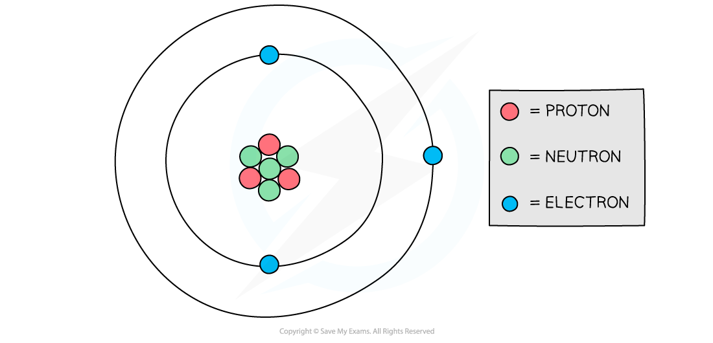
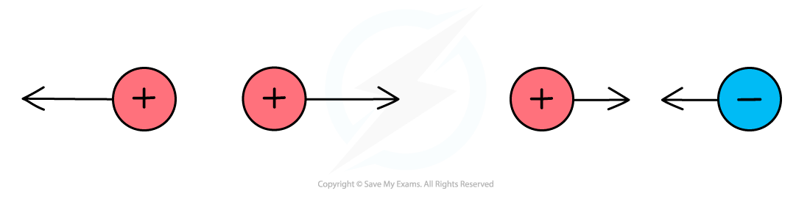

# Electric Charge

## Positive & negative charges

> **Spec point** — `spcpt_p3Zjz7dmyvYv2qD7`

## Positive & negative charges

- There are two types of electric charge: **positive **and **negative**
- Inside an atom, there are

  - negatively charged **electrons**
  - positively charged **protons**
  - neutral (no charge) **neutrons**

- Atoms contain equal numbers of protons and electrons as they have equal and opposite charges
- These charges cancel out so the overall charge of an atom is zero

#### Structure of an atom

***The number of negative electrons in an atom balances the number of positive protons***

### Attraction and repulsion

- When two charges are close together, they exert a **force **on each other, this could be:

  - **Attractive** (the objects get closer together)
  - **Repulsive** (the objects move further apart)

#### Electric forces between charges

***Opposite charges attract, like charges repel***

- Whether two objects attract or repel depends on their **charge**

  - If the charges are the **opposite**, they will **attract**
  - If the charges are the **same**, they will **repel**

#### Attraction or repulsion summary table

| **Charge of object 1** | **Charge of object 2** | **Attract or repel?** |
|---|---|---|
| positive | positive | repel |
| positive | negative | attract |
| negative | positive | attract |
| negative | negative | repel |

- The table shows that:

  - Positive charges **repel **other positive charges and **attract **negative charges
  - Negative charges **repel **other negative charges and **attract **positive charges

### Extended Tier Only

- Electric charge is measured in units called **coulombs (C)**

> **Exam Hint**
> Remember the saying “**opposites attract**” when answering questions about forces between charged particles.
> 
> While electrostatic forces share many similarities with magnetic forces, they are different phenomena** – do not confuse the two!**
