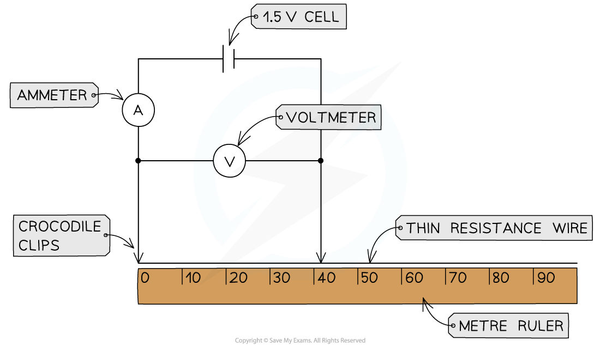
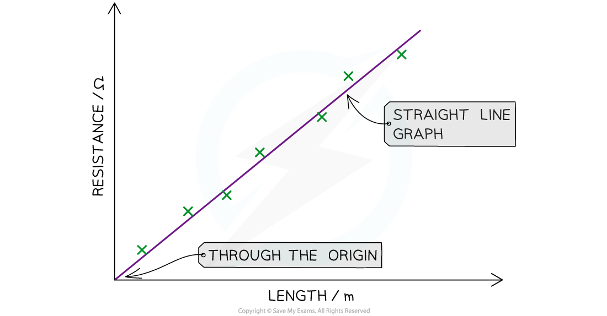

# Investigating Resistance

## Investigating resistance

> **Spec point** — `spcpt_Dvv2RQz6BhgsPRkW`

## Investigating resistance

### Aim of the experiment

- The aim of this experiment is to investigate how the length of a wire at a constant temperature affects the resistance of electrical circuits

### Variables

- *Independent variable* = Length of resistance wire, *L*
- *Dependent variable* = Resistance, *R*
- Control variables:

  - Voltage of the power supply
  - Temperature of the wire

### Equipment

#### Equipment list

| **Equipment** | **Purpose** |
|---|---|
| power supply / cell / battery | to supply a source of voltage to the circuit |
| wires | to connect the components in the circuits |
| crocodile clips | to connect different lengths of the resistance wire |
| ammeter | to measure the current through the circuit |
| voltmeter | to measure the voltage across the resistors |
| 2 or more resistors | to provide resistance in the circuit |
| thin resistance wire | to provide resistance in the circuit |
| metre rule | to measure the length of the resistance wire |

- *Resolution* of measuring equipment:

  - Metre ruler = 1 mm
  - Ammeter = 0.01 A
  - Voltmeter = 0.1 V

### Method

***Apparatus to measure the resistance of different lengths of wire***

1. Set up the apparatus by connecting two crocodile clips to the thin resistance wire a distance of 10 cm apart and setting the power supply to 1.5 V
2. Connect the wire, using the clips, to the rest of the circuit
3. Record the potential difference from the voltmeter and current from the ammeter
4. Move the clips in 10 cm intervals further apart
5. Take new measurements from the voltmeter and ammeter for each length reading
6. Continue until the crocodile clips are a length of 1 m apart

#### Example results table

### Analysis of results

- Calculate the resistance of each length of wire using the equation:

$R=\frac{V}{I}$

- Where:

  - *R* = resistance (Ω)
  - *V* = voltage (V)
  - *I* = current (A)

- Plot a graph of resistance (on the y-axis) against length (on the x-axis) and draw a line of best fit

#### Graph of resistance against length

***The expected graph of resistance against length should be a straight line through the origin***

- The graph should be a straight line through the origin with a **positive correlation**

  - This means that the longer the piece of wire, the higher the resistance

- In other words, the resistance is **directly proportional** to the length of the wire

### Evaluating the experiment

*Systematic errors*

- Eradicate **zero error** in measurements of length, current and voltage by

  - ensuring the first crocodile clip (connected to the circuit, not the wire) starts at 0 on the ruler
  - ensuring both the ammeter and voltmeter start from 0

*Random errors*

- Keep the temperature of the wire constant (to ensure resistance stays constant) by

  - using low values of current throughout the experiment
  - switching off the current between readings

- Repeat the experiment by reducing the length of the wire 10 cm each time down to a length of 10 cm
- Add more resistors in series and parallel to calculate the effect on the combined resistance

### Safety considerations

- When there is a high current flowing through a thin wire, the wire will become very hot
- Make sure never to touch the wire directly when the circuit is switched on
- Switch off the power supply right away if burning is smelled
- Make sure there are no liquids close to the equipment, as this could damage the electrical equipment or increase the risk of electrocution
