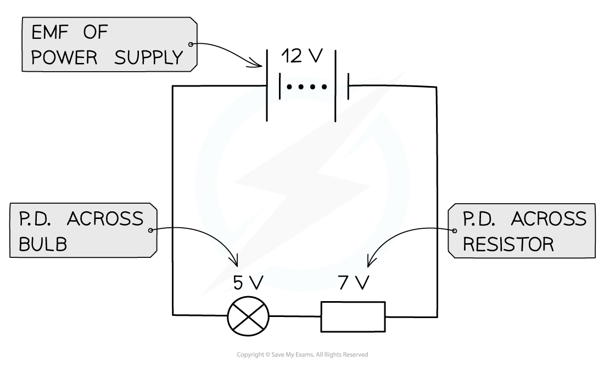
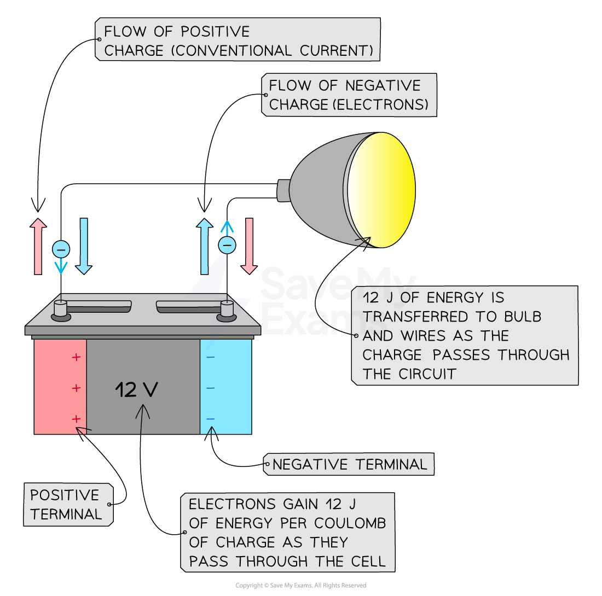

# Potential Difference

## Potential difference

> **Spec point** — `spcpt_C56qtYjDfG6Fbw2w`

## Potential difference

### Extended Tier Only

- Potential difference is defined as: **The work done by a unit charge passing between two points in a circuit**
- Potential difference is measured in units of **volts (V)**

- The potential difference between two points in a circuit is related to the amount of **energy transferred **between those points

***The potential difference is the difference in the electrical potential across each component: 5 volts for the bulb (on the left) and 7 volts for the resistor (on the right)***

- As electrons flow through a cell, they **gain **energy

  - For example, in a 12 V cell, every coulomb of charge passing through gains 12 J of energy

- As electrons flow through a circuit, they **lose **energy

  - For example, after leaving the 12 V cell, each coulomb of charge will transfer 12 J of energy to the wires and components in the circuit

***Electrons gain energy as they pass through a cell. As they flow through the light bulb, energy is transferred to the surroundings by heating and radiation***

## Video of Potential Difference

> **Spec point** — `spcpt_MjfJbkVw7B27jkYF`

##
