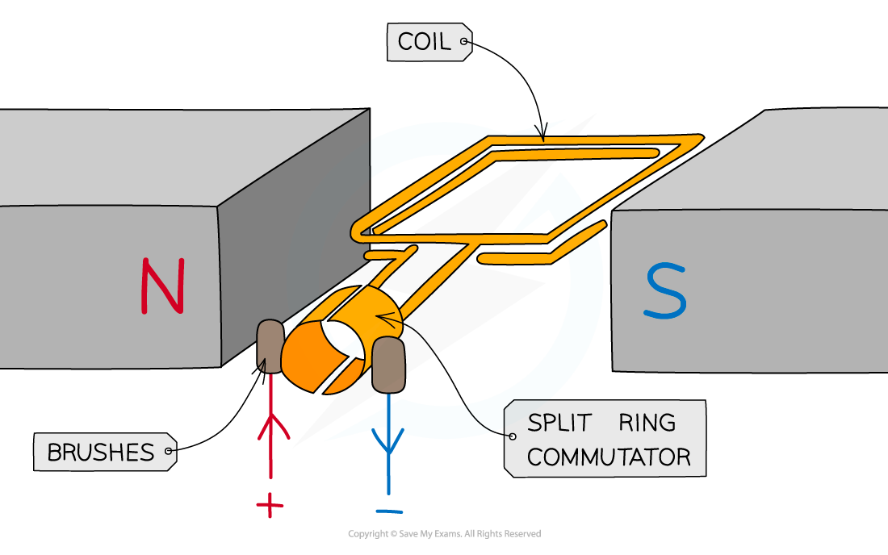
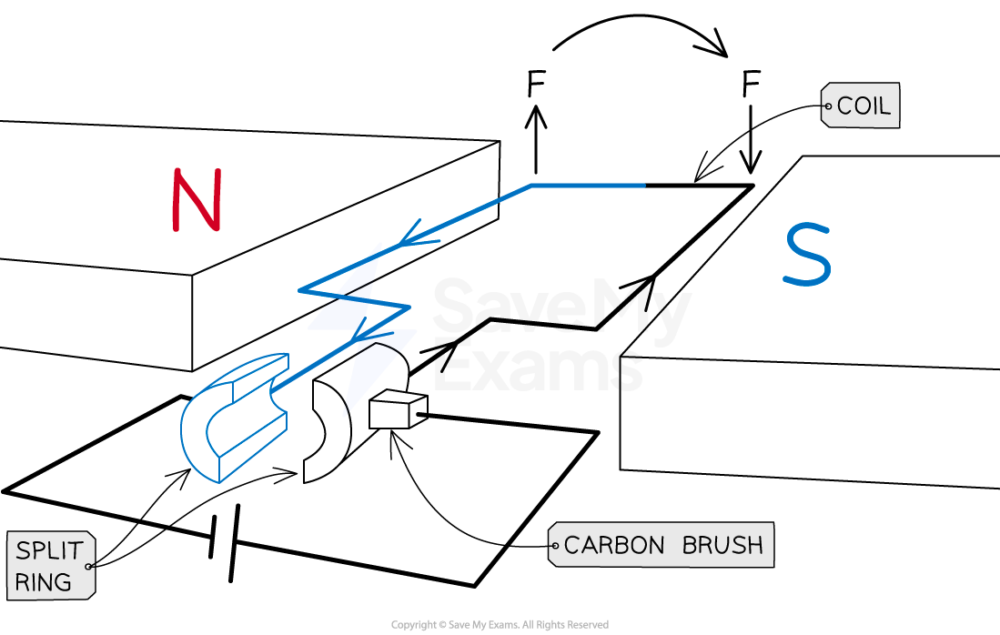
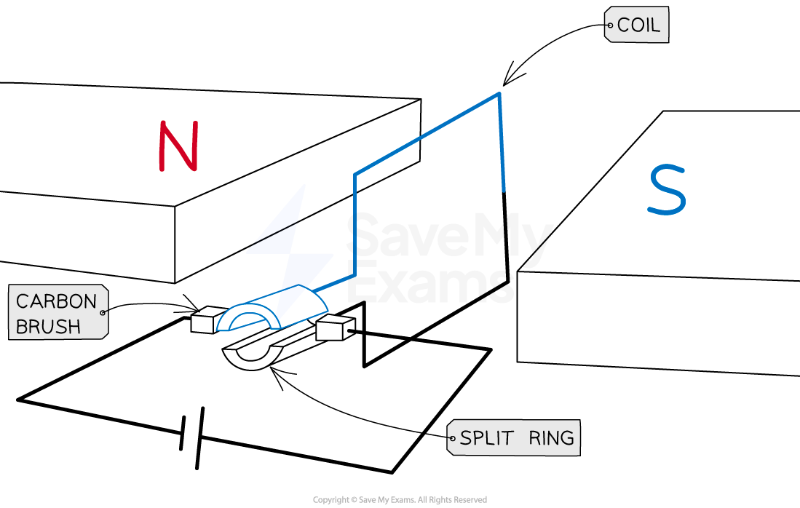
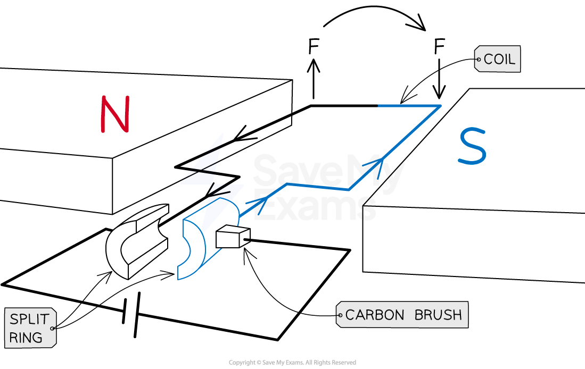

# Electric Motors

## The d.c. motor

> **Spec point** — `spcpt_w45t3Y8DqvfHDv4Q`

## The d.c. motor

### Extended tier only

- The ***motor effect*** can be used to create a simple d.c. electric motor

  - The [force on a current-carrying coil](https://www.savemyexams.com/igcse/physics/cie/23/revision-notes/4-electricity--magnetism/4-4-electromagnetic-effects/4-4-6-force-on-a-current-carrying-conductor/) causes it to **rotate** in a single direction

- A simple d.c. motor consists of

  - a coil of wire (which is free to rotate) between the poles of a permanent magnet
  - a split-ring commutator and brushes connected to a source of ***d.c.***

#### Structure of a simple d.c. motor

***In a simple d.c. motor, a coil placed in a magnetic field may experience a turning effect***

- As current flows through the coil, it produces a magnetic field which interacts with the external magnetic field
- Forces act in opposite directions on each side of the coil, causing a **turning effect**

  - The **greater **the force on the coil, the greater the turning effect and the **faster **it will turn

- The turning effect is increased by increasing:

  - the **number of turns** on the coil
  - the **current **in the coil
  - the **strength **of the magnetic field

> **Exam Hint**
> Motors and generators look very similar, but they do very different things.
> 
> When tackling a question on either of them, make sure you are writing about the right one! A **mo**tor takes in electricity and turns it into **mo**tion. A **generator** takes in motion and **generates** electricity.
> 
> You might be expected to give explanations of how these two things happen - make sure that you understand their subtle differences!

## Operation of a d.c. motor

> **Spec point** — `spcpt_HjHNySJw4pyX3nc2`

## Operation of a d.c. motor

### Extended tier only

- In a d.c. motor, when the coil of wire is horizontal, it forms a complete circuit with a cell

  - The coil is attached to a **split ring **(a circular tube of metal split in two)
  - This split ring is connected in a circuit with the cell via contact with conducting **carbon brushes**

#### Forces on the horizontal coil in a d.c. motor

***Forces acting in opposite directions on each side of the coil, causing it to rotate. The split ring connects the coil to the flow of current***

- Current flowing through the coil produces a magnetic field

  - This magnetic field interacts with the uniform external field, so a **force **is exerted on the wire

- Forces act in opposite directions on each side of the coil, causing it to rotate:

  - On the blue side of the coil, current travels towards the cell so the force acts upwards (using ***Fleming's left-hand rule***)
  - On the black side, current flows away from the cell so the force acts downwards

- Once the coil has rotated 90°, the split ring is **no longer in contact** with the brushes

  - No current flows through the coil so no forces act

#### Coil in the vertical position in a d.c. motor

***No force acts on the coil when vertical, as the split ring is not in contact with the brushes***

- Even though no force acts, the momentum of the coil causes the coil to continue to rotate slightly
- The split ring reconnects with the carbon brushes and current flows through the coil again

  - Now the blue side is on the right and the black side is on the left
- Current still flows toward the cell on the left and away from the cell on the right, even though the coil has flipped

  - The black side of the coil experiences an upward force on the left and the blue side experiences a downward force on the right
  - The coil continues to rotate in the same direction, forming a continuously spinning motor

#### Forces on the coil when rotated 180°

***Even though the coil has flipped, the current still flows anticlockwise and the forces still cause rotation in the same direction***

### Factors affecting the d.c. motor

- The **speed** at which the coil rotates can be increased by:

  - increasing the **current**
  - using a **stronger magnet**

- The **direction of rotation** of the coil in the d.c. motor can be changed by:

  - reversing the direction of the **current supply**
  - reversing the direction of the magnetic field by reversing the **poles** of the magnet

- The **force** supplied by the motor can be increased by:

  - increasing the **current** in the coil
  - increasing the strength of the **magnetic field**
  - adding **more turns** to the coil

> **Worked Example**
> A d.c. motor is set up as shown below.
> 
> 
> 
> Determine whether the coil will be rotating clockwise or anticlockwise.
> 
> **Answer:**
> 
> **Step 1: Draw arrows to show the direction of the magnetic field lines**
> 
> - These will go from the north pole of the magnet to the south pole of the magnet
> 
> 
> 
> **Step 2: Draw arrows to show the direction the current is flowing in the coils**
> 
> - Current will flow from the positive terminal of the battery to the negative terminal
> 
> 
> 
> **Step 3: Use Fleming’s left hand rule to determine the direction of the force on each side of the coil**
> 
> - Start by pointing your **F**irst **F**inger in the direction of the (magnetic) **F**ield
> - Now rotate your hand around the first finger so that the se**C**ond finger points in the direction of the **C**urrent
> - The **TH**umb will now be pointing in the direction of the **TH**rust (the force)
> 
> 
> 
> **Step 4: Use the force arrows to determine the direction of rotation**
> 
> - The coil will be turning **clockwise**
> 
> 

> **Exam Hint**
> It is important to remember all the steps that cause the rotation of the coil in a d.c. motor. Use Fleming's Left Hand rule to convince yourself of the direction of the force on each side of the coil, these should be in opposite directions because the directions of the current through each side are opposite.
> 
> Additionally, don't be confused if you see the phrase 'split-ring **commutator**'. This is another way of referring to the split ring in the circuit and they mean the same thing.
