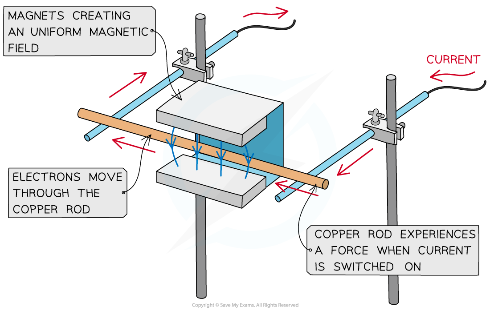
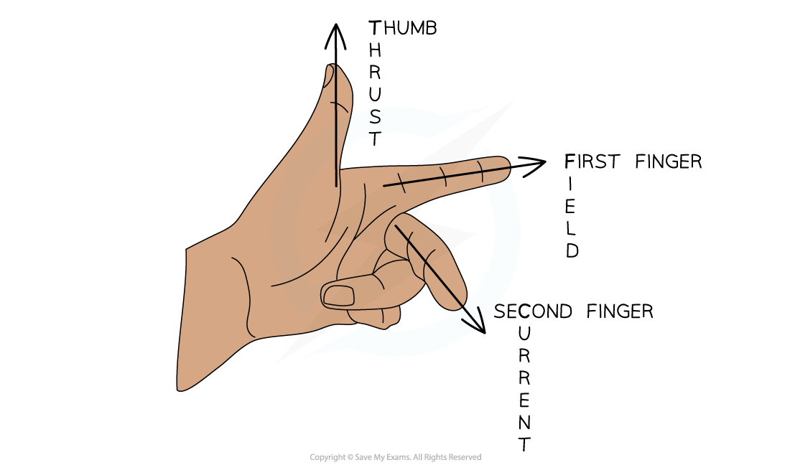

# Force on a Current-Carrying Conductor

## Force on a current-carrying conductor

> **Spec point** — `spcpt_TbWMc9P32drTPQC6`

## Force on a current-carrying conductor

### Extended tier only

- A current-carrying conductor produces its own *magnetic field*

  - When interacting with an external magnetic field, it therefore will experience a **force**

- A current-carrying conductor will only experience a force if the current through it is **perpendicular **to the direction of the magnetic field lines

  - A simple situation would be a copper rod placed within a uniform magnetic field
  - When current is passed through the copper rod, it experiences a force which makes it move

***A copper rod moves within a magnetic field when current is passed through it***

- Two ways to reverse the direction of the force (and therefore, the copper rod) are by:

  - reversing the direction of the **current**
  - reversing the direction of the **magnetic field**

> **Exam Hint**
> This phenomenon is sometimes referred to as 'the motor effect'. The direction of the force is determined by Fleming's left-hand rule.

## Fleming's left-hand rule

> **Spec point** — `spcpt_CfBK7vzJdGVrVSvM`

## Flemings left-hand rule

### Extended tier only

- The **direction** of the **force** (aka the **thrust**) on a current-carrying wire depends on the direction of

  - the current
  - the magnetic field

- The direction of the force (or thrust) can be worked out by using **Fleming's left-hand rule**:

  - the **thumb **points in the direction of the force, or thrust, on the conductor
  - the **first **finger points in the direction of the magnetic field
  - the **second **finger points in the direction of current flow (from positive to negative)

***Fleming’s left-hand rule can be used to determine the directions of the force, magnetic field and current***

- All three will be **perpendicular **to each other in Fleming's left-hand rule questions

  - This means that sometimes the force could be into and out of the page (in 3D)

> **Worked Example**
> A current-carrying wire is placed into the magnetic field between the poles of the magnet, as shown in the diagram.
> 
> 
> 
> Use Fleming’s left-hand rule to show that there will be a downward force acting on the wire.
> 
> **Answer:**
> 
> **Step 1: Determine the direction of the magnetic field**
> 
> - Start by pointing your **F**irst **F**inger in the direction of the (magnetic) **F**ield
> 
> **Step 2: Determine the direction of the current**
> 
> - Now rotate your hand around the first finger so that the se**C**ond finger points in the direction of the **C**urrent
> 
> **Step 3: Determine the direction of the force**
> 
> - The **TH**umb will now be pointing in the direction of the **TH**rust (the force)
> - Therefore, this will be the direction in which the wire will move
> 
> 

> **Exam Hint**
> Remember that the magnetic field is always in the direction from **North **to **South** and current is always in the direction of a **positive** terminal to a **negative** terminal.
> 
> Feel free to use Fleming's left hand rule in your exam, just don't make it too distracting for other students!

## Video of The Left Hand Rule

> **Spec point** — `spcpt_n8gVcVK8rnzbwfQK`

## 

## Video of The Motor Effect

> **Spec point** — `spcpt_943DjwVKDW82v3Fc`

##
