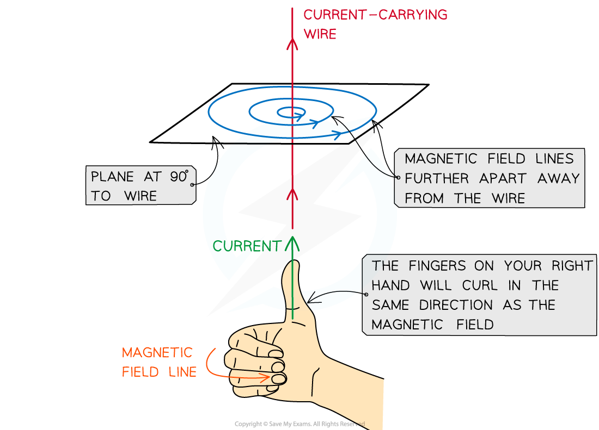
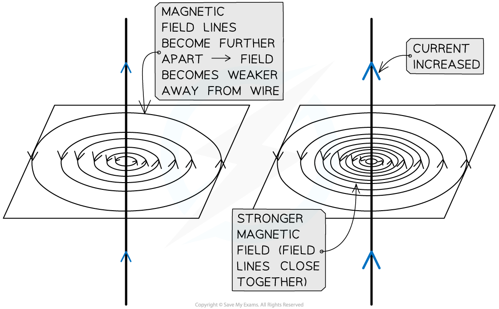

# Magnetic Effect of a Current

## Magnetic field around wires & solenoids

> **Spec point** — `spcpt_CGpN9TD96cPhF7r6`

## Magnetic fields around wires & solenoids

### Extended tier only

- *Magnetic fields* are formed wherever a current flows, such as in:

  - straight wires
  - solenoids
  - circular coils

### Magnetic field due to a straight wire

- The magnetic field lines around a straight wire are

  - made up of *concentric circles*
  - centred on the wire

- A circular field pattern indicates that the magnetic field around a current-carrying wire has **no poles**

- The **right-hand grip rule** can be used to work out the **direction** of the magnetic field

***The direction of the field around a current-carrying wire can be determined using the right-hand grip rule***

- The field lines are clockwise or anticlockwise around the wire, depending on the direction of the current

  - Reversing the current reverses the direction of the field

- The direction of the magnetic field can be determined using the** right-hand grip rule**

  - This is determined by pointing the **right-hand** thumb in the direction of the current in the wire and curling the fingers onto the palm
  - The direction of the curled fingers represents the direction of the magnetic field lines around the wire
  - For example, if the current is travelling vertically upwards, the magnetic field lines will be directed anticlockwise, as seen from directly above the wire

- **Note:** the direction of the current is taken to be the conventional current i.e. from **positive** to **negative**, **not** the direction of electron flow

### Magnetic field due to a solenoid

- As seen from a current-carrying wire, an electric current produces a magnetic field
- An electromagnet utilises this by using a coil of wire called a** ***solenoid*

  - This increases the strength of the magnetic field by adding more **turns **of wire into a smaller region of space

- One end of the solenoid becomes a north pole and the other becomes the south pole

***The magnetic field lines around a solenoid are similar to a bar magnet***

- As a result, the field lines around a solenoid are similar to a bar magnet

  - The field lines **emerge** from the **north** pole
  - The field lines **return** to the **south** pole

- The poles of the solenoid can be determined using the **right-hand grip rule**

  - The curled fingers represent the direction of the current flow around the coil
  - The thumb points in the direction of the field inside the coil, towards the **north pole**

***In a solenoid, the north pole forms at the end where the current flows anti-clockwise, and the south pole at the end where the current flows clockwise***

### Magnetic field due to a circular coil

- A circular coil is equivalent to one of the coils of a solenoid
- The field lines emerge through one side of the circle (north pole) and enter through the other (south pole)
- As with a solenoid, the direction of the magnetic field lines depends on the direction of the current

  - This can also be determined using the **right-hand grip rule**

***Magnetic field lines of many individual circular coils can be combined to make a solenoid***

> **Worked Example**
> The current in a long, straight vertical wire is in the direction XY, as shown in the diagram.
> 
> 
> 
> Sketch the magnetic field lines in the horizontal plane ABCD due to the current-carrying wire. Draw at least four field lines.
> 
> **Answer:**
> 
> 
> 
> - Concentric circles
> - Increasing separation between each circle
> - Arrows drawn in an anticlockwise direction

## Magnetic effects of changing current

> **Spec point** — `spcpt_XJX7jzxZtxfTHMbR`

## Magnetic effects of changing current

### Extended tier only

### Magnetic field strength around a straight wire

- The **strength **of the magnetic field produced around a **wire **can be increased by:

  - increasing the amount of **current** flowing through the wire

- The **direction **of the magnetic field produced around a **wire **can be changed by:

  - changing the direction of the **current**

- The strength of a magnetic field **decreases **with **distance **from the wire

  - The magnetic field is strongest near the wire and becomes weaker further away from the wire
  - This is shown by the magnetic field lines becoming** further apart**

***The greater the current, the stronger the magnetic field. This is shown by more concentrated field lines***

### Magnetic field strength around a solenoid

- The **strength **of the magnetic field produced around a **solenoid** can be increased by:

  - increasing the amount of **current** flowing through the coil
  - increasing the **number of turns** on the coil
  - inserting an **iron core** into the coil

- The **direction **of the magnetic field produced around a **solenoid** can be changed by:

  - changing the direction of the **current**

- When a soft **iron core** is inserted into a solenoid, it can be used as an electromagnet

  - The iron core becomes an *induced magnet* when a current flows through the coils
  - The magnetic field produced by the solenoid and the iron core will create a much **stronger** magnet overall

#### Structure of an electromagnet

***An electromagnet consists of a solenoid wrapped around a soft iron core***

## Video of Field Around a Wire

> **Spec point** — `spcpt_Y9SwmnGx2bQBccGx`

## 

## Video of Field Around a Coil

> **Spec point** — `spcpt_JmWwZFf79wFBh5Gj`

##
