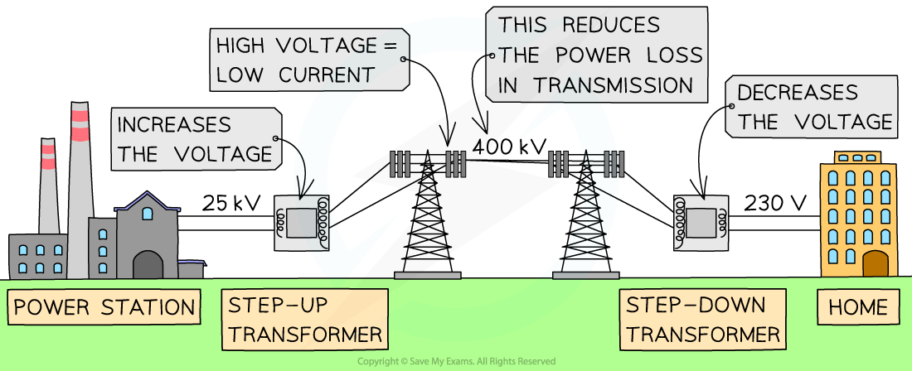

# Transformer Calculations

## Transformer calculations

> **Spec point** — `spcpt_MRT7FVFtfPWw5xxF`

## Transformer calculations

### Extended tier only

- The voltages across the primary and secondary coils of a transformer can be calculated using the **transformer equation**, which states **The ratio of the voltages across the primary and secondary coils of a transformer is equal to the ratio of the number of turns on each coil**
- It can be expressed by the equation:

$\frac{\mathrm{primary} \mathrm{voltage}}{\mathrm{secondary} \mathrm{voltage}}=\frac{\mathrm{number} \mathrm{of} \mathrm{turns} \mathrm{on} \mathrm{primary}}{\mathrm{number} \mathrm{of} \mathrm{turns} \mathrm{on} \mathrm{secondary}}$

- It can be expressed in symbols as follows:

$\frac{V_{p}}{V_{s}}=\frac{N_{p}}{N_{s}}$

- Where

  - $V_{p}$ = voltage across the primary coil, in volts (V)
  - $V_{s}$ = voltage across the secondary coil, in volts (V)
  - $N_{p}$ = number of turns on the primary coil
  - $N_{s}$ = number of turns on the secondary coil

- The transformer equation can be flipped upside down to give:

$\frac{V_{s}}{V_{p}}=\frac{N_{s}}{N_{p}}$

- Rearranging for the secondary voltage:

$V_{s}=V_{p}\times\frac{N_{s}}{N_{p}}$

- This equation shows that the output (**secondary**) voltage of a transformer depends on:

  - the **number of turns** on the primary and secondary coils
  - the input (**primary**) voltage

- In a step-up transformer, $V_{s}>V_{p}$ and $N_{s}>N_{p}$
- In a step-down transformer, $V_{s}<V_{p}$ and $N_{s}<N_{p}$

> **Worked Example**
> A transformer has 20 turns on the primary coil and 800 turns on the secondary coil. The voltage across the primary coil is 500 V.
> 
> a) Calculate the output voltage of the secondary coil.
> 
> b) State whether this is a step-up or step-down transformer.
> 
> **Answer**
> 
> **Part (a)**
> 
> **Step 1: List the known quantities**
> 
> - Number of turns on the primary coil, $N_{p}$ = 20
> - Number of turns on the secondary coil, $N_{s}$ = 800
> - Voltage across the primary coil, $V_{P}$ = 500 V
> 
> **Step 2: Write down the transformer equation**
> 
> - There will be less rearranging to do if $V_{S}$ is on the top of the fraction
> 
> $\frac{V_{s}}{V_{p}}=\frac{N_{s}}{N_{p}}$
> 
> **Step 3: Rearrange the equation to make **$V_{S}$** the subject**
> 
> $V_{s}=V_{p}\times\frac{N_{s}}{N_{p}}$
> 
> **Step 4: Substitute the known values into the equation**
> 
> $V_{S}=500\times\frac{800}{20}=20000V$
> 
> **Part (b)**
> 
> - The secondary voltage is larger than the primary, $V_{s}>V_{p}$
> - There are more turns on the secondary coil than on the primary, $N_{s}>N_{p}$
> - Therefore, this is a **step-up transformer**

> **Exam Hint**
> When carrying out transformer calculations, make sure you have used the **same letter** (p or s) in the **numerators** (top line) of the fraction and the **same letter** (p or s) in the **denominators** (bottom line) of the fraction.
> 
> There will be less rearranging to do in a calculation if the variable which you are trying to find is on the numerator (top line) of the fraction.
> 
> The individual loops of wire going around each side of the transformer should be referred to as **turns** and **not **coils.

## Ideal transformer equation

> **Spec point** — `spcpt_KdM4v8bC43vwFK3p`

## Ideal transformer equation

### Extended tier only

- A transformer which is **100% efficient **is called an** ideal transformer**
- Although transformers can increase the voltage of a power source, due to the *law of conservation of energy*, they cannot increase the power output

- If a transformer is 100% efficient, then the input power in the primary coil is equal to the output power of the secondary coil:

$\mathrm{power} \mathrm{in} \mathrm{primary}=\mathrm{power} \mathrm{in} \mathrm{secondary}$

- The equation to calculate electrical power is:

$P=V\timesI$

- Where:

  - *P* = power, in watts (W)
  - *V* = voltage, in volts (V)
  - *I* = current, in amps (A)

- Therefore, the equation for an ideal transformer is:

$I_{p}V_{p}=I_{s}V_{s}$

- Where:

  - $I_{p}$ = primary current, in amps (A)
  - $V_{p}$ = primary voltage, in volts (V)
  - $I_{s}$ = secondary current, in amps (A)
  - $V_{s}$ = secondary voltage, in volts (V)

- The equation above could also be written as a ratio:

$\frac{I_{s}}{I_{p}}=\frac{V_{p}}{V_{s}}$

> **Worked Example**
> A transformer in a travel adapter steps up a 115 V a.c. mains electricity supply to the 230 V needed for a hair dryer. A current of 5 A flows through the hairdryer.
> 
> Assuming that the transformer is 100% efficient, calculate the current drawn from the mains supply.
> 
> **Answer:**
> 
> **Step 1: List the known quantities**
> 
> - Voltage in primary coil, $V_{p}$ = 115 V
> - Voltage in secondary coil, $V_{s}$ = 230 V
> - Current in secondary coil, $I_{s}$ = 5 A
> 
> **Step 2: Write down the equation for an ideal transformer**
> 
> $V_{p}\timesI_{p}=V_{s}\timesI_{s}$
> 
> **Step 3: Substitute in the known values**
> 
> $115\timesI_{p}=230\times5$
> 
> **Step 4: Rearrange the equation to find the primary current**
> 
> $I_{p}=\frac{230\times5}{115}$
> 
> $I_{p}=10A$

## High-voltage transmission

> **Spec point** — `spcpt_7XWmY6m3cVDVJ8Mp`

## High-voltage transmission

### Extended tier only

- Electricity is transmitted through power cables at a low current to prevent dissipation of energy

  - When current flows in a wire, there is heating in the wire due to resistance
  - Therefore, energy is dissipated to the surroundings, this energy is wasted
  - The lower the current, the more efficient the energy transfer

- Electrical power is equal to voltage × current, or $P=VI$

- This means that a low current can be achieved by increasing the voltage, so electricity must be transmitted at a **high voltage**

  - A **smaller current** flowing through the power lines results in **less heat** being produced in the wire
  - This **reduces **the **energy loss **in the power lines

***Electricity is transmitted at high voltage, reducing the current and hence power loss in the cables using transformers***

## Calculating power losses

> **Spec point** — `spcpt_scY4ssQFhq3xvRTf`

## Calculating power losses

### Extended tier only

- The power dissipated in the wire due to resistance is given by:

$P=I^{2}R$

- Where:

  - *P* = power, in watts (W)
  - *I* = current, in amps (A)
  - *R =* resistance, in ohms (Ω)

- A **step-up** transformer is used to increase the voltage and decrease the current of electricity **before **transmission

  - A high-voltage transmission ensures the same power transfer with a smaller current
  - A smaller current means less thermal energy will be lost due to the resistance in the wire

- A **step-down** transformer is used to decrease the voltage and increase the current of electricity **after** transmission

  - High-voltage electricity is dangerous for use in homes, so it must be lowered before the current reaches consumers

> **Exam Hint**
> If you forget the equation *P* = *I**2**R* just remember 'Twinkle twinkle little star, power equals *I* squared *R*''.

## Video of The Transformer Equation

> **Spec point** — `spcpt_tZhDnkNYqDbhQdHs`

##
