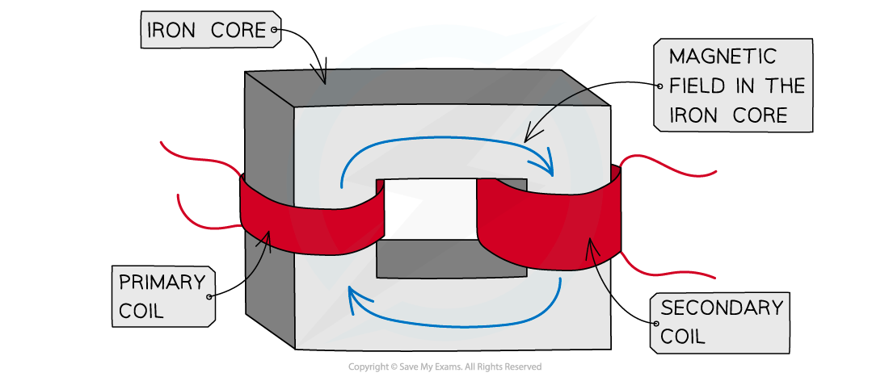
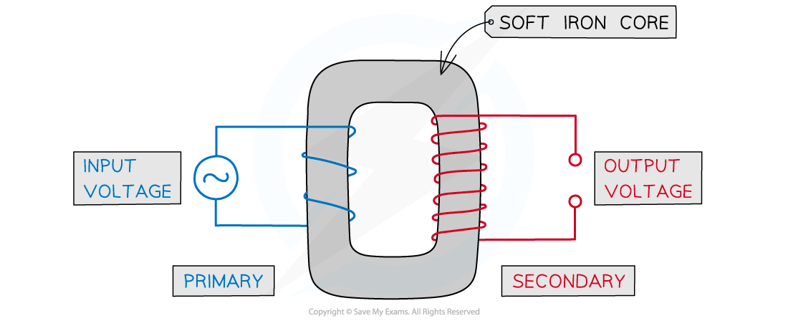
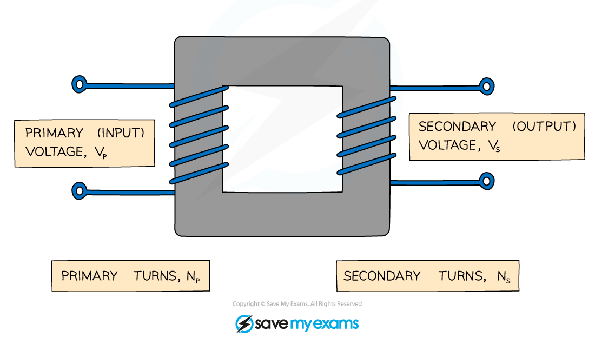

# Transformers

## Structure of a transformer

> **Spec point** — `spcpt_vDJWJGxxMXSNRwSD`

## Structure of a transformer

### Extended tier only

- A **transformer** is a device used to **change **the size of an **alternating voltage **or *current*

  - This is achieved using the *generator effect*

- A basic transformer consists of:

  - a **primary coil**
  - a** secondary coil**
  - a **soft** **iron core**

- Iron is used because it is easily **magnetised**

#### Construction of a simple transformer

***A simple transformer is made up of a primary coil and a secondary coil wound on a soft iron core***

## Step-up & step-down transformers

> **Spec point** — `spcpt_VgbvTW8G2NbBHzCT`

## Step-up & step-down transformers

### Extended tier only

- A transformer consists of a **primary **and **secondary **coil

  - The primary coil is the **first** coil
  - The secondary coil is the **second** coil

### Step-up transformer

- A **step-up** transformer:

  - increases the **voltage** of a power source `open parentheses V subscript s space greater than space V subscript p close parentheses`
  - has **more turns** on the secondary coil than on the primary coil `open parentheses N subscript s space greater than space N subscript p close parentheses`

***A step-up transformer has more turns on the secondary coil which increases the size of the voltage***

### Step-down transformer

- A **step-down** transformer:

  - decreases the **voltage** of a power source `open parentheses V subscript s space less than space V subscript p close parentheses`
  - has** fewer turns** on the secondary coil than on the primary coil `open parentheses N subscript s space less than space N subscript p close parentheses`

***A step-up transformer has fewer turns on the secondary coil which decreases the size of the voltage***
