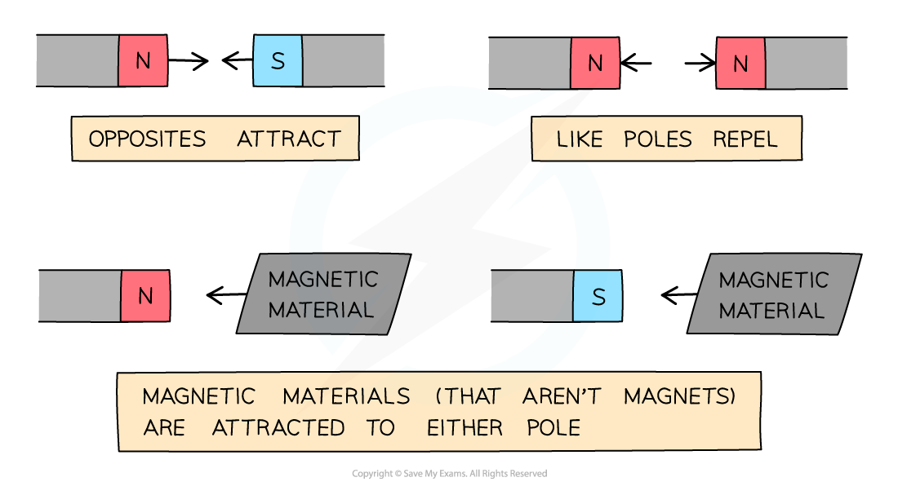

# Magnetism

## Magnetism

> **Spec point** — `spcpt_JWKhvDFW49kRqw2F`

## Magnetism

### Magnetic and non-magnetic materials

- Very few metals in the Periodic Table are magnetic
- The magnetic metals are:

  - Iron
  - Cobalt
  - Nickel
  - Steel is an alloy which contains iron, so it is also magnetic

#### Magnetic materials

***Magnetic materials are attracted to a magnet; non-magnetic materials are not***

- Magnetic materials (which are not magnets) will always be **attracted** to the magnet, regardless of which pole is held close to it

#### Magnets and magnetic materials

***Magnetic materials are attracted to both poles of a permanent magnet***

- Bringing a material close to a known magnet will determine if the material is magnetic, non-magnetic or if it is a magnet itself

  - It is a **magnet **if it is **repelled **by the known magnet
  - It is a **magnetic material** if it is **attracted **to the known magnet
  - It is a **non-magnetic material** if it is **neither **attracted nor repelled by the known magnet

### Forces between magnetic poles

- The ends of a magnet are called **poles**
- Magnets have two poles: a **north** and a **south**
- Magnetic forces are **strongest **at the poles

#### North and south poles of a magnet

***Poles of a Magnet***

- When two magnets are held close together, there will be a force between the magnets

  - **Like poles repel **(push each other apart)
  
    - A north pole will repel a north pole
    - A south pole will repel a south pole
  - **Opposite poles attract** (are pulled toward each other)
  
    - A north pole will be attracted to a south pole

#### Magnet attraction and repulsion

***Opposite poles attract and like poles repel***

### Forces between magnets and magnetic materials

- When there is a force of **attraction **between a **magnet** and a **magnetic material **the magnetic material has been **magnetised**

  - This means that the end of the material closest to the magnet will have the **opposite **pole to that of the magnetic pole closest to the material

- When removed from the magnetic field, the magnetic material will **lose **its induced magnetism **quickly **and become **unmagnetised**

#### Forces between magnets and magnetic materials

***Induced magnetism causes a magnetic material to become magnetised where the poles act like the poles of a magnet.***

> **Exam Hint**
> In your exam, you need to be able to predict the interaction that will occur between magnets when given their physical arrangement.

## Induced magnetism

> **Spec point** — `spcpt_mhVQtJDMHwhCZKbP`

## Induced magnetism

### Extended tier only

- An **induced magnet** is a material with a **soft iron core** that **becomes **a magnet **temporarily **when it is placed in a magnetic **field**
- Induced magnetism always causes a force of **attraction **between a **magnet** and an induced magnet

  - When this happens it is said that the material has been **magnetised**

#### Induced magnetism in a magnetic material

***Inducing magnetism in a magnetic material***

> **Worked Example**
> The diagram below shows a magnet held close to a piece of metal suspended by a light cotton thread. The piece of metal is attracted towards the magnet.
> 
> 
> 
> Which of the following rows in the table gives the correct type of pole at X and the correct material of the suspended piece of metal?
> 
> | ** ** | **Type of pole at X** | **Material of suspended piece of metal** |
> |---|---|---|
> | A | North | Nickel |
> | B | South | Nickel |
> | C | North | Aluminium |
> | D | South | Aluminium |
> 
> **Answer: A**
> 
> - X must be a **north **pole
> 
>   - The piece of metal is being attracted towards the magnet
>   - The law of magnetism states that opposite poles attract
> 
> - The material of the suspended piece of metal is **nickel**
> 
>   - Nickel is a magnetic material (It will experience a force when it is placed in a magnetic field, in this case it is attracted towards the magnet)
> 
> - **B** is incorrect because X cannot also be a south pole (and hence is a north pole)
> 
>   - If the pole at X was a south pole then the piece of metal would be repelled from the magnet because the law of magnetism states that like poles repel
> 
> - **C** and **D** are incorrect because aluminium is not a magnetic material
> 
>   - A non-magnetic material would be unaffected by the magnetic field produced by the magnet
