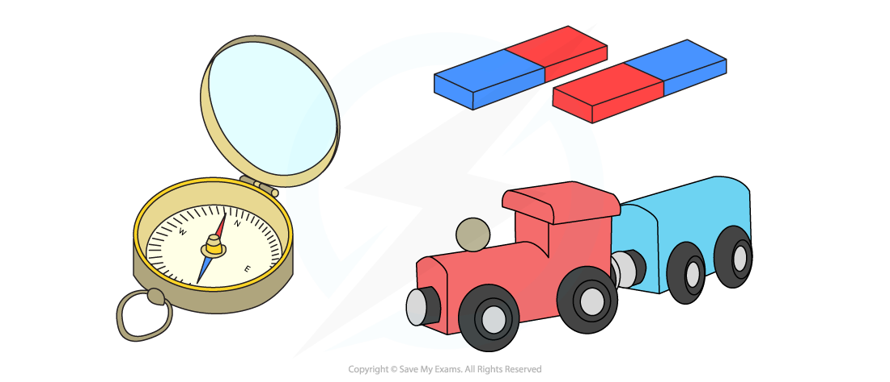

# Magnets

## Temporary & permanent magnets

> **Spec point** — `spcpt_DZwJjg5syZYkQ2Yn`

## Temporary & permanent magnets

### Types of magnets

- There are two types of magnets:

  - Permanent magnets
  - Induced (also called temporary) magnets

#### Permanent magnets

- Permanent magnets are made out of permanent [magnetic materials](https://www.savemyexams.com/igcse/physics_co-ordinated-sciences-double-award/cie/23/revision-notes/4-electricity-and-magnetism/simple-phenomena-of-magnetism/magnetism/), for example, **steel**
- A permanent magnet will **produce its own magnetic field**

  - It will not lose its magnetism easily

#### Temporary (induced) magnetism

- An **induced magnet** is a material with a **soft iron core** that **becomes **a magnet **temporarily **when it is placed in a magnetic **field**
- When removed from the magnetic field, the material will **lose **its induced magnetism **quickly **and become **unmagnetised**

  - Some objects such as paperclips or needles (made from steel) can be magnetised and will remain magnetic for a while
  - Other objects, such as electromagnets or transformers (which are made from **soft iron**) will be **unmagnetised **(no longer magnetised) as soon as the cause of the induced magnetism is **removed**

### Electromagnets

- An **electromagnet **can be made** **by winding **coils** of wire around a soft **iron core**

- An electromagnet can be **switched on and off**

  - When the **current** is **flowing** the electromagnet is switched on
  - When there is **no current flowing** then the electromagnet is **switched off **

#### Electromagnet diagram

***An electromagnet consists of coils of wire wrapped around a soft iron core***

*** ***

#### Differences between permanent and electromagnets

- There are many **differences** between permanent and electromagnets

  - These differences affect how these types of magnets are used
- **Permanent **magnets are **always** **magnetic**

  - They cannot be switched on and off
- **Electromagnets** are **sometimes magnetic**

  - An electromagnet is turned on by switching on the current passing through the coils of wire
  - The electromagnet is turned off by switching off the current
- It is not possible to change the **strength** of a permanent magnet
- The strength of an electromagnet can be changed in several ways:

  - By increasing the current
  - By increasing the number of turns of the coil
  - By adding a soft iron core

#### Uses of permanent and electromagnets

- Permanent and electromagnets have **different uses**
- Uses of permanent magnets include:

  - Compasses
  - School lab experiments
  - Toys
  - Fridge magnets

#### Some uses of permanent magnets

***Compasses and toy trains are two examples of the use of permanent magnets***

- Electromagnets have many uses including

  - MRI scanners
  - Speakers and earphones
  - Recycling
  - Mag-Lev Trains

#### Some uses of electromagnets

***Picking and sorting scrap metal and an MRI scanner are two examples of the uses of electromagnets***
