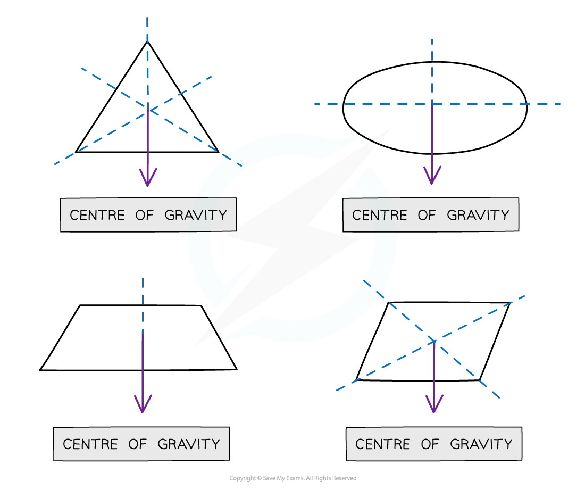
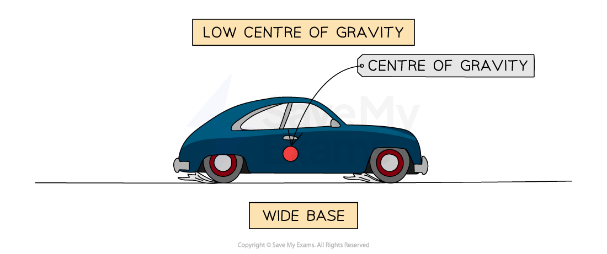

# Centre of Gravity

## Centre of gravity

> **Spec point** — `spcpt_FDWD4Bjd3fNdfH4s`

## Centre of gravity

- The **centre of gravity** of an object is defined as: **The point through which the weight of an object acts**
- For a symmetrical object of uniform density, the **centre of gravity is located at the point of symmetry**

  - For example, the centre of gravity of a sphere is at the centre

#### Finding the centre of gravity of symmetrical objects

***The centre of gravity of a regular shaped object can be found using symmetry***

> **Exam Hint**
> Since the centre of gravity is a hypothetical point, it can lie inside or outside of a body. The centre of gravity will constantly shift depending on the shape of a body. For example, a human body’s centre of gravity is lower when learning forward than when standing upright
> 
> However, when you are drawing force diagrams, always draw the weight force as if it were acting from the centre of gravity of the object!

## Stability

> **Spec point** — `spcpt_2wMj4chTTHzTtyxc`

## Stability

- The **centre of gravity** of a symmetrical object is along the** axis of symmetry**
- The **position **of the centre of gravity affects the **stability **of an object
- An object is **stable **when its centre of gravity lies above its **base**

#### Centre of gravity of an object in different positions

***The object will topple, when its centre of gravity is no longer over its base***

- If the centre of gravity does not lie above its base, then an object will **topple **over
- The most stable objects have a **low **centre of gravity and a **wide **base

#### Low centre of gravity of a car

***Cars are stable because they have a low centre of gravity and a wide base***

- Taller objects with a narrow base have a higher centre of gravity and are less stable
- This is why lorries and buses are advised not to use motorways and bridges on very windy days

#### Stability of object in different positions

***When the object is positioned on its narrow base, it is less stable because its centre of gravity is higher***

### Moments and stability

- If the line of action of the **weight **force lies outside the base of the object, there will be a **resultant moment,** and the body will topple

#### Car and bus on varying inclines

***The car can be titled to 60° without toppling, but the bus will topple at 45°***

- Tall objects with a narrow base will topple easily

  - Ten-pin bowling pins are designed specifically to topple easily
- The stability of objects can be increased by widening the base

  - High chairs are designed with a wide base so that they do not topple
  - Bunsen burners have a wide base to ensure they do not topple

> **Exam Hint**
> Since the centre of gravity is a hypothetical point, it can lie inside or outside of a body. The centre of gravity will constantly shift depending on the shape of a body. For example, a human body’s centre of gravity is lower when learning forward than upright
