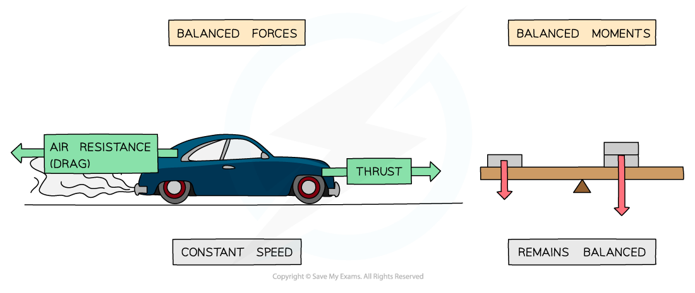

# Equilibrium

## Equilibrium

> **Spec point** — `spcpt_gw5hJPXmFP36mnZY`

## Equilibrium

- In physics, the term **equilibrium** means: **A state of balance or stability**
- In other words, a system in equilibrium keeps doing what it’s doing without any change

### Conditions for equilibrium

- For objects in equilibrium:

  - The **forces **on the object must be **balanced**
  
    - There must be no **resultant force**
  - The **sum of clockwise moments **on the object must **equal **the **sum of anticlockwise moments**
  
    - There must be no **resultant moment**

#### Examples of systems in equilibrium

***When the forces and moments on an object are balanced, the object will remain in equilibrium***
