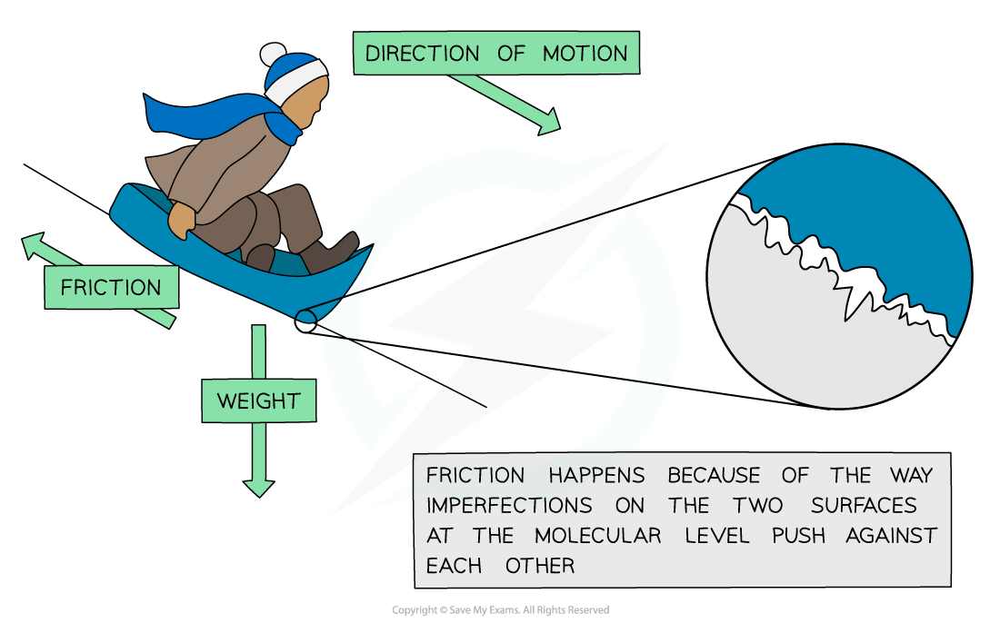

# Friction

## Friction in solids

> **Spec point** — `spcpt_5QvwJbJ6N37YPZWt`

## Friction in solids

- Friction is a force that works in **opposition** to the motion of an object

  - Frictional forces slow down the motion of the object
- When friction occurs, energy is transferred by **heating**

  - Friction causes an increase in **temperature** of the object and its surroundings
  - The work done against the frictional forces causes this rise in the temperature

- **Friction in solids **is caused by **imperfections** in the surfaces of the objects moving over one another
- Therefore, friction:

  - decreases the speed of the moving object
  - increases the temperature of the objects due to heating

#### Friction between surfaces

***The interface between the ground and the sledge is bumpy, causing the frictional force***

- Friction between solids can be reduced by:

  - lubricating the surfaces
  - smoothing the surfaces

## Friction in fluids

> **Spec point** — `spcpt_vs8CSwmGdBmHQBNB`

## Friction in fluids

- **Gases** and **liquids** are known as **fluids**

  - Fluids are different to solids because the **particles** in fluids are **free to move** around
- Friction acts on objects moving through gases and liquids as the particles collide with the object

  - This type of friction is called **drag**

- Air resistance is a **type of friction** that slows the motion of an object moving through **air**
- Air particles bump into the object as it moves through the air
- Air resistance:

  - reduces the speed of the object
  - increases the temperature of the object and the air particles due to heating

***The return module of a rocket heats up due to the work done by air resistance as it travels a distance through the atmosphere***

- Friction in fluids can be reduced by:

  - streamlining the shape of the object moving through the fluid
