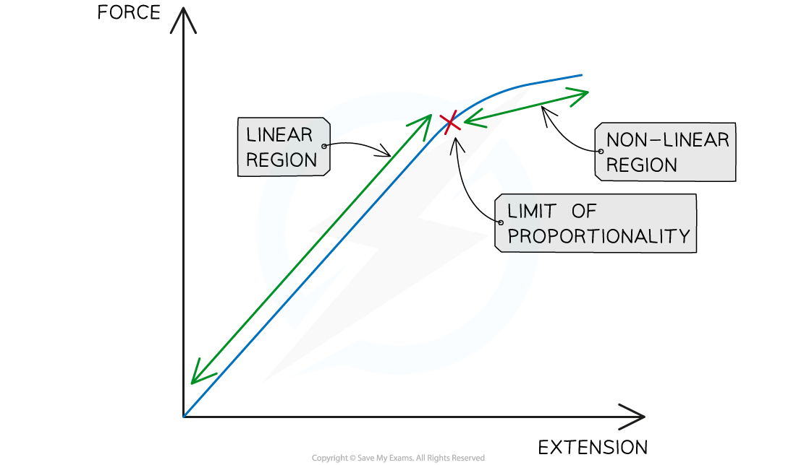

# Hooke's Law

## Hooke's law

> **Spec point** — `spcpt_74JFBdyhQGBWpCxV` · Define the spring constant as force per unit extension; recall and use the equation k = F / x
"Define and use the term ‘limit of proportionality’ for a load–extension graph and identify this point on the graph (an understanding of the elastic limit is not required)"

## Hooke's law

### Extended Tier Only

- The relationship between the extension of an elastic object and the applied force is defined by **Hooke's law**
- Hooke's law states that:

**The extension of an elastic object is directly proportional to the force applied, up to the limit of proportionality **

- The force applied to the spring is sometimes referred to as the **load**
- **Directly proportional** means that as the force is increased, the extension increases

  - If the force is doubled, then the extension will double
  - If the force is halved, then the extension will also halve
- The **limit of proportionality **is the point beyond which the relationship between force and extension is no longer directly proportional

  - This limit varies according to the material

> **Exam Hint**
> You may have met the term 'elastic limit' elsewhere. It is not on this syllabus, and using it in place of 'limit of proportionality' will not earn the mark.

*Hooke's law states that a force applied to a spring will cause it to extend by an amount proportional to the force*

- Hooke's law can be described by the following equation:

$F=kx$

- Where:

  - $F$ = force applied, measured in newtons (N)
  - $k$ = the spring constant, measured in newtons per metre (N/m)
  - $x$ = extension of spring, measured in metres (m)

### Spring constant

- The spring constant is defined as:

**The force per unit extension**

- Therefore, the units are newtons per metre (N/m), though newtons per centimetre (N/cm) is equally acceptable and is often more convenient when extensions are measured in centimetres.
- The spring constant is a measure of how **stiff **the spring is

  - **Stiff **springs have a **high **spring constant
  - **Stretchy **springs have a **low **spring constant
- Any elastic object has a spring constant, not just springs
- The Hooke's law equation can be used to calculate the **spring constant **of a material

$k=\frac{F}{x}$

### The load-extension graph

- Hooke's law is a **linear** relationship

  - This is represented by a **straight line** on a load-extension, or force-extension graph

#### Load-extension graph for a spring

*Hooke's law is associated with the linear region of a load-extension graph. Beyond the limit of proportionality, Hooke's law no longer applies*

#### Important features of the load-extension graph

- The **linear **portion of the graph

  - This represents the load or force under which the spring **obeys **Hooke's law
  - Load and extension are **directly proportional**
  - The **gradient **of the linear portion is equal to the spring constant for a **load-extension** graph
  - The **gradient **of the linear portion is equal to $\frac{1}{k}$ for an **extension-load** graph
- The **limit of proportionality**

  - This is the point at which the graph **begins to curve**
  - Beyond this point, load and extension are** no longer** proportional
- The **curved **portion of the graph

  - This is where the material **does not** obey Hooke's law
  - Load and extension are **not **proportional

> **Worked Example**
> A force of 32 N pulls a spring from its orginal length of 8 cm to 18 cm. Calculate the spring constant of the spring in N/m.
> 
> [3]
> 
> **Answer:**
> 
> **Step 1: List the known quantities**
> 
> - Force, *F* = 32 N
> - Original length = 8 cm
> - Final length = 18 cm
> 
> **Step 2: Write the relevant equation**
> 
> $F=kx$
> 
> **Step 3: Rearrange to make spring constant the subject**
> 
> $k=\frac{F}{x}$ **[1 mark]**
> 
> **Step 4: Calculate the extension, *****x***
> 
> $x=\mathrm{final} \mathrm{length}-\mathrm{original} \mathrm{length}$
> 
> $x=18-8=10\mathrm{cm}$ **[1 mark]**
> 
> **Step 5: Convert any units**
> 
> - $x$ must be in metres (m) to get a spring constant in N/m
> 
> $x=\frac{10}{100}=0.1m$
> 
> **Step 6: Substitute the values for force and extension**
> 
> $k=\frac{32}{0.1}$
> 
> $k=320N/m$ **[1 mark]**

> **Worked Example**
> The figure below shows the forces acting on a child who is balancing on a pogo stick. The child and pogo stick are not moving.
> 
> 
> 
> The spring constant of the spring on the pogo stick is 4900 N/m. The weight of the child causes the spring to compress elastically from a length of 40 cm to a new length of 33 cm.
> 
> Calculate the weight of the child.
> 
> [4]
> 
> **Answer:**
> 
> **Step 1: List the known quantities**
> 
> - Spring constant, *k* = 4900 N/m
> - Original length = 40 cm
> - Final length = 33 cm
> 
> **Step 2: Write the relevant equation**
> 
> $F=kx$ **[1 mark]**
> 
> **Step 3: Calculate the extension, *****x***
> 
> $x=\mathrm{final} \mathrm{length}-\mathrm{original} \mathrm{length}$
> 
> $x=33-40=-7\mathrm{cm}$
> 
> - A negative extension represents a compression of 7 cm **[1 mark]**
> 
> **Step 4: Convert any units**
> 
> - Since the spring constant is given in N/m, $x$ must be in metres (m)
> 
> $x=\frac{-7}{100}=-0.07m$ **[1 mark]**
> 
> **Step 5: Substitute the values into the Hooke's law equation**
> 
> $F=4900\times-0.07$
> 
> $F=-343N$
> 
> - The minus sign simply indicates the direction of the force, downwards in this case
> - The child's weight is 343 N **[1 mark]**

> **Exam Hint**
> Remember that the spring constant is calculated by dividing the load by the **extension** of the elastic object, not the total length of the elastic object.
> 
> In the exam, mark the limit of proportionality as a single precise point at the end of the straight section, and label it L. A mark placed on the curved part of the line, or a range drawn between two points, will not be accepted.
