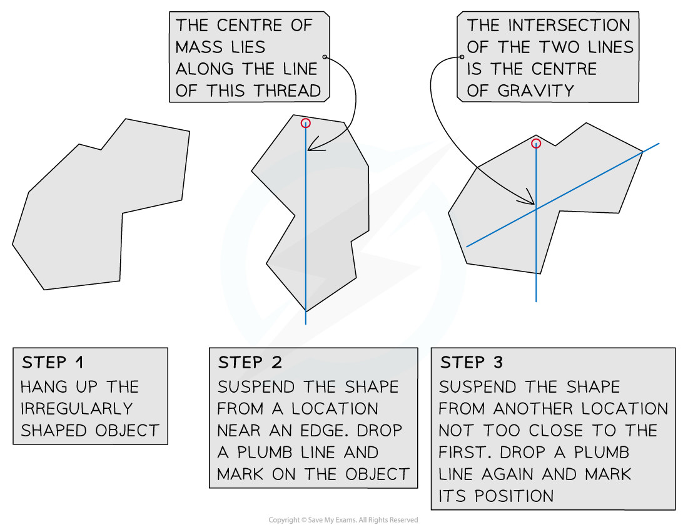

# Investigating Centre of Gravity

## Investigating centre of gravity

> **Spec point** — `spcpt_MytFhbbSFqkQwGpp`

## Investigating centre of gravity

### Aim of the experiment

- This experiment aims to determine the position of the centre of gravity of an irregularly shaped *plane lamina*

- *Independent variable* = position of centre of gravity
- *Dependent variable* = shape of plane lamina
- Control variables:

  - Punching the holes in the plane lamina before determining the line of action of the weight force

### Equipment

#### Equipment list

| **Equipment** | **Purpose** |
|---|---|
| Irregularly shaped plane lamina | To find the position of the centre of gravity of |
| Hole punch | To create a hole in the plane lamina to tie the thread to |
| Thread | To hang the plane lamina from the clamp |
| Thread and mass or sticky tack | To form the plumb line |
| Pencil and ruler | To draw the line of action of the weight force |
| Clamp stand, boss & clamp | To hang the plane lamina from |

### Method

#### Determining the centre of gravity of an irregularly shaped plane lamina

***For irregularly shaped objects, the centre of gravity can be found using the suspension method***

1. Punch 3 holes near the outer edges of the plane lamina in different locations
2. Create a loop of thread and hang the plane lamina from the clamp
3. Use a plumb line (a weighted thread) aligned with the hanging thread to show the line of action of the weight force
4. Use a ruler and pencil to mark the line of action of the weight force onto the plane lamina
5. Repeat the process until 3 lines have been drawn
6. The point at which the lines cross is the position of the centre of gravity

** **

### Analysis of results

- Each plane lamina is an irregularly shaped object
- When an object is suspended from a point, it will always settle with its centre of gravity directly below the point of suspension

### Evaluating the experiment

*Systematic errors*

- The plumb line should be viewed straight on to avoid a **parallax error**
- Dots should be made on the plane lamina whilst in position and then a ruled line should be made after the lamina has been removed from the clamp

*Random errors*

- The plane lamina should be allowed to settle before determining the action line of the weight force
- The holes should be punched in the plane lamina before determining the action line of the weight force, because punching the holes after can affect the position of the centre of gravity
