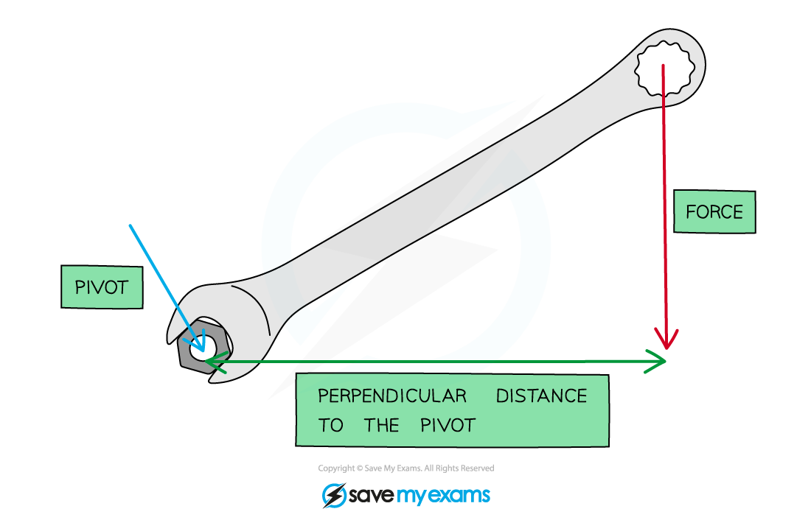
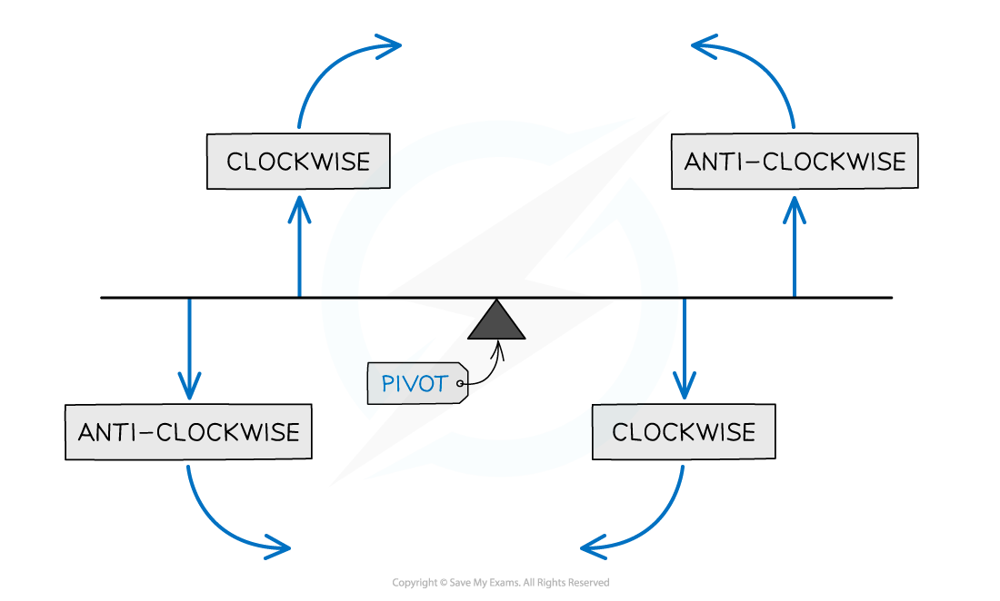

# Moments

## Moments

> **Spec point** — `spcpt_sbRcx2C2h72f9v7v`

## Moments

- The **moment **of a force is the **turning effect** produced when a force is exerted on an object

- Examples of the turning effect of a force are:

  - A child on a see-saw
  - Turning the handle of a spanner
  - A door opening and closing
  - Using a crane to move building supplies
  - Using a screwdriver to open a tin of paint
  - Turning a tap on and off
  - Picking up a wheelbarrow
  - Using scissors

- Forces can cause the **rotation** of an object about a fixed **pivot**
- This rotation can be **clockwise **or **anticlockwise**

#### Clockwise and anti-clockwise rotation

***Consider the hands of a clock when deciding if an object will rotate in a clockwise or anti-clockwise direction***

- A force applied on one side of the pivot will cause the object to rotate

#### Turning effect of a force about a pivot

***The force applied will cause the object to rotate clockwise about the pivot***

### The moment equation

- A **moment** is defined as: **The turning effect of a force about a pivot**
- The size of a moment is defined by the equation:

$\mathrm{moment}=\mathrm{force}\times\mathrm{perpendicular} \mathrm{distance} \mathrm{from} \mathrm{pivot}$

- The forces should be **perpendicular** to the distance from the pivot

  - For example, on a horizontal beam, the forces which will cause a moment are those directed upwards or downwards

#### The turning effect of a force exerted on a spanner

***The moment depends on the force and perpendicular distance to the pivot***

- **Increasing** the **distance** at which a force is applied from a pivot **decreases** the **force** required

  - If you try to push open a door right next to the hinge, it is very difficult, as it requires a lot of force
  - If you push the door open at the side furthest from the hinge, then it is much easier, as less force is required

#### Forces required to open a door

***A greater force is required to push open a door next to the hinges than at the door handle***

> **Worked Example**
> A carpenter attempts to loosen a bolt that has rusted. To turn the bolt, they exert a force of 22 N using a spanner of length 20 cm. The force is exerted 5 cm from the end of the spanner.
> 
> Calculate the turning effect of the force.
> 
> **Answer:**
> 
> **Step 1: List the known quantities**
> 
> - Force, $F=22N$
> - Length of spanner, $=20\mathrm{cm}$
> 
> **Step 2: Determine the distance from the pivot**
> 
> - The force is exerted 5 cm from the end of the spanner
> - Therefore, the distance from the force to the pivot is
> 
> $s=20-5$
> 
> $s=15\mathrm{cm}$
> 
> - Convert cm to m
> 
> $s=\frac{15}{100}$
> 
> $s=0.15m$
> 
> **Step 3: Write out the equation for moments**
> 
> $\mathrm{moment}=\mathrm{force}\times\mathrm{perpendicular} \mathrm{distance} \mathrm{from} \mathrm{pivot}$
> 
> $M=Fs$
> 
> **Step 4: Substitute in the known values to calculate**
> 
> $M=22\times0.15$
> 
> $M=3.3Nm$

> **Exam Hint**
> The moment of a force is measured in newton metres (N m), but can also be newton centimetres (N cm) if the distance is measured in cm instead.
> 
> If your IGCSE moments exam question doesn't ask for a specific unit, always convert the distance into **metres**

## Principle of moments

> **Spec point** — `spcpt_QpjhK2XGSbPPJxD5`

## Principle of moments

### Extended tier only

- The **principle of moments** states that: **If an object is balanced, the total clockwise moment about a pivot equals the total anticlockwise moment about that pivot**
- The principle of moments means that for a balanced object, the moments on both sides of the pivot are **equal **

**clockwise moment = anticlockwise moment**

#### Principle of moments

***Imagine holding the beam about the pivot and applying just one of the forces. If the beam moves clockwise then the force applied is clockwise. This is the principle of moments***

> **Worked Example**
> A parent and child are at opposite ends of a playground see-saw.
> 
> The weight force acting on the parent is 690 N and the weight force acting on the child is 140 N.
> 
> The adult sits at a distance of 0.3 m from the pivot.
> 
> 
> 
> Calculate the distance the child must sit from the pivot for the see-saw to be balanced.
> 
> Use the principle of moments in your calculation.
> 
> **Answer:**
> 
> **Step 1: List the known quantities**
> 
> - Clockwise force (child), $F_{child}=140N$
> - Anticlockwise force (adult), $F_{adult}=690N$
> - Distance of adult from the pivot, $s_{adult}=0.3m$
> 
> **Step 2: Write down the moment equation and the principle of moments**
> 
> - Moment equation:
> 
> $\mathrm{moment}=\mathrm{force}\times\mathrm{perpendicular} \mathrm{distance} \mathrm{from} \mathrm{pivot}$
> 
> $M=Fs$
> 
> - Principle of moments:
> 
> $\mathrm{total} \mathrm{clockwise} \mathrm{moments}=\mathrm{total} \mathrm{anticlockwise} \mathrm{moments}$
> 
> **Step 3: Calculate the total clockwise moments**
> 
> - The clockwise moment is from the child
> 
> $M_{child}=F_{child}\timess_{child}$
> 
> $M_{child}=140\timess_{child}$
> 
> **Step 4: Calculate the total anticlockwise moments**
> 
> - The anticlockwise moment is from the adult
> 
> $M_{adult}=F_{adult}\timess_{adult}$
> 
> $M_{adult}=690\times0.3$
> 
> $M_{adult}=207Nm$
> 
> **Step 5: Substitute into the principle of moments equation**
> 
> $\mathrm{total} \mathrm{clockwise} \mathrm{moments}=\mathrm{total} \mathrm{anticlockwise} \mathrm{moments}$
> 
> $M_{child}=M_{adult}$
> 
> $140\timess_{child}=207$
> 
> **Step 6: Rearrange for the distance of the child from the pivot**
> 
> $s_{child}=\frac{207}{140}$
> 
> $s_{child}=1.5m$
> 
> - The child must sit **1.5 m** from the pivot to balance the see-saw

> **Exam Hint**
> Make sure that all the distances are in the same units and that you’re considering the correct forces as **clockwise** or **anticlockwise**
> 
> For CIE IGCSE Co-ordinated Sciences, you will only be expected to apply the principle of moments to a situation where one force acts on either side of the pivot
