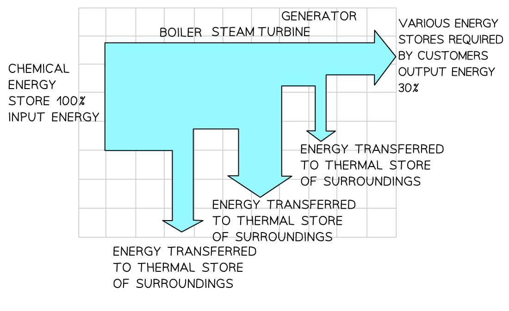

# Efficiency

## Efficiency of energy transfer

> **Spec point** — `spcpt_MsncjQBmZRqw8s5s`

## Efficiency of energy transfer

- The **efficiency **of a system is a measure of the amount of **useful **and **wasted energy** in an energy transfer
- Efficiency is defined as:

**The ratio of the useful power or energy output from a system to its total power or energy input**

- This means that:

  - if a system has **high** efficiency, this means most of the energy transferred is **useful**
  - if a system has **low** efficiency, this means most of the energy transferred is **wasted**
- The overall efficiency of a typical thermal power station is approximately 30%

  - This means that 70% of the energy transferred from the power station to the National Grid is **wasted energy**
- In the production of electricity:

  - Energy is used to heat water to produce steam
  - The steam turns a turbine
  - The turbine turns a generator
  - The generator produces electricity
  
    - At each stage of this process, energy is dissipated to the surroundings

#### Sankey diagram of electricity production

***Sankey diagram showing the energy transfers involved in generating electricity in a gas-fired power station***

## Calculating efficiency

> **Spec point** — `spcpt_k2V2CrW8rjspnMHF`

## Calculating efficiency

### Extended Tier Only

- Efficiency is represented as a percentage and can be calculated using two equations

- Efficiency in terms of **energy**:

`efficiency space equals space fraction numerator useful space energy space output over denominator total space energy space input end fraction space open parentheses cross times 100 percent sign close parentheses`

- Efficiency in terms of **power**:

`efficiency space equals space fraction numerator useful space power space output over denominator total space power space input end fraction space open parentheses cross times 100 percent sign close parentheses`

> **Worked Example**
> An electric motor has an efficiency of 35%.
> 
> It lifts a 7.2 kg load through a height of 5 m in 3 s.
> 
> Calculate the power of the motor.
> 
> **Answer:**
> 
> **Step 1: Write down the efficiency equation in terms of power**
> 
> `e fficiency space equals space fraction numerator useful space power space output over denominator total space power space input end fraction space open parentheses cross times 100 percent sign close parentheses`
> 
> **Step 2: Rearrange to make power input the subject**
> 
> $\mathrm{power} \mathrm{input}=\frac{\mathrm{power} \mathrm{output}}{\mathrm{efficiency}\div100}$  **OR**  $\mathrm{power} \mathrm{input}=\frac{\mathrm{power} \mathrm{output}\times100}{\mathrm{efficiency}}$
> 
> **Step 3: Calculate the power output**
> 
> $\mathrm{power} \mathrm{output}=\frac{\DeltaE}{t}$
> 
> - $\DeltaE$ is equal to the change in gravitational potential energy as the load is lifted
> 
> $\DeltaE_{P}=mg\Deltah$
> 
> $\DeltaE_{P}=7.2\times9.8\times5$
> 
> $\DeltaE_{P}=352.8J$
> 
> - Therefore:
> 
> $\mathrm{power} \mathrm{output}=\frac{352.8}{3}$
> 
> $\mathrm{power} \mathrm{output}=117.6W$
> 
> **Step 4: Substitute the values into the power input equation**
> 
> $\mathrm{power} \mathrm{input}=\frac{117.6}{0.35}$  **OR**  $\mathrm{power} \mathrm{input}=\frac{117.6\times100}{35}$
> 
> $\mathrm{power} \mathrm{input}=336W$

> **Exam Hint**
> Efficiency can be given in a ratio (between 0 and 1) or percentage format (between 0 and 100 %)
> 
> If the question asks for efficiency as a ratio, give your answer as a fraction or decimal.
> 
> If the answer is required as a percentage, remember to multiply the ratio by 100 to convert it:
> 
> - if the ratio = 0.25, percentage = 0.25 × 100 = 25 %
> 
> Remember that efficiency has **no units**

## Video of calculating efficiency

> **Spec point** — `spcpt_WYP8tDdgNz3D2CXH`

##
