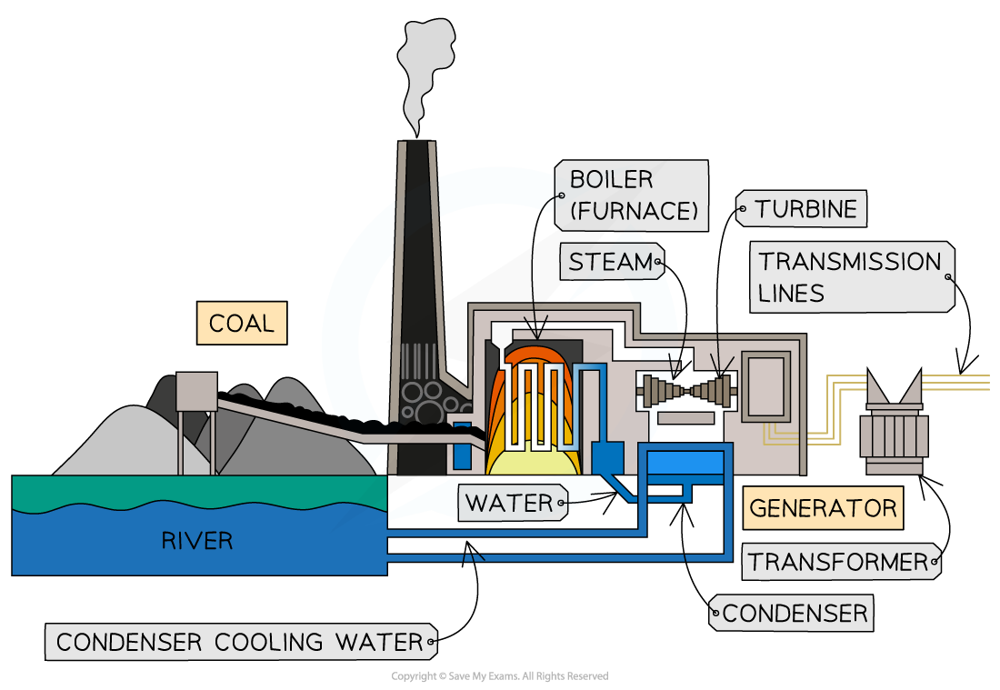

# Energy from Fuels

## Fossil fuels

> **Spec point** — `spcpt_QQ2nB8NVQDrvSv2t`

## Fossil fuels

- Fossil fuels are:

  - **Coal**
  - **Natural gas** (mostly methane)
  - Crude **oil** which is refined into petrol, diesel, and other fuels

#### Fossil fuels

***Fossil fuels: coal, oil and natural gas***

- Fossil fuels are formed from the **remains of plants and animals **

### Advantages of fossil fuels

- Fossil fuel power stations are **extremely reliable** and the infrastructure is well established in most countries
- Fossil fuel power stations are **extremely responsive** (they can be turned on and off easily), which means they can meet the changing demands of a nation
- Fossil fuels are relatively **safe **to store and use

### Disadvantages of fossil fuels

- It takes **millions of years** for fossil fuels to form

  - This is why they are considered to be a **non-renewable** energy resource
  - The increasing demand for a **decreasing supply** causes prices to increase
  - Fossil fuels are predicted to **completely run out** within the next 200 years
- Burning fossil fuels pollutes the atmosphere with harmful gases such as:

  - **Carbon dioxide** which contributes to the **greenhouse effect**
  - **Sulphur dioxide** which produces **acid rain**
  - Both carbon and sulphur can be captured upon burning, preventing it from being released into the atmosphere but this is expensive to do
- Extraction of fossil fuels causes **damage **to the **environment**
- Fossil fuel power stations are **expensive **to build and decommission (close down)
- The **price **of fossil fuels is **volatile**, which means the price of the electricity produced can fluctuate based on global factors of supply and demand

### Uses of fossil fuels

- Fossil fuels are used for:

  - Transport
  - Generating electricity
  - Heating

#### Transport

- The majority of vehicles in the world are powered by **petroleum** products such as petrol, diesel and kerosene

  - These resources all originate from crude oil, which is a **fossil fuel**

- A growing number of vehicles are now being powered by **electricity**

  - The advantage of this is that while the vehicle is being driven, it produces **zero carbon emissions**
  - The disadvantage is that when the vehicle is being charged, it is connected to the National Grid, which currently uses a **combination** of renewable and non-renewable energy sources

#### Electricity generation

- Fossil fuels, such as **gas **and **coal**, are used to produce energy **on-demand** when energy is needed

  - The fossil fuel is burned (combusted) and used to heat water to produce **steam**
  - The steam turns a **turbine**
  - The turbine turns a **generator**, which generates electricity
  - The current produced is transmitted via the **National Grid**
  - The steam is condensed into water to be used again

#### Electricity generation in a coal-fired power station

***Fossil fuels are burned to heat water to produce steam. The steam turns the turbine, which turns the generator, which produces electricity.***

- Electricity plays a bigger role in people's lives than ever before

  - With almost 8 billion people in the world, this means the **demand** for electricity is **extremely high**
  - To keep up with this demand, a combination of **all** the energy resources available is needed

#### Global energy consumption

***Currently, more than three quarters of the global electricity production uses fossil fuels; this is increasing the levels of atmospheric carbon dioxide, which leads to global warming***

* *

#### Heating

- The majority of heating systems run on **fossil fuels**

  - **Gas **central heating systems are the most common, with a gas boiler that heats water through a system of pipes and radiators throughout the building
  - Boilers can also be powered by **oil **or biofuels
  - Open fireplaces burn wood or **coal**
- Electric heaters run on electricity
- Bottled gas can also be used in portable heaters

  - Bottled gas is either **propane **or **butane **which are also produced from fossil fuels

## Biofuels

> **Spec point** — `spcpt_f58N6fbvwzjFtyZK`

## Biofuels

- Biofuels are made from plant matter
- **Ethanol** or **methane** can be produced and used in place of fossil fuels

### Advantages of biofuel

- Biofuel is a **renewable resource**
- Some vehicles can be powered by **biofuel **rather than using fossil fuels
- Biofuel is considered to be **carbon neutral**
- No sulphur dioxide is produced
- Biofuel is added to petrol and diesel products in many country to **reduce **the volume of **pollutants **released in combustion

### Disadvantages of biofuel

- Crops of biofuel producing plants must be grown, which takes **time**

  - Growing the crops takes a lot of **land**, and takes **resources **needed for food production
- Burning biofuels releases **carbon dioxide** into the atmosphere

  - Biofuels are considered **carbon neutral** because plants** **take in carbon dioxide when they photosynthesise, however, this view is **controversial**
  - If the land had been used to grow crops for food, the same amount of carbon would have been taken out of the atmosphere, and much less carbon would have been returned
- Biofuels have only half the energy density of fossil fuels, which means twice as much fuel needs to be used to release the same amount of energy
- Not many vehicles can run on biofuel alone

#### Cycle of biofuel production and use

***Plants take in carbon dioxide during photosynthesis, but carbon dioxide is released back into the atmosphere when biofuels are burned***

## Nuclear fuel

> **Spec point** — `spcpt_Fy76NrCps4SwvdGS`

## Nuclear fuel

- Energy stored in the **nucleus** of atoms can be released when the nucleus is broken in two

  - This is known as nuclear **fission**

#### Nuclear fission

***Nuclear Fission: when a large nucleus is broken into two smaller nuclei, energy is released***

- Nuclear power stations use fission reactions to **heat water** to produce steam, to turn turbines that turn generators which** generate electricity**

### Advantages of nuclear power

- **No pollution **released into atmosphere
- Nuclear power stations are** extremely reliable** and **well established** in some countries
- Nuclear power stations are **responsive **as the output is easily controlled
- Nuclear power stations produce **massive amounts** of **power**

  - **Twice **the power output of a fossil fuel power station
- Nuclear fuel has a **high energy density**

  - A small amount of fuel releases massive amounts of energy

### Disadvantages of nuclear power

- Nuclear power is a **non-renewable** resource

  - Uranium ore mined from rocks so there is a **finite supply**
- Nuclear fuels produce **radioactive waste**

  - Radioactive waste is packaged and buried underground to be stored for **thousands **of years
  - Burial sites must remain undisturbed and uninhabited
- Nuclear power stations are **extremely expensive to build **and to decommission (close down)
- Nuclear power stations are **expensive **to run and **maintain **because rigorous safety protocols must be in place
- Nuclear power stations are **potentially **dangerous in the event of an **accident**

> **Exam Hint**
> In your IGCSE Co-ordinated Sciences exam, you may be required to discuss the advantages and disadvantages of various energy resources. You may also need to apply your understanding of energy resources to unfamiliar scenarios, for example, by suggesting which type of energy resource would be best for a particular community. Make sure you can justify your choices.
