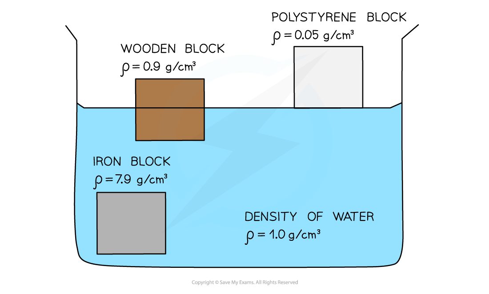

# Floating

## Floating objects

> **Spec point** — `spcpt_8JP2j2vm3gkyNPNG`

## Floating objects

### Density and floating

- Whether an object **floats **or **sinks **depends on the **relative densities** of the object and the fluid it is submerged in

  - If the object is **denser **than the fluid, it will **sink**
  - If the object is **less dense** than the fluid, it will **float**
- **Upthrust **is a **force **that **pushes **upwards on an object submerged in a **fluid**
- Upthrust always acts in the **opposite direction** to the object's **weight **force

  - This is how objects float
- The size of the upthrust force depends on:

  - the **density** of the fluid
  - the **volume** of fluid that is displaced (which is equal to the volume of the object)
  - The **denser** the liquid, the **greater** the force of upthrust exerted on the object

#### Upthrust and weight forces on a boat

***An object will float if the force of upthrust is equal to the force of weight***

### Factors affecting floating & sinking

- The factors affecting floating and sinking are:

  - upthrust
  - density
- If the force of **upthrust **on an object is:

  - **equal** to the object’s **weight**, then the object will **float**
  - **less than** the object’s **weight**, then the object will **sink**

- If the **density **of the **object **is:

  - **greater than** the density of the **fluid**, then the object will **sink**
  - **less than **the density of the **fluid**, then the object will **float**
- If the density of the object is greater than the density of the fluid, the object can never displace enough fluid to create an upthrust that will equal its weight (and therefore it sinks)

***Objects which are less dense than water will float in water, and those that are more dense will sink***

- A polystyrene block will **float** in water

  - This is because polystyrene has a density of 0.05 g/cm3 which is **much less** than the density of water (1.0 g/cm3)
- A wooden block will be partially submerged but will still **float**

  - This is because the density of a wooden block (0.9 g/cm3) is **slightly less** than the density of water
- An iron block will **sink**

  - This is because iron has a density (7.9 g/cm3) that is **much higher** than water

> **Worked Example**
> Potassium is an alkali metal that reacts with oxygen and water. Potassium is therefore stored in containers filled with mineral oil. The potassium must sink in the mineral oil to ensure it has no contact with any air in the container.
> 
> A science teacher has four different mineral oils in which they could store their potassium. Potassium has a density of 0.862 g/cm3.
> 
> Which mineral oil should the teacher choose?
> 
> **A.** White mineral oil, $ρ=0.864g/\mathrm{cm}^{3}$
> 
> **B.** Paraffin oil, $ρ=0.890g/\mathrm{cm}^{3}$
> 
> **C. **Liquid paraffin, $ρ=0.825g/\mathrm{cm}^{3}$
> 
> **D.** Food grade mineral oil, $ρ=0.880g/\mathrm{cm}^{3}$
> 
> **Answer: C**
> 
> - An object will sink in a fluid if the density of the object is greater than the density of the fluid
> - Therefore, for the potassium to sink, the density of the oil must be less than the density of the potassium
> - Liquid paraffin is less dense than potassium $0.825g/\mathrm{cm}^{3}<0.862g/\mathrm{cm}^{3}$
> - The only oil which is less dense than potassium is **C**

> **Exam Hint**
> The main thing to remember is that **density is mass per unit volume**
> 
> In Physics, mass is almost always measured in kg
> 
> Density is the only topic in which physicists sometimes use grams instead
