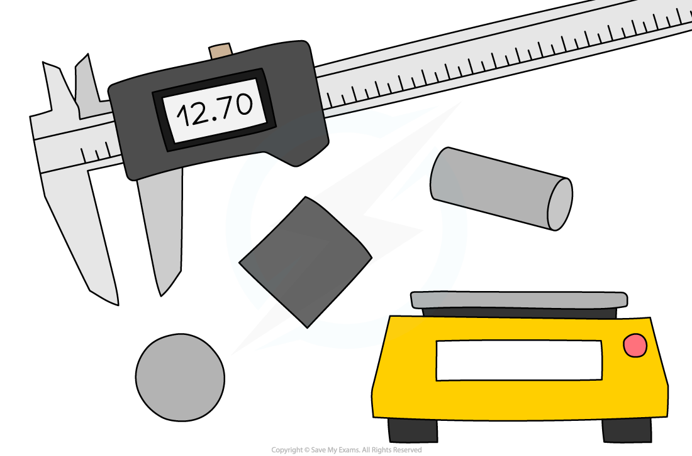
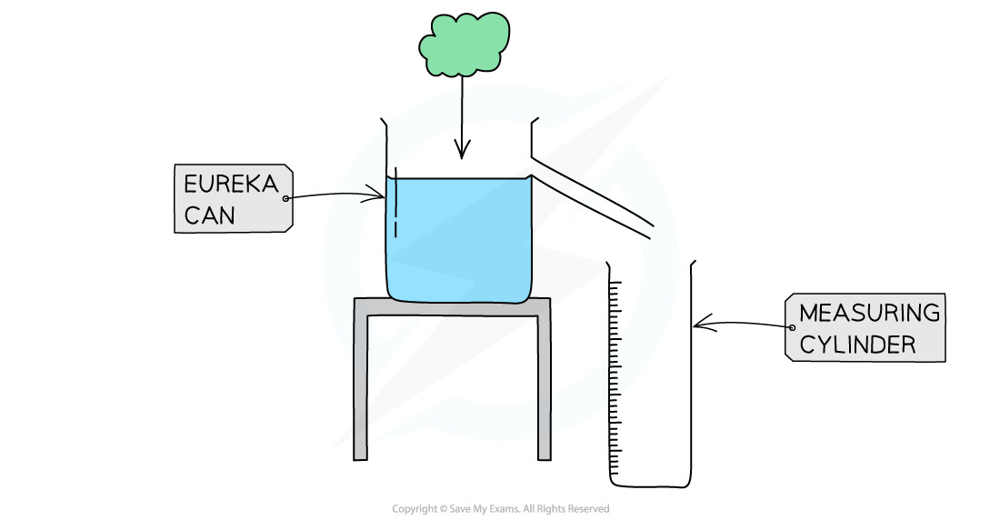
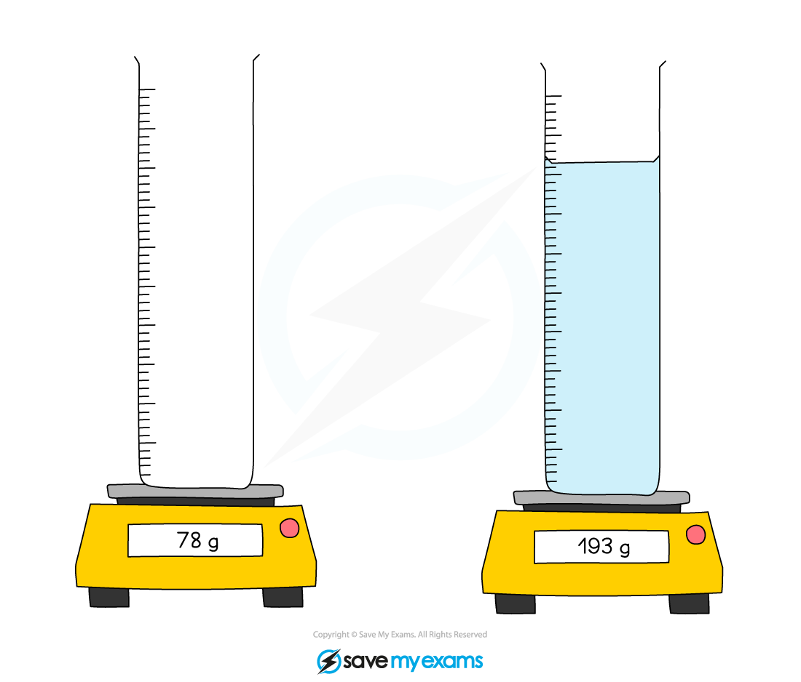

# Measuring Density

## Measuring density

> **Spec point** — `spcpt_h4SzGWzwRP4C7mVQ` · Describe how to determine the density of a liquid, of a regularly shaped solid and of an irregularly shaped solid which sinks in a liquid (volume by displacement), including appropriate calculations

## Measuring density

- This is a list of equipment used in these experiments:

| **Apparatus** | **Purpose** |
|---|---|
| Regular and irregularly shaped objects | Objects used to measure the density of |
| A suitable liquid (e.g. sugar or salt solution) | Liquid to use to measure the density |
| A 30 cm ruler | To measure objects up to 30 cm in length |
| Vernier callipers | To measure objects to around 15 cm in length |
| Micrometer | To measure objects to around 3 cm in length |
| Digital balance | To measure the mass of objects |
| Displacement "Eureka" can | To measure the displacement of water of irregularly shaped objects |
| Measuring cylinders | To measure the volume of liquid |

- ***Resolution*** of measuring equipment:

  - 30 cm ruler = 1 mm
  - Vernier callipers = 0.1 mm
  - Micrometer = 0.01 mm
  - Digital balance = 0.01 g

### Experiment 1: measuring the density of regularly shaped objects

- The aim of this experiment is to determine the densities of regular objects by using measurements of their dimensions

#### Variables:

- ***Independent variable*** = Type of shape / volume
- ***Dependent variable*** = Density of the object

#### Method

#### Equipment needed to measure the density of regularly shaped objects

*Apparatus for measuring the dimensions and mass of regularly shaped objects*

1. Place the object on a digital balance and note down its mass
2. Use either the ruler, Vernier callipers or micrometer to measure the object’s dimensions (width, height, length, radius) – the apparatus will depend on the size of the object
3. Repeat these measurements and take an average of these readings before calculating the density

#### Results

#### An example results table to measure the density of regularly shaped objects

|   | Cuboid | Sphere | Cylinder |   |   |   |   |   |   |   |   |   |
|---|---|---|---|---|---|---|---|---|---|---|---|---|
| Mass readings / g |   |   |   |   |   |   |   |   |   |   |   |   |
| Average mass / g |   |   |   |   |   |   |   |   |   |   |   |   |
| Average mass / kg |   |   |   |   |   |   |   |   |   |   |   |   |
| Dimension reading / cm | Height |   |   |   | Radius |   |   |   | Radius |   |   |   |
| Width |   |   |   |   |   |   |   |   |   |   |   |   |
| Length |   |   |   | Length |   |   |   |   |   |   |   |   |
| Average dimensions / m | Height =  Width =  Length = | Radius = | Radius =  Length = |   |   |   |   |   |   |   |   |   |
| Volume / m3 | $H\timesW\timesL$ | $\frac{4}{3}\timesπ\timesR^{3}$ | $π\timesR^{2}\timesL$ |   |   |   |   |   |   |   |   |   |

***A suitable results table must contain space for multiple readings and any calculations that need to be performed***

#### Analysis of results

- Calculate the volume of the object depending on whether it is a cube, sphere, cylinder (or other regular shape)
- Then use the formula for density to calculate the density of each object

  - The formulae for volume and density are explained in the revision note [Density](https://www.savemyexams.com/igcse/physics/cie/23/revision-notes/1-motion-forces--energy/1-3-mass-weight--density/1-3-2-density/)

### Experiment 2: measuring the density of irregularly shaped objects

- This experiment aims to determine the densities of irregular objects using a displacement technique

#### Variables:

- ***Independent variable*** = Different irregular shapes / mass
- ***Dependent variable*** = Volume of displaced water

#### Method

#### Equipment needed to measure the density of irregularly shaped objects

*Apparatus for measuring the density of irregular objects*

1. Place the object on a digital balance and note down its mass
2. Fill the eureka can with water up to a point just below the spout
3. Place an empty measuring cylinder below its spout
4. Carefully lower the object into the eureka can and let it sink in the liquid
5. Measure the volume of the displaced water in the measuring cylinder
6. Repeat these measurements and take an average before calculating the density

- Alternatively, the object can be placed in a measuring cylinder containing a known volume of liquid, and the change in volume then measured

*When an irregular solid is placed in a measuring cylinder, it will sink in the liquid and the level of the liquid will rise by an amount equal to the volume of the solid*

- Once the mass and volume of the shape is known, its density can be calculated

#### Results

#### An example results table to measure the density of irregularly shaped objects

| Object | Mass of object / g | Average mass / kg | Volume of water displaced / m3 | Average volume of water displaced / m3 |   |   |   |   |
|---|---|---|---|---|---|---|---|---|
| 1 | 2 | 3 | 1 | 2 | 3 |   |   |   |
| 1 |   |   |   |   |   |   |   |   |
| 2 |   |   |   |   |   |   |   |   |
| 3 |   |   |   |   |   |   |   |   |

***A suitable results table must contain space for multiple readings and any calculations that need to be performed***

#### Analysis of results

- The volume of the water displaced is equal to the volume of the object
- Once the mass and volume of the shape are known, the density can be calculated using:

$ρ=\frac{m}{V}$

### Experiment 3: measuring the density of liquids

- This experiment aims to determine the density of a liquid by finding a difference in its mass

#### Variables:

- ***Independent variable*** = Volume of water added
- ***Dependent variable*** = Mass of cylinder

#### Method

#### Equipment needed to measure the density of liquid

*Apparatus for determining the density of a liquid*

1. Place an empty measuring cylinder on a digital balance and note down the mass
2. Fill the cylinder with the liquid and note down the volume
3. Note down the new reading on the digital balance
4. Repeat these measurements and take an average before calculating the density

#### Results

#### An example results table to measure the density of a liquid

| Mass of cylinder before / g | Average mass / kg | Volume of water added / m3 | Mass of cylinder with water / g | Average mass of cylinder with water / kg |   |   |   |   |
|---|---|---|---|---|---|---|---|---|
| 1 | 2 | 3 | 1 | 2 | 3 |   |   |   |
|   |   |   |   |   |   |   |   |   |
|   |   |   |   |   |   |   |   |   |
|   |   |   |   |   |   |   |   |   |

***A suitable results table must contain space for multiple readings and any calculations that need to be performed***

#### Analysis of results

- Find the mass of the liquid by subtracting the original reading from the final reading

**Mass of liquid = Mass of cylinder with water – mass of cylinder**

- Once the mass and volume of the liquid are known, the density can be calculated using the equation for calculating density

  - This is explained in the revision note [Density](https://www.savemyexams.com/igcse/physics/cie/23/revision-notes/1-motion-forces--energy/1-3-mass-weight--density/1-3-2-density/)

### Evaluating the experiments

- *Systematic errors*:

  - Ensure the digital balance is set to zero before taking measurements of mass
  
    - This includes when measuring the density of the liquid – remove the measuring cylinder and zero the balance before adding the liquid
- *Random errors*:

  - A main cause of error in this experiment is in the measurements of length
  
    - Ensure to take repeat readings and calculate an average to keep this error to a minimum
  - Place the irregular object in the displacement can carefully, as dropping it from a height might cause water to splash, which will lead to an incorrect volume reading

### Safety considerations

- There is a lot of glassware in this experiment, ensure this is handled carefully
- Water should not be poured into the measuring cylinder when it is on the digital balance

  - This could lead to electric shock
- Make sure to stand up during the whole experiment, to react quickly to any spills

> **Exam Hint**
> When writing about experiments, a good sequence is as follows:
> 
> - If you need to use an equation to calculate something, start off by giving it as this will give you some hints about what you need to mention later
> - List the apparatus that you need
> - State what measurements you need to make (your equation will give you some hints) and how you will measure them
> - Finally, state that you will repeat each measurement several times and take averages
