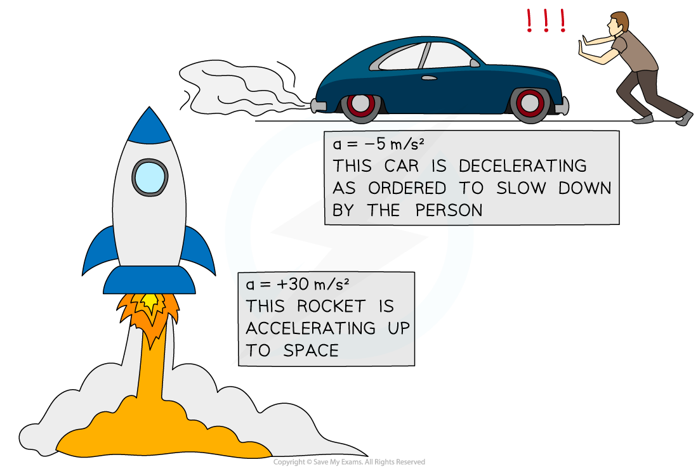

# Acceleration

## Acceleration

> **Spec point** — `spcpt_3YJRMM2YjG38PFJ4`

## Acceleration

- An object can change its speed by:

  - speeding up
  - slowing down
- When an object speeds up, it is **accelerating**
- When an object slows down, it is **decelerating**

## Calculating acceleration

> **Spec point** — `spcpt_57Dsjdsx3MbJcn8V`

## Calculating acceleration

### Extended Tier Only

- **Acceleration** describes how the **velocity **of an object changes over **time**
- Acceleration is defined as: **The** **rate of change of velocity **
- In other words, acceleration is the change in velocity per unit time
- The acceleration of an object is often changing throughout an object's journey
- Therefore, is it often useful to know the **average acceleration**

$a=\frac{\Deltav}{\Deltat}$

- Where:

  - $a$ = acceleration in metres per second squared (m/s2)
  - $\Deltav$ = change in velocity in metres per second (m/s)
  - $\Deltat$ = time taken in seconds (s)

#### Formula triangle for acceleration, change in velocity and change in time

***To use a formula triangle, simply cover up the quantity you wish calculate and the structure of the equation is revealed***

- Information on how to use a formula triangle can be found in [Speed & velocity](https://www.savemyexams.com/igcse/physics/cie/23/revision-notes/1-motion-forces--energy/1-2-motion/1-2-1-speed--velocity/)

### Change in velocity

- The **change in velocity** is the **difference** between the initial and final velocity:

$\Deltav=v-u$

- Where:

  - $\Deltav$ = change in velocity in metres per second (m/s)
  - $v$ = final velocity in metres per second (m/s)
  - $u$ = initial velocity in metres per second (m/s)

- If an object speeds up, its acceleration is **positive**
- If an object slows down, its acceleration is **negative**
- Acceleration is positive if it is in the **same direction** as the motion of the object

#### Acceleration of different objects

***A rocket speeding up (accelerating) and a car slowing down (decelerating)***

> **Worked Example**
> A Japanese bullet train decelerates at a constant rate in a straight line. The velocity of the train decreases from 50 m/s to 42 m/s in 30 seconds.
> 
> (a) Calculate the change in velocity of the train.
> 
> (b) Calculate the deceleration of the train, and explain how your answer shows the train is slowing down.
> 
> **Answer:**
> 
> **Part (a)**
> 
> **Step 1: List the known quantities**
> 
> - Initial velocity, $u=50m/s$
> - Final velocity, $v=42m/s$
> 
> **Step 2: Write the equation for change in velocity**
> 
> $\Deltav=v-u$
> 
> **Step 3: Substitute values for final and initial velocity**
> 
> $\Deltav=42-50$
> 
> $\Deltav=-8m/s$
> 
> **Part (b)**
> 
> **Step 1: List the known quantities**
> 
> - Change in velocity, $\Deltav=-8m/s$
> - Time taken, $\Deltat=30s$
> 
> **Step 2: Write the equation for acceleration**
> 
> $a=\frac{\Deltav}{\Deltat}$
> 
> **Step 3: Substitute the values for change in velocity and time**
> 
> $a=\frac{-8}{30}$
> 
> $a=-0.27m/s^{2}$
> 
> **Step 4: Interpret the value for deceleration**
> 
> - The answer is **negative**, which indicates the train is **slowing down**

> **Exam Hint**
> Remember, the units for acceleration are **metres per second squared**, m/s2. In other words, acceleration measures how much the velocity (m/s) changes every second, so the units are metres per second per second (m/s/s).
