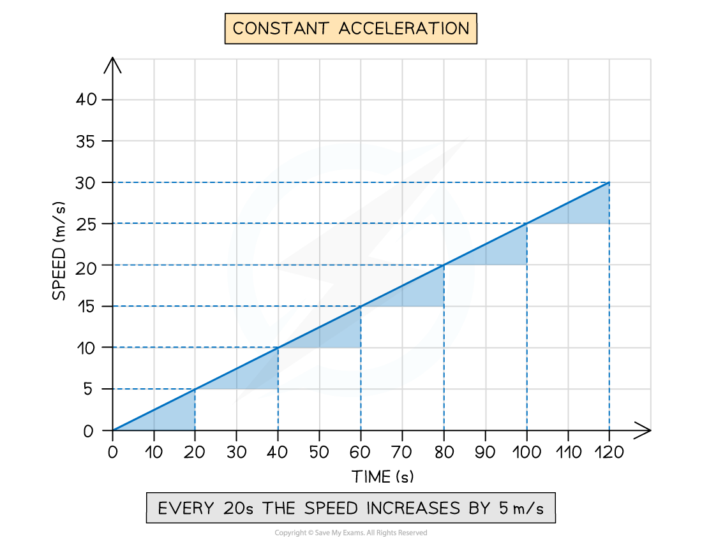
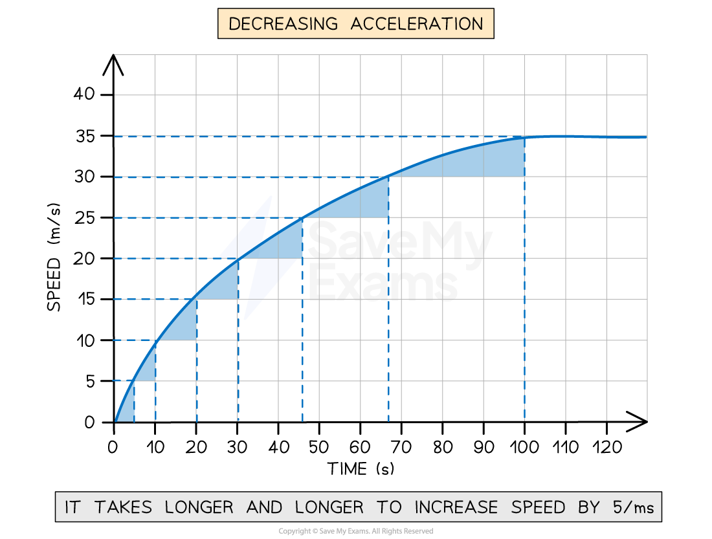
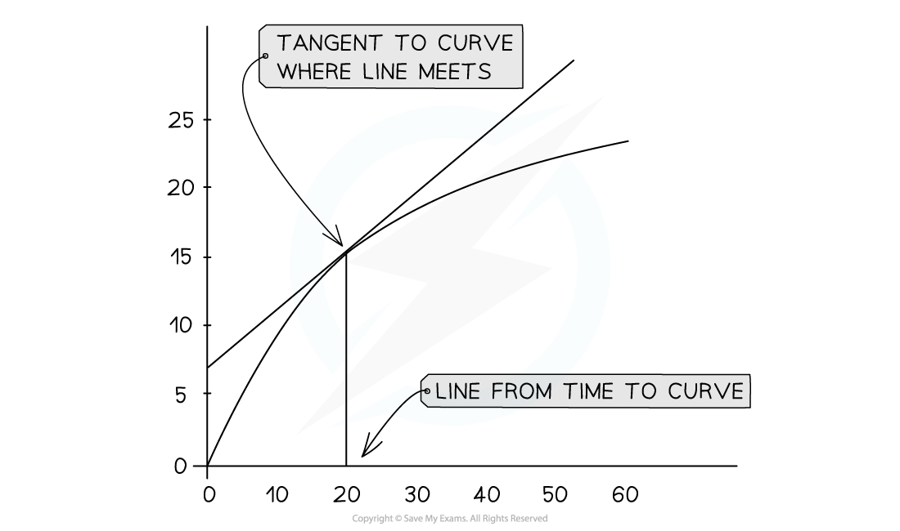

# Calculating Acceleration from Speed-Time Graphs

## Interpreting speed-time graphs

> **Spec point** — `spcpt_kCFvd792q3vz4tZJ`

## Interpreting speed-time graphs

### Extended Tier Only

- When interpreting speed-time graphs, the shape of the graph can show:

  - constant acceleration
  - changing acceleration

- The **gradient **of a speed-time graph shows the **acceleration **of a moving object

  - The gradient is **positive **if the object is accelerating (speed increases with time)
  - The gradient is **negative **if the object is decelerating (speed decreases with time)

### Interpreting constant positive acceleration on a speed-time graph

- When the acceleration is **constant **and **non-zero**:

  - the graph is a **straight line**
  - velocity is **increasing **at a **constant **rate, i.e. speed changes by the same amount in equal intervals of time

#### Constant positive acceleration on a speed-time graph

***A speed-time graph for an object with constant positive acceleration. Its speed increases by 5 m/s every 20 s, showing that the rate at which the speed increases is constant.***

### Interpreting increasing positive acceleration on a speed-time graph

- When the acceleration is **increasing**:

  - the graph is a **curve **
  - velocity is **increasing **at an **increasing **rate, i.e. the speed changes by the same amount in increasingly shorter time intervals

#### Increasing positive acceleration on a speed-time graph

***A speed-time graph for an object with changing positive acceleration. The time taken for the speed to increase by 5 m/s decreases over time, showing that acceleration is increasing.***

### Interpreting decreasing positive acceleration on a speed-time graph

- When the acceleration is **decreasing**:

  - the graph is a **curve**
  - velocity is **increasing **at a **decreasing **rate, i.e. the speed changes by the same amount in increasingly longer time intervals

#### Decreasing positive acceleration on a speed-time graph

***A speed-time graph for an object with changing positive acceleration. The time taken for the speed to increase by 5 m/s increases over time, showing that acceleration is decreasing.***

### Interpreting decreasing negative acceleration on a speed-time graph

- When the deceleration is **decreasing:**

  - the graph is a **curve**
  - the velocity is **decreasing **at a **decreasing **rate, i.e. the speed changes by the same amount in increasingly longer intervals of time

#### Decreasing negative acceleration on a speed-time graph

***A speed-time graph for an object with changing negative acceleration. The time taken for the speed to decrease by 5 m/s increases over time, showing that deceleration is decreasing.***

> **Exam Hint**
> **Interpreting graphs** can be difficult, and students often struggle with this key skill
> 
> In CIE IGCSE Co-ordinated Sciences, interpreting graphs is a **required **skill
> 
> - For your exam, you are also expected to calculate the **gradient **of a graph and the area under a graph
> - Finding the **area under a graph** is covered in the revision note [Speed-time graphs](https://www.savemyexams.com/igcse/physics_co-ordinated-sciences-double-award/cie/23/revision-notes/1-motion-forces-and-energy/motion/speed-time-graphs/)

## Calculating acceleration from speed-time graphs

> **Spec point** — `spcpt_WrRmkzjN4Jk6QpgN`

## Calculating acceleration from speed-time graphs

### Extended Tier Only

- The **acceleration** of an object can be calculated from the **gradient** of a speed-time graph

### Finding the gradient when acceleration is constant

- When acceleration is **constant**, the speed-time graph will be a **straight line**
- The gradient of a straight line can be found using:

$\mathrm{gradient}=\frac{\Deltay}{\Deltax}$

- Where:

  - $\Deltay$ = change in $y$ (speed) values
  - $\Deltax$ = change in $x$ (time) values

- Therefore, the gradient is equal to:

$a=\frac{\Deltav}{\Deltat}$

- Where:

  - $a$ = acceleration, measured in metres per second squared (m/s2)
  - $\Deltav$ = change in speed, measured in metres per second (m/s)
  - $\Deltat$ = change in time, measured in seconds (s)

***The gradient of a speed-time graph for constant acceleration can be found using Δy divided by Δx***

### Finding the gradient when acceleration is changing

- When acceleration is **changing**, the speed-time graph will be a **curve**
- The **gradient **of a point on a **curve** can be found by drawing a **tangent **to the curve

#### A tangent to the curve

***The value of the gradient at a single point on a curve can be determined by finding the gradient of the tangent to that point ***

*** ***

- The tangent provides a gradient that is representative of the gradient at a **specific point** on the curve
- The gradient of the tangent can be found using:

$\mathrm{gradient}=\frac{\Deltay}{\Deltax}$

- The value of the gradient at specific point on the curve represents the acceleration of the object **at that moment**

  - This is called **instantaneous acceleration**

> **Worked Example**
> A cyclist is training for a cycling tournament.
> 
> The speed-time graph below shows the cyclist's motion as they cycle along a flat, straight road.
> 
> 
> 
> (a) In which section (A, B, C, D, or E) of the speed-time graph is the cyclist's acceleration the largest?
> 
> (b) Calculate the cyclist's acceleration between 5 and 10 seconds.
> 
> **Answer:**
> 
> **Part (a)**
> 
> **Step 1:** **Recall that the slope of a speed-time graph represents the magnitude of acceleration**
> 
> - The slope of a speed-time graph indicates the magnitude of acceleration Therefore, the only sections of the graph where the cyclist is accelerating are sections B and D
> - Sections A, C, and E are flat; in other words, the cyclist is moving at a constant velocity (therefore, not accelerating)
> 
> **Step 2: Identify the section with the steepest slope**
> 
> - Section D of the graph has the steepest slope
> - Hence, the largest acceleration is shown in section D
> 
> **Part (b)**
> 
> **Step 1: Recall that the gradient of a speed-time graph gives the acceleration**
> 
> - Calculating the gradient of a slope on a speed-time graph gives the acceleration for that time period
> 
> **Step 2: Draw a large gradient triangle at the appropriate section of the graph**
> 
> - A gradient triangle is drawn for the time period between 5 and 10 seconds
> 
> 
> 
> **Step 3: Calculate the size of the gradient and state this as the acceleration**
> 
> - The acceleration is given by the gradient, which can be calculated using:
> 
> $a=\frac{\Deltay}{\Deltax}$
> 
> $a=\frac{5}{5}$
> 
> $a=1m/s^{2}$
> 
> - Therefore, the cyclist accelerated at 1 m/s2 between 5 and 10 seconds

> **Exam Hint**
> Use the **entire slope**, where possible, to calculate the gradient. Examiners tend to award credit if they see a **large gradient triangle** used.
> 
> Remember to actually draw the lines directly on the graph itself, particularly when the question asks you to **use the graph** to calculate the acceleration.

> **Worked Example**
> A skydiver jumps from a plane and reaches terminal velocity after 15 seconds. A  speed-time graph of their motion is shown below.
> 
> Use the graph to find the acceleration at 5 seconds.
> 
> 
> 
> **Answer:**
> 
> **Step 1: Draw a tangent to the curve at the point where t = 5 s**
> 
> 
> 
> **Step 2: Calculate the gradient of the tangent**
> 
> $a=\frac{\Deltay}{\Deltax}$
> 
> $a=\frac{58-20}{9.75-0.75}$
> 
> $a=\frac{38}{9.0}$
> 
> `a space equals space 4.2 space straight m divided by straight s squared space open parentheses 2 space straight s. straight f. close parentheses`

> **Exam Hint**
> The CIE IGCSE Co-ordinated Science specification does not say that you need to calculate acceleration from a curved speed–time graph.
> 
> However, it does say that you need to be able to find the gradient of a tangent to a curve as part of your maths skills. This skill can be tested in many different topics and types of questions. A speed–time graph, like the one shown above, is just one example where you may be asked to use it.
> 
> The skills in this revision note are applicable to any type of graph. For more information on interpreting graphs in Physics, see the article [Graph skills in GCSE Physics](https://www.savemyexams.com/learning-hub/exam-guides/graph-skills-in-gcse-physics/)
