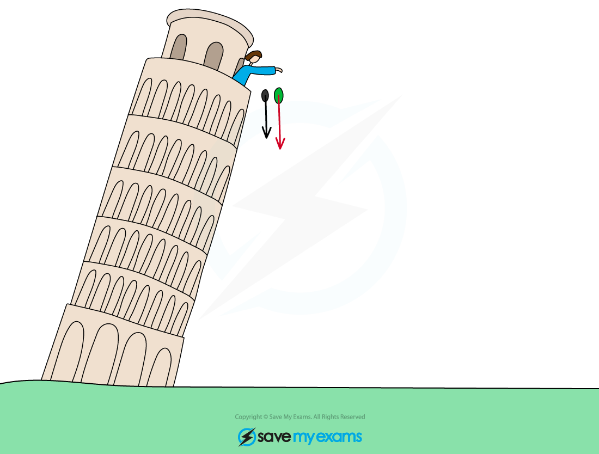

# Freefall

## Acceleration of free fall

> **Spec point** — `spcpt_zk3PT9Rb6zDDRGnY`

## Acceleration of free fall

### Extended Tier Only

- In the absence of **air resistance**, all objects fall with the **same *****acceleration***** **regardless of their mass
- This is called the **acceleration of freefall**

  - This is also sometimes called acceleration due to gravity

$\mathrm{acceleration} \mathrm{of} \mathrm{freefall}=g=9.8m/s^{2}$

***In the absence of air resistance, Galileo discovered that all objects (near Earth's surface) fall with an acceleration of about 9.8 m/s******2***

- This means that for every second an object falls, its velocity will increase by 9.8 m/s

> **Exam Hint**
> - The symbol $g$ also stands for the **gravitational field strength**, and can be used to calculate the force of weight acting an object using its mass:
> 
> $W=mg$
> 
> - Where:
> 
>   - $W$ = the force of weight acting on an object, measured in newtons (N)
>   - $m$ = mass of object, measured in kilograms (kg)
>   - $g$ = gravitational field strength, measured in newtons per kilogram (N/kg)
