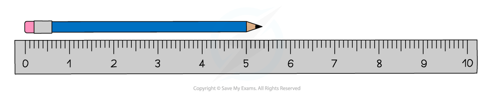
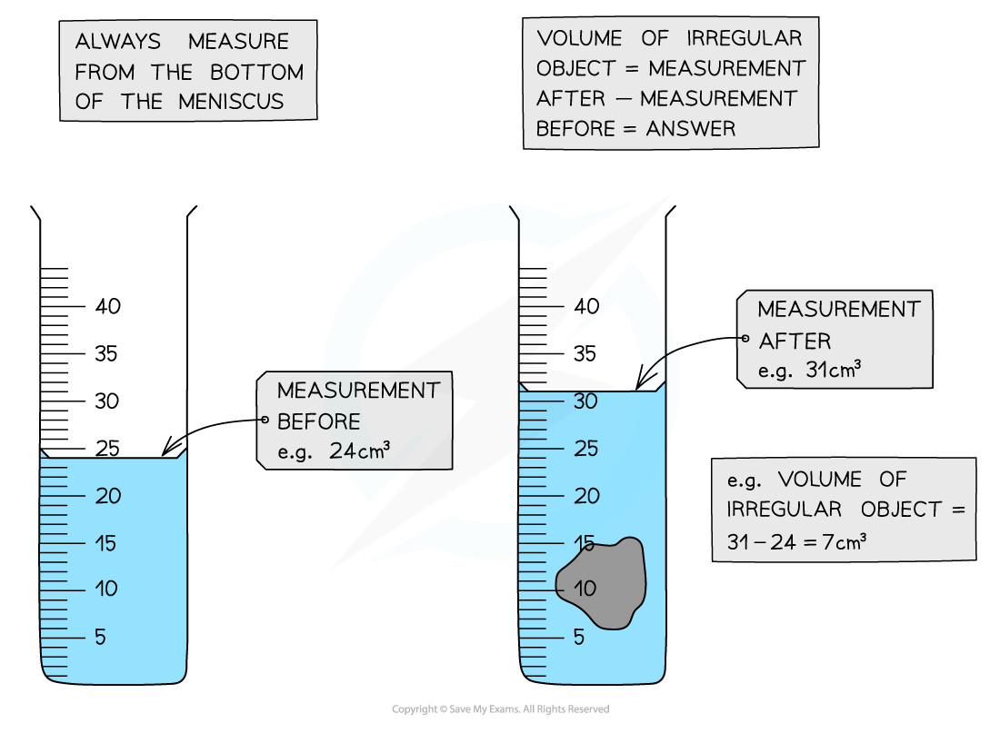

# Measurement

## Measuring length & volume

> **Spec point** — `spcpt_vPZ7Cr4dXd32gbRq` · Describe the use of rulers and measuring cylinders to find a length or a volume

## Measuring length & volume

- When making measurements in physics, different instruments are used for different measurements

### Measuring length

- Rulers can be used to measure small distances of a few centimetres (cm)

  - They are able to measure to the nearest millimetre (mm)

*A ruler can measure lengths in cm or mm*

- A **tape measure** is used to measure longer lengths, from tens of centimetres to several metres

### Measuring volume

- **Measuring cylinders** are used to measure the volume of liquids

  - By measuring the **change in volume**, a measuring cylinder can also be used to determine the volume of an irregular shape

*Measuring cylinders can be used to determine the volume of a liquid or an irregular shaped solid*

## Measuring time

> **Spec point** — `spcpt_czZsgHDHz4DVMcqn` · Describe how to measure a variety of time intervals using clocks and digital timers

## Measuring time

- In physics, clocks and digital timers are usually used to measure **time intervals**

  - **Clocks** typically measure **long** time intervals
  - **Digital timers**, such as stopwatches, typically measure **short** time intervals
- An important factor when measuring time intervals is **human reaction time**

  - The standard human reaction time for an alert person is typically around 0.2 to 0.3 s
  - This can have a significant impact upon measurements when the measurements involved are very short

> **Worked Example**
> A stopwatch is used to measure the time taken for a runner to complete a lap of a 400 m track.
> 
> The images below give the readings on the stopwatch at the start and the end of the lap.
> 
> 
> 
> Calculate how long it took the runner to complete the lap. Give your answer in seconds.
> 
> [2]
> 
> **Answer:**
> 
> **Step 1: Identify the start time for the lap**
> 
> - The stopwatch displays time in (minutes):(seconds):(one hundredths of a second)
> - The stopwatch was already at 0:55:10 when the runner started the lap
> - Start time =  **55.10 seconds (s)**
> 
> **Step 2: Identify the finish time for the lap**
> 
> - The stopwatch reads 1:45:10 at the end of the lap
> - Finish time = **1 minute and 45.10 s**
> 
> **Step 3: Convert the finish time into seconds**
> 
> $1\text{minute}=60\text{seconds}$
> 
> $\text{finish time}=60+45.10$
> 
> $\text{finish time}=105.10\text{s}$ **[1 mark]**
> 
> **Step 4: Calculate the total time taken to complete the lap**
> 
> $\text{total time}=\text{finish time}-\text{start time}$
> 
> $\text{total time}=105.10-55.10$
> 
> $\text{total time}=50\text{s}$ **[1 mark]**

> **Exam Hint**
> You will sometimes find that information is given in the question that is not actually needed in the calculation.
> 
> In this worked example, you were told that the track the runner is running on is 400 m. This had nothing to do with the calculation the question asked you to perform.
> 
> This is a common method for making a question seem more difficult. Don't let it catch you out.

## Multiple readings

> **Spec point** — `spcpt_sm5YDY3mRJ2Jtqrf` · Determine an average value for a small distance and for a short interval of time by measuring multiples (including the period of oscillation of a pendulum)

## Multiple readings

- In physics, **multiple readings** of measurements are often taken to reduce the impact of measurement errors

*Taking multiple measurements improves precision and reduces the impact of errors*

- The measurement of the thickness of a single sheet of paper is so small that it would be very difficult to get a **precise** measurement

  - However, measuring the thickness of **100 sheets** of paper can be done much more precisely and reduces the uncertainty of the measurement
  - **Dividing **the answer by 100 then gives a precise figure for the **average **thickness of **one sheet**
- Measuring the time period of a simple pendulum would incur a human reaction time error at the start of the measurement **and** at the end of the measurement
- If the measurement is small, the percentage uncertainty in the measurement is large
- Therefore, **multiple readings** can be taken to reduce the uncertainty of the measurement

  - The time taken for **10 oscillations** of the pendulum can be measured
  - **Dividing **the answer by 10 gives a more **precise **figure for the **average **time taken for **one oscillation**
- A **reference marker **can be used when measuring oscillations

  - A reference marker is a **visual reference point** such as a line or a dot
  - The marker is added to the point at which the** measurement is taken**, such as the **equilibrium position** of an oscillating pendulum
  - This makes it easier to see when the pendulum passes this point, **reducing **the **error **in **starting **and **stopping **the timer

> **Worked Example**
> The diagram shows four identical ball bearings placed between two blocks on a steel ruler.
> 
> 
> 
> Calculate the diameter of one ball bearing.
> 
> [2]
> 
> **Answer:**
> 
> **Step 1: Measure the length of all four ball bearings**
> 
> - The blocks mark the edges of the first and last ball bearings
> - The blocks make it easier to measure the length of all four ball bearings
> 
> $\text{total length}=12-4$
> 
> $\text{total length}=8\text{cm}$ **[1 mark]**
> 
> **Step 2: Find the diameter by dividing the total length by the number of ball bearings**
> 
> $\text{diameter}=\frac{\text{total length}}{\text{number of ball bearings}}$
> 
> $\text{diameter}=\frac{8}{4}$
> 
> $\text{diameter}=2\text{cm}$ **[1 mark]**
