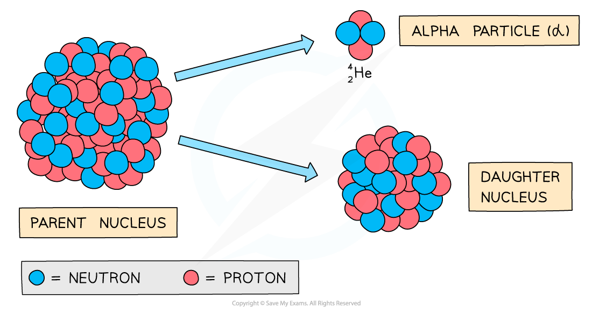

# Changes During Radioactive Decay

## Change to a new element

> **Spec point** — `spcpt_gyWSvxg4tKGSGh3F`

## Change to a new element

- A nucleus changes to a **different element**, during α-decay or β-decay

  - The initial nucleus is often called the **parent nucleus**
  - The nucleus of the new element produced is often called the **daughter** nucleus
- The daughter nucleus is a new element because it has a **different** proton and/or nucleon number than the original parent nucleus
- This can be seen on a graph of N (neutron number) against Z (proton number)

  - For example; when Pu-239 decays by alpha to U-235, it loses 2 protons and 2 neutrons
  - U (uranium) is a completely different element from Pu (plutonium)

#### Graph of neutron number against proton number

***Graph of N against Z for the decay of Pu*****–*****239***

### Alpha decay

- During alpha decay an alpha particle is emitted from an unstable nucleus
- A completely **new element** is formed in the process

#### Alpha decay

***Alpha decay usually happens in large unstable nuclei, causing the overall mass and charge of the nucleus to decrease***

- An alpha particle is a **helium nucleus**

  - It is made of 2 protons and 2 neutrons
- When the alpha particle is emitted from the unstable nucleus, the mass number and atomic number of the nucleus changes

  - The mass number **decreases** by 4
  - The atomic number **decreases** by 2
- The charge on the nucleus also decreases by 2

  - This is because protons have a charge of +1 each

### Beta decay

- During **beta** decay, a **neutron** changes into a **proton** and an **electron**

  - The electron is **emitted** and the proton **remains** in the nucleus
- A completely new element is formed because the **atomic number** changes

#### Beta decay

***Beta decay often happens in unstable nuclei that have too many neutrons. The mass number stays the same, but the atomic number increases by one***

- A beta particle is a high-speed **electron**
- It has a mass number of 0

  - This is because the electron has a negligible mass, compared to neutrons and protons
- Therefore, the **mass number** of the decaying nucleus **remains the same**
- Electrons have an atomic number of -1

  - This means that the new nuclei will **increase their atomic number by 1** so atomic number is conserved before and after the decay
- During **β-emission**, a change takes place in the nucleus:

  - A neutron is transformed into a proton and an electron
  - **neutron → proton + electron**

### Gamma decay

- During gamma decay, a gamma ray is emitted from an unstable nucleus

  - This process makes the nucleus less energetic but does not change its structure because gamma radiation has no mass or charge

#### Gamma decay

***Gamma decay does not affect the mass number or the atomic number of the radioactive nucleus, but it does reduce the energy of the nucleus***

## Decay equations

> **Spec point** — `spcpt_ZHzJQP7zVdxN4nnq`

## Decay equations

### Extended tier only

- Decay equations, use **nuclide notation**, to show the emission of α-particles, β-particles and γ-radiation
- A decay equation is similar to a chemical reaction equation

  - The particles present before the decay are shown **before** the arrow
  - The particles produced in the decay are shown **after** the arrow
- During decay equations, the sum of the mass and atomic numbers **before** the reaction must be the same as the sum of the mass and atomic numbers **after** the reaction

### Alpha decay equation

- All alpha decay equations have the following form for isotopes X and Y:

`X _ Z ^ A -> Y _ Z - 2 ^ A - 4 + alpha _ 2 ^ 4`

- The following decay equation shows polonium-212 undergoing alpha decay $Po_{84}^{212} \rightarrow Pb_{82}^{208} + \ \\alpha pre_{2} pre^{4}$

  - It forms lead-208 and an alpha particle
  - An alpha particle can also be written as a helium (He) nucleus

### Beta decay equation

- All beta decay equations have the following form for isotopes X and Y:

`X _ Z ^ A -> Y _ Z + 1 ^ A + beta _ - 1 ^ 0`

### Gamma decay equation

- All gamma decay equations have the following form for isotope X

$\mathrm{X} pre_{Z} pre^{A} \rightarrow \mathrm{X} pre_{Z} pre^{A} + \ \\gamma pre_{0} pre^{0}$

> **Worked Example**
> A nucleus with 84 protons and 126 neutrons undergoes alpha decay. It forms lead, which has the element symbol Pb.
> 
> **A. **$Pb_{82}^{206}$
> 
> **B. **$Pb_{82}^{208}$
> 
> **C. **$Pb_{84}^{210}$
> 
> **D. **$Pb_{86}^{214}$
> 
> Which isotope of lead pictured is the correct one formed during the decay?
> 
> **Answer: A**
> 
> **Step 1: Calculate the mass number of the original nucleus**
> 
> - The mass number is equal to the number of protons plus the number of neutrons
> - The original nucleus has 84 protons and 126 neutrons
> 
> $84+126=210$
> 
> - The mass number of the original nucleus is 210
> 
> **Step 2: Calculate the new atomic number**
> 
> - The alpha particle emitted is made of two protons and two neutrons
> - Protons have an atomic number of 1, and neutrons have an atomic number of 0
> - Removing two protons and two neutrons will reduce the atomic number by 2
> 
> $84--2=82$
> 
> - The new nucleus has an atomic number of **82**
> 
> **Step 3: Calculate the new mass number**
> 
> - Protons and neutrons both have a mass number of 1
> - Removing two protons and two neutrons will reduce the mass number by 4
> 
> $210--4=206$
> 
> - The new nucleus has a mass number of **206**

> **Worked Example**
> A nucleus with 11 protons and 13 neutrons undergoes beta decay. It forms magnesium, which has the element symbol Mg.
> 
> **A. **$Mg_{9}^{20}$
> 
> **B. **$Mg_{10}^{24}$
> 
> **C. **$Mg_{11}^{23}$
> 
> **D. **$Mg_{12}^{24}$
> 
> Which is the correct isotope of magnesium formed during the decay?
> 
> **Answer: D**
> 
> **Step 1: Calculate the mass number of the original nucleus**
> 
> - The mass number is equal to the number of protons plus the number of neutrons
> - The original nucleus has 11 protons and 13 neutrons
> 
> $11+13=24$
> 
> - The mass number of the original nucleus is 24
> 
> **Step 2: Calculate the new atomic number**
> 
> - During beta decay a neutron changes into a proton and an electron
> - The electron is emitted as a beta particle
> - The neutron has an atomic number of 0 and the proton has an atomic number of 1
> - So the atomic number increases by 1
> 
> $11+1=12$
> 
> - The new nucleus has an atomic number of 12
> 
> **Step 3: Calculate the new mass number**
> 
> - Protons and neutrons both have a mass number of 1
> - Changing a neutron to a proton will not affect the mass number
> - The new nucleus has a mass number of 24 (the same as before)

> **Exam Hint**
> You are not expected to know the names of the elements produced during radioactive decays, but you do need to be able to calculate the mass and atomic numbers by making sure they are balanced on either side of the reaction.

## Video of Alpha Emission

> **Spec point** — `spcpt_fNMHfym8mXKvYrGT`

## 

## Video of Beta Emission

> **Spec point** — `spcpt_XR8qRk56Gf7ZgGrw`

##
