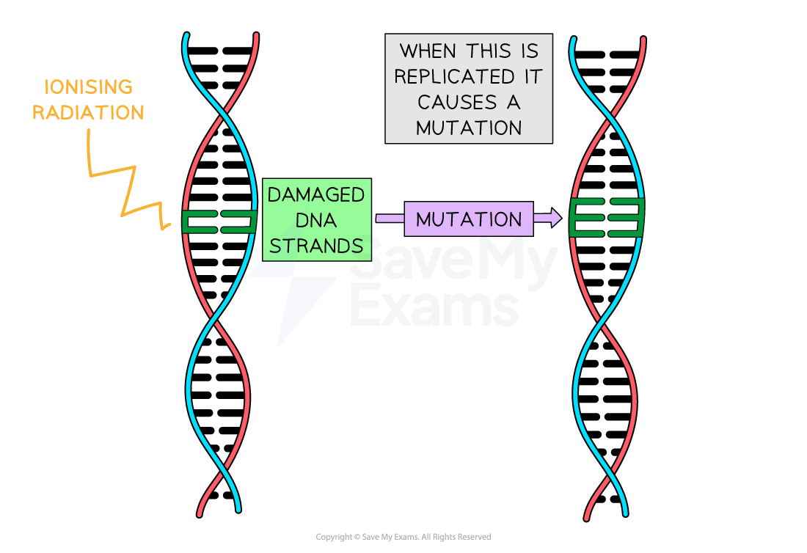
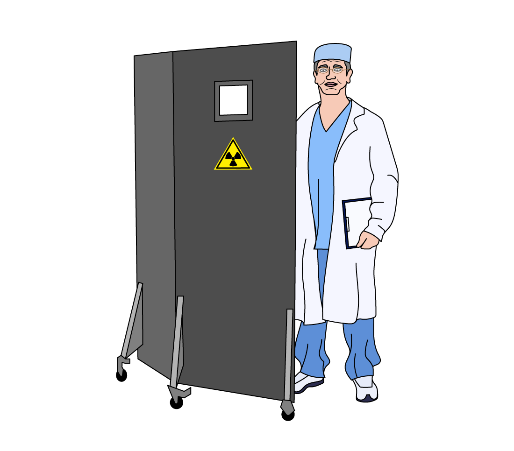

# Dangers of Radioactivity

## Dangers of radioactivity

> **Spec point** — `spcpt_YKCK8w77RJdbVC4R`

## Dangers of radioactivity

- Ionising nuclear radiation can **damage living things** such as human cells and tissues at high doses:
- This can include:

  - Cell death
  - Mutations
  - Cancer
- If the atoms that make up a DNA strand are **ionised,** then the DNA strand can be** damaged**
- If the DNA is damaged, then the cell may die, or the DNA may be** mutated** when it is replicated
- If a mutated cell replicates itself then a **tumour** may develop

  - This is an example of **cancer**, which is a significant danger of radiation exposure

#### Ionising DNA is a danger of radioactivity

***Diagram showing the damage caused to DNA by ionising radiation. Sometimes the cell is able to repair the DNA during replication successfully, but incorrect repairs can cause a mutation***

- Acute radiation exposure can have other serious symptoms:

  - It can cause skin **burns**, similar to severe sunburn
  - Radiation can **reduce** the amount of **white blood cells** in the body, making a person more susceptible to infections by lowering their immune system
- Because of this, it is very important to handle radioactive sources carefully

## Safe storage

> **Spec point** — `spcpt_fF7dVVbYkZJ4sHK3`

## Safe storage

- Safety precautions for all ionising radiation include:
- reducing** exposure time**

  - increasing the **distance** between the source and living tissue
  - using **shielding** to absorb radiation

### Reducing exposure time reduces the dangers of radioactivity

- Limiting the amount of time spent near a radioactive source reduces the amount of radiation dose received
- The amount of radiation received by a person is called the dose and is measured in **sieverts** (Sv)
- One sievert is a very big dose of radiation

  - It would cause acute **radiation poisoning**

### Increasing the distance reduces the dangers of radioactivity

- **Increasing** the **distance** the radiation is away greatly **reduces** the size of the **dose** received

  - Using tongs instead of your hand when handling a radioactive source can help with this
- Constructing nuclear power plants in **remote areas** increases their distance from people if there is a problem
- Burying nuclear waste far from places where people live also increases **the distance **to people

### Shielding reduces the dangers of radioactivity

- Radiation shielding is a **barrier** placed between a radiation source and a person or area to protect them

  - The purpose of shielding is to **limit exposure** to radiation at a certain location or time
- Barriers** absorb the energy** from radioactive sources
- Barriers are normally made of lead, water or concrete

  - People handling radioactive sources should wear a **lead apron** to reduce their exposure
- When X-rays are taken:

  - the area around where the image is needed is shielded
  - the radiologist stands behind a barrier or leaves the room

#### Reducing the dangers of radiation for a radiologist

***A radiologist can stand behind a lead barrier to reduce the amount of radiation they are exposed to***
