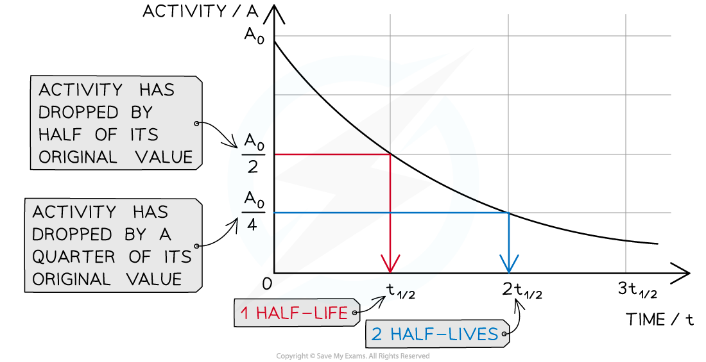

# Half-Life

## Half-life

> **Spec point** — `spcpt_Sh8HRc65vRz4SWCD`

## Half-life

- The **half-life** of a particular **isotope** is defined as: **The time taken for half the nuclei of that isotope in any sample to decay**
- The **rate** at which the activity of a sample decreases is measured in terms of **half-life**

  - This is the time it takes for the activity of a sample to fall to half its original level

- This is the time it takes for the activity of the sample to decrease from 100 % to 50 %

  - It is the same length of time as it would take to decrease from 50 % activity to 25 % activity

- Different isotopes have different half-lives and half-lives can vary from a fraction of a second to billions of years in length

  - The half-life is **constant** for a particular isotope

### Representing half life

- Half-life can be determined from an activity–time graph

#### A half-life graph

***The graph shows how the activity of a radioactive sample changes over time. Each time the original activity halves, another half-life has passed***

- Half-life can also be represented on a table

  - As the number of the half-life increases, the proportion of the isotope remaining **halves**

#### Table showing the number of half-lives to the proportion of isotope remaining

| **Number of half-lives** | **Proportion of isotope remaining** |
|---|---|
| 0 | 1 |
| 1 | $\frac{1}{2}$ |
| 2 | $\frac{1}{4}$ |
| 3 | $\frac{1}{8}$ |
| 4 | $\frac{1}{16}$ |
| ... | ... |

> **Worked Example**
> An isotope of protactinium-234 has a half-life of 1.17 minutes.
> 
> Calculate the amount of time it takes for a sample to decay from a mass of 10 mg to 2.5 mg.
> 
> **Answer:**
> 
> **Step 1: Calculate the fraction of the sample remaining**
> 
> - Initial mass of sample = 10 mg
> - Final mass of sample = 2.5 mg
> 
> $\frac{2.5}{10}=\frac{1}{4}$
> 
> - The fraction of the sample remaining is $\frac{1}{4}$
> 
> **Step 2: Calculate the number of half-lives that have passed**
> 
> - Using the table above we can see that** two** half-lives have passed
> 
> **Step 3: Calculate the time for the sample to decay**
> 
> - Two half lives have passed
> - So the time for the sample to decay is twice the half-life
> 
> $2\times1.17=2.34\mathrm{minutes}$
> 
> - The time for the sample to decay to a mass of 2.5 mg is **2.34 minutes**

## Video of Half- Life

> **Spec point** — `spcpt_YpzxCZFYnHT3wmsd`

##
