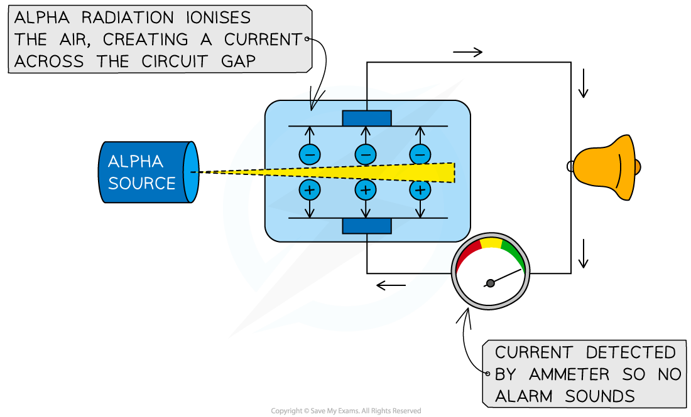
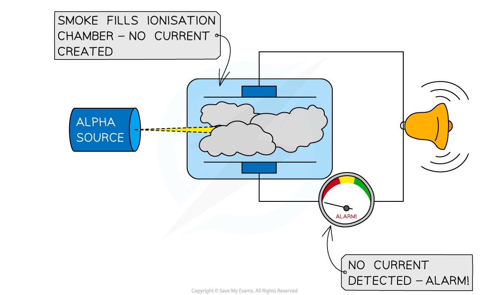
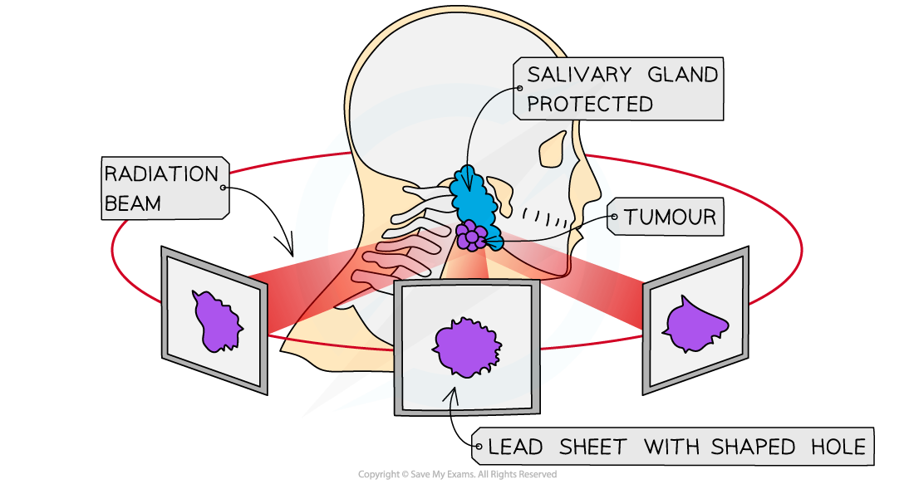

# Uses of Radioactivity

## Uses of radioactivity

> **Spec point** — `spcpt_VG6ywKtPfrG6sp6z`

## Uses of radioactivity

- Radioactivity has the following applications:

  - household fire (smoke) alarms
  - irradiating food to kill bacteria
  - sterilisation of equipment using gamma rays
  - measuring and controlling thicknesses of materials with the choice of radiations used linked to penetration and absorption
  - diagnosis and treatment of cancer using gamma rays

### Household fire alarms are a use of alpha radiation

- Alpha particles are used in smoke detectors
- The alpha radiation **ionises** the air within the detector, creating a current
- The alpha emitter is blocked when smoke enters the detector
- The alarm is triggered by a microchip when the sensor no longer detects the alpha particles

#### Uses of alpha radiation: household fire alarms

***In the diagram at the bottom, alpha particles are stopped by the smoke, preventing the flow of current and triggering the alarm***

### Sterilisation of equipment using gamma rays

- Gamma radiation is widely used to **sterilise** medical equipment

### Irradiating food to kill bacteria using gamma rays

- Food can be irradiated to** kill any microorganisms **that are present on it
- This makes the food last longer and reduces the risk of food-borne infections

#### Uses of gamma radiation: killing bacteria

***Food that has been irradiated carries this symbol, called the Radura. Different countries allow different foods to be irradiated***

### Measuring the thickness of materials using different radiation

- Beta radiation is most commonly used to measure the thickness of materials

- A material moves across the **radiation **source

  - The particles that penetrate it are monitored using a detector above
- The thickness of the material is monitored

  - If the material gets **thicker, more** particles will be absorbed by the material, meaning that **less** will get through and be detected by the detector
  - If the material gets **thinner** the **opposite** happens
- The machine makes **adjustments** to keep the thickness of the material **constant**

#### Uses of radiation: monitoring material thickness

***Beta particles can be used to measure the thickness of thin materials such as paper, cardboard or aluminium foil***

### Diagnosis and treatment of cancer using gamma rays

- **Radiotherapy** is the name given to the treatment of cancer using radiation

  - Chemotherapy is treatment using chemicals
- Radiation can kill living cells

  - Some cells, such as bacteria and cancer cells, are more susceptible to radiation than others
- Beams of gamma rays are directed at the cancerous tumour

  - Gamma rays are used because they can** penetrate the body**, reaching the tumour
  - The beams are moved around to minimise harm to healthy tissue whilst still being aimed at the tumour

#### Uses of gamma radiation: treatment of cancer

***Radiation therapy to remove a tumour***

- A **tracer** is a radioactive isotope that can be used to track the movement of substances, like blood, around the body

  - A PET scan can detect the emissions from a tracer to diagnose cancer and determine the location of a tumour

> **Worked Example**
> Use the diagram to explain why alpha radiation is used in smoke detectors, and beta or gamma radiation is not.
> 
> 
> 
> **Answer:**
> 
> - Consider the different properties of alpha, beta and gamma:
> 
>   - **Alpha** is the most **weakly** penetrating and **strongest** ioniser
>   - **Beta** and **gamma** have **stronger** penetrating power and **weaker** ionising power
> - If beta or gamma radiation were used in this situation then they would pass straight through the smoke and the alarm would not go off
> - Therefore, since alpha is **absorbed** by smoke, and beta and gamma are not, this makes it **most suitable** for use in a smoke detector

> **Exam Hint**
> If you are presented with an unfamiliar situation in your exam don’t panic! Just apply your understanding of the properties of alpha, beta and gamma radiation. Mainly think about the range (how far it can travel) and ionising power of the radiation to help understand which radiation is used in which situation.
