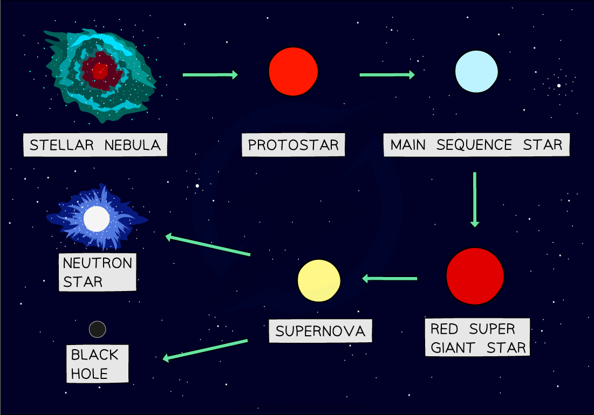
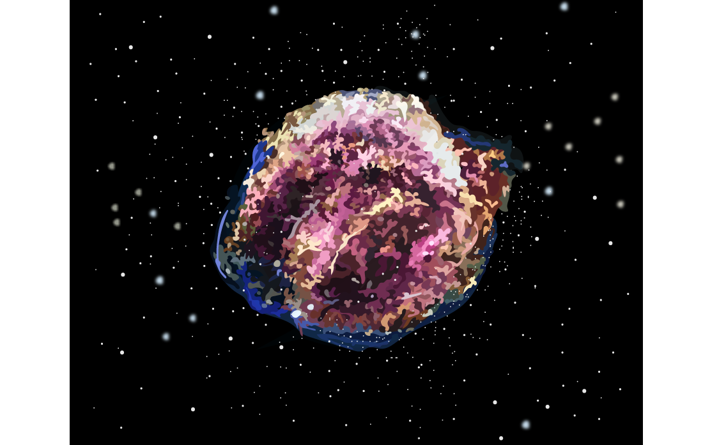

# Life Cycle of a Star

## Life cycle of a star

> **Spec point** — `spcpt_km9BX4r4TC9R6z89`

## Life cycle of a star

### Small mass star

- A small mass star is one which has a similar mass as the Sun
- After the stable star stage, a small mass star finishes its life cycle in the following evolutionary stages:

**red giant → planetary nebula + white dwarf**

- Red giant:

  - Formed when a small mass star reaches the end of its life
  - The outer layers of the star expand and cool

- Planetary nebula:

  - Formed when the outer layers of the star are pushed away

- White dwarf:

  - Formed when the core of the star collapses
  - Found at the centre of a planetary nebula

#### The life cycle of a small mass star

***The life cycle of a star that is similar to our Sun***

### Large mass star

- A large mass star is one with a larger mass than the Sun
- After the stable star stage, a large mass star finishes its life cycle in the following evolutionary stages:

**red supergiant → supernova → neutron star**

- Red supergiant:

  - Formed when a large (or very large) mass star reaches the end of its life
  - The outer layers of the star expand and cool

- Supernova:

  - An exploding red supergiant

- Neutron star:

  - Formed when the core of a large star collapses
  - Very dense, but not as much as a black hole

### Very large mass star

- A very large mass star is one with a much larger mass than the Sun
- After the stable star stage, a very large mass star finishes its life cycle in the following evolutionary stages:

**red supergiant → supernova → black hole**

- Black hole:

  - Formed when the core of a very large star collapses
  - Extremely dense

#### The life cycle of a large mass star

***The life cycle of a star much larger than our Sun***

## Formation of new stars and planets

> **Spec point** — `spcpt_WMgJ7ppKRfNhBC7C`

## Formation of new stars and planets

### Extended Tier Only

- The nebula from a supernova may form new **stars **with orbiting **planets**

  - The heaviest elements (elements heavier than iron) are formed during a supernova and are ejected into space
  - These nebulae may form new planetary systems

#### A supernova

***The nebula formed from a supernova may eventually form new stars with orbiting planets***
