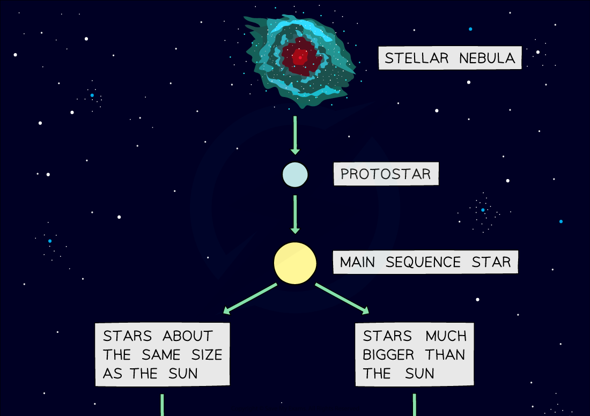

# Star Formation

## Star formation

> **Spec point** — `spcpt_zPjZ3Zc3BDjTSrBv`

## Star formation

- Stars go through a sequence of evolutionary stages, known as the **life cycle** of a star
- All stars follow the same initial stages:

**nebula → protostar → stable star**

### Nebula

- Stars form from a giant interstellar **cloud of gas and dust **called a nebula

### Protostar

- The **gravitational attraction** within a nebula pulls the particles **closer together** until a hot ball of gas forms, known as a **protostar**

### Stable star

- Once the protostar becomes hot enough and the forces inside the star become balanced, it is known as a **stable** **star**

### Fate of the star

- Once a stable star is formed, the final stages of its life cycle depend on its **mass**
- The different life cycles are shown below

#### Summary of the life cycles of stars

***Flow diagram showing the life cycle of a star which is the same size as the Sun (solar mass) and the lifecycle of a star which is much more massive than the Sun***
