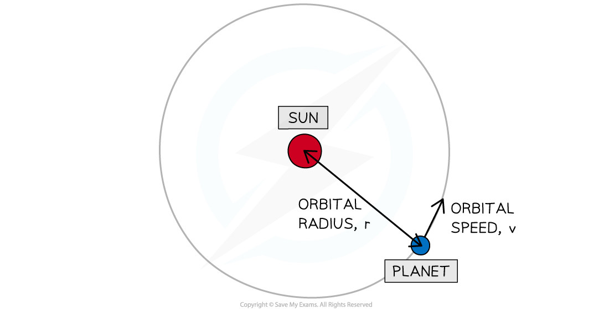

# Orbital Speed Equation

## Orbital speed equation

> **Spec point** — `spcpt_9wxjWYshrc2ZWYYF`

## Orbital speed equation

### Extended Tier Only

- When planets orbit around the Sun, or a moon moves around a planet, they move in **circular orbits**
- In one complete orbit, a planet travels a distance equal to the circumference of a circle

  - This is equal to $2πr$,* *where $r$ is the radius of the circular path

- The relationship between speed, distance and time is:

$\mathrm{speed}=\frac{\mathrm{distance}}{\mathrm{time}}=\frac{\mathrm{circumference} \mathrm{of} \mathrm{orbit}}{\mathrm{orbital} \mathrm{period}}$

- The average orbital speed of an object can be defined by the equation:

$v=\frac{2πr}{T}$

- Where:

  - *v* = orbital speed in metres per second (m/s)
  - *r* = average radius of the orbit in metres (m)
  - *T* = orbital period in seconds (s)

- This orbital period (or time period) is defined as: **The time taken for an object to complete one orbit**
- The orbital radius *r *is always taken from the **centre** of the object being orbited to the object orbiting

#### Orbital speed of a planet

***Orbital radius and orbital speed of a planet moving around a Sun***

> **Worked Example**
> The Hubble Space Telescope moves in a circular orbit. Its height above the Earth’s surface is 560 km and the radius of the Earth is 6400 km. It completes one orbit in 96 minutes.
> 
> 
> 
> Calculate its orbital speed in m/s.
> 
> **Answer:**
> 
> **Step 1: List the known quantities**
> 
> - Radius of the Earth,* R* = 6400 km
> - Height of the telescope above the Earth's surface, *h *= 560 km
> - Time period, *T *= 96 minutes
> 
> **Step 2: Write the relevant equation**
> 
> $v=\frac{2πr}{T}$
> 
> **Step 3: Calculate the orbital radius, *****r***
> 
> - The **orbital radius** is the distance from the **centre** of the Earth to the telescope
> 
> 
> 
> $r=R+h$
> 
> $r=6400+560=6960\mathrm{km}$
> 
> **Step 4: Convert any units**
> 
> - The time period needs to be in seconds
> 
> $1\mathrm{minute}=60\mathrm{seconds}$
> 
> $96\mathrm{minutes}=60\times96=5760s$
> 
> - The radius needs to be in metres
> 
> $1\mathrm{km}=1000m$
> 
> $6960\mathrm{km}=6960000m$
> 
> **Step 5: Substitute values into the orbital speed equation**
> 
> $v=\frac{2π\times6960000}{5760}=7592.18=7590m/s$

> **Exam Hint**
> Remember to check that the orbital radius *r* given is the distance from the **centre** of the Sun (if a planet is orbiting a Sun) or the planet (if a moon is orbiting a planet) and not just from the surface. If the distance is a height above the surface you must add the radius of the body, to get the height above the centre of mass of the body.
> 
> This is because orbits are caused by the mass, which can be assumed to act at the centre, rather than the surface.
> 
> Don't forget to check your units and convert any if required!
