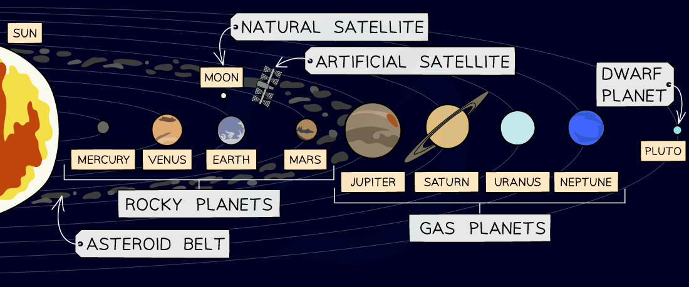

# The Solar System

## The Solar System

> **Spec point** — `spcpt_9PKzTqrdg9sJ76gF`

## The Solar System

- The Solar System consists of:

  - the Sun
  - eight planets
  - natural and artificial satellites
  - minor planets, including dwarf planets

#### The Solar System

***The Solar System consists of one star (the Sun) and the objects that orbit it, including the planets, moons, dwarf planets, asteroids and comets***

### The Sun

- The Sun is the **closest **star to the Earth
- It is found at the **centre **of the Solar System

### The planets

- There are **eight **planets which *orbit* the Sun
- In ascending order of the distance from the Sun, these are: **Mercury, Venus, Earth, Mars, Jupiter, Saturn, Uranus, Neptune**
- The planets can be divided into two groups

  - the **inner **rocky planets
  - the **outer **gas giants

### Dwarf planets

- A dwarf planet is an object similar to a planet, but much smaller
- The **gravitational field** around a planet is strong enough to pull in nearby objects (with the exception of natural *satellites*)
- Whereas, the gravitational field** **around a dwarf planet is **not strong enough** to pull in nearby objects

### Satellites

- There are two types of satellites: **natural **and **artificial**

#### Natural and artificial satellites of Earth

***The Moon is a natural satellite of the Earth. Many artificial satellites orbit around the Earth.***

- Natural satellites are objects that orbit planets
- A **moon **is a type of natural satellite
- **Artificial satellites** are manmade objects that orbit another object in space
- The International Space Station (ISS) is an example of an artificial satellite that orbits the Earth

### Orbiting bodies

- The Solar System is made up of many bodies which orbit around other bodies
- **Smaller** bodies **orbit** around **larger** bodies

  - For example, planets orbit the Sun and moons orbit planets

- The orbiting bodies in the Solar System are shown in the table below:

#### Table of orbiting bodies in the Solar System

| **orbiting body** | **body it orbits** |
|---|---|
| planet | the Sun |
| moon | planet |
| minor planets | the Sun |
| artificial satellites | the Earth |

> **Exam Hint**
> You need to know the order of the 8 planets in the Solar System. The following mnemonic gives the first letter of each of the planets to help you recall them:
> 
> **M**y **V**ery **E**xcellent **M**other **J**ust **S**erved **U**s **N**oodles
> 
> **M**ercury, **V**enus, **E**arth, **M**ars, **J**upiter, **S**aturn, **U**ranus, **N**eptune
