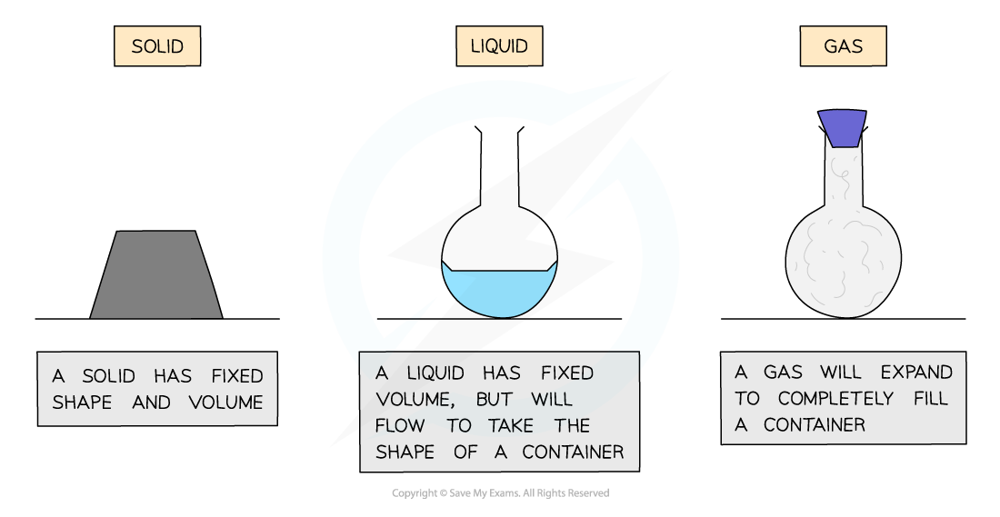

# States of Matter

## Properties of solids, liquids & gases

> **Spec point** — `spcpt_Dfb4h9V3H8KXNbfY`

## Properties of solids, liquids & gases

### The three states of matter

***The three states of matter in terms of shape and volume***

#### Solids

- Solids have a definite shape and a definite volume

  - Solids cannot flow and are not compressible

#### Liquids

- Liquids have no definite shape but do have a definite volume

  - Liquids are able to flow to take the shape of a container but they are not compressible

#### Gases

- Gases have no definite shape and no fixed volume

  - Gases can flow to take the shape of their container and are highly compressible

## Changes of state

> **Spec point** — `spcpt_cy67RR2YjzH6zzFq`

## Changes of state

When a substance changes state, the number of molecules in that substance doesn't change and so neither does its mass

- The only thing that changes is its **energy**
- Changes of state are physical changes and so they are **reversible**

**Melting & freezing**

- Melting occurs when a solid turns into a liquid (e.g. ice to water)
- Freezing occurs when a liquid turns into a solid

**Boiling & condensing**

- Boiling occurs when a liquid turns into a gas

  - This is also called evaporating
- Condensing occurs when a gas turns into a liquid

***You need to know these four processes only, and the states at which they start and end.***

> **Exam Hint**
> It is very useful to think about water when learning the changes of state, because we are all used to the idea that solid water (ice) melts to become liquid water (water!) and boils to become gaseous water (water vapour).
> 
> However, do remember that **all **substances undergo the same changes between the three states, but at different temperatures. So while water will help you to remember the names, don't refer to water in your answers unless it has been specified.
