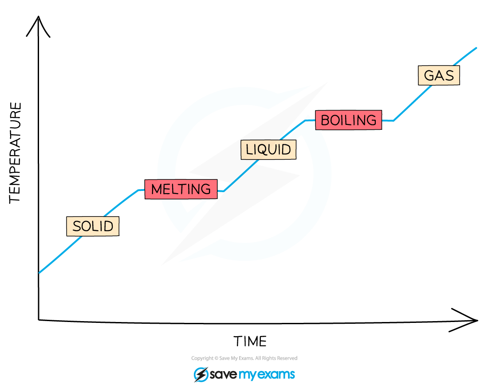

# Melting & Boiling

## Fixed points of water

> **Spec point** — `spcpt_HkNHcwwkMMwVxntr`

## Fixed points of water

- The **melting point** and **boiling point** of pure water are called **fixed points**
- Pure water melts at **0 °C** and boils at **100 °C**
- These values are for **pure water at atmospheric pressure**

***Ice melts at 0 °C and water boils at 100 °C ***

## Melting & boiling

> **Spec point** — `spcpt_HGRS748qNsXSrH34`

## Melting & boiling

- While a substance is **changing state **(e.g., melting or boiling):

  - The **temperature** of the substance **does not change**
  - Energy is still being transferred to or away from the thermal energy store of the substance
- One major difference between melting and boiling is that boiling occurs at a higher temperature

  - Melting results in particles being able to flow and move more freely,
  - During boiling, enough energy is transferred such that the [intermolecular forces](https://www.savemyexams.com/igcse/science/cie/co-ordinated-sciences-double-award/23/physics/revision-notes/thermal-physics/kinetic-particle-model-of-matter/molecular-matter/) can be completely **overcome**

***When the substance is changing state, the temperature remains constant as shown by the horizontal regions of this graph***

### Boiling

- When liquid water is heated by adding thermal energy (e.g., from a gas flame or kettle element), the temperature of the water rises until the water boils

  - At the **boiling** point, even if more thermal energy is added, the temperature of the liquid water does not increase

- The additional thermal energy is transferred to the **potential store** of the molecules, not the kinetic store

  - This energy goes into overcoming the intermolecular forces between the molecules of water, so the **internal energy continues to rise** even though the temperature stays constant
  - As the forces are overcome, the liquid water becomes water vapour (steam); the water is now a **gas**

### Melting

- When solid water (ice) is heated by adding thermal energy, the temperature of the ice increases until the melting point is reached

  - At the **melting** point, even if more thermal energy is added, the temperature of the ice does not increase

- The additional thermal energy is transferred to the **potential store** of the molecules, not the kinetic store

  - This energy goes into overcoming the intermolecular forces between the molecules of the ice, so the **internal energy continues to rise** even though the temperature stays constant
  - As the forces are overcome, the solid water becomes **liquid**; this is **melting**

## Condensation & solidification

> **Spec point** — `spcpt_fkvdY6drYyXqDnpj`

## Condensation & solidification

- Changes of state depend on whether energy is being transferred **to** or **away from** the system

  - Heating is when energy is transferred **to** the system, increasing the internal energy of the molecules
  - Cooling is when energy is transferred **away from** the system (or dissipated to the surroundings), decreasing the internal energy of the molecules

### Condensation

- When a gas **cools**, energy is transferred away from the system, and kinetic energy decreases until the temperature reaches the **boiling point**

  - At the boiling point, energy transferred away from the system reduces its potential energy
  - The particles no longer have enough energy to overcome the** intermolecular forces** of attraction
  - They only have enough energy to **flow** over one another
- The gas has condensed; it is now a liquid

  - As the energy has been transferred away from the **potential **store of the particles, the energy in the **kinetic **store is unchanged, so **temperature remains constant** through this process

### Solidification

- When a liquid **cools**, energy is transferred away from the system, and kinetic energy decreases until the temperature reaches the **melting point**

  - At the melting point, energy transferred away from the system reduces its potential energy
  - The particles no longer have enough energy to overcome the** intermolecular forces** of attraction
  - They are now low enough in energy to be bound to each other and can only vibrate around a fixed point
- The liquid has solidified; it is now a solid

  - As the energy has been transferred away from the **potential **store of the particles, the energy in the **kinetic **store is unchanged, so **temperature remains constant** through this process
