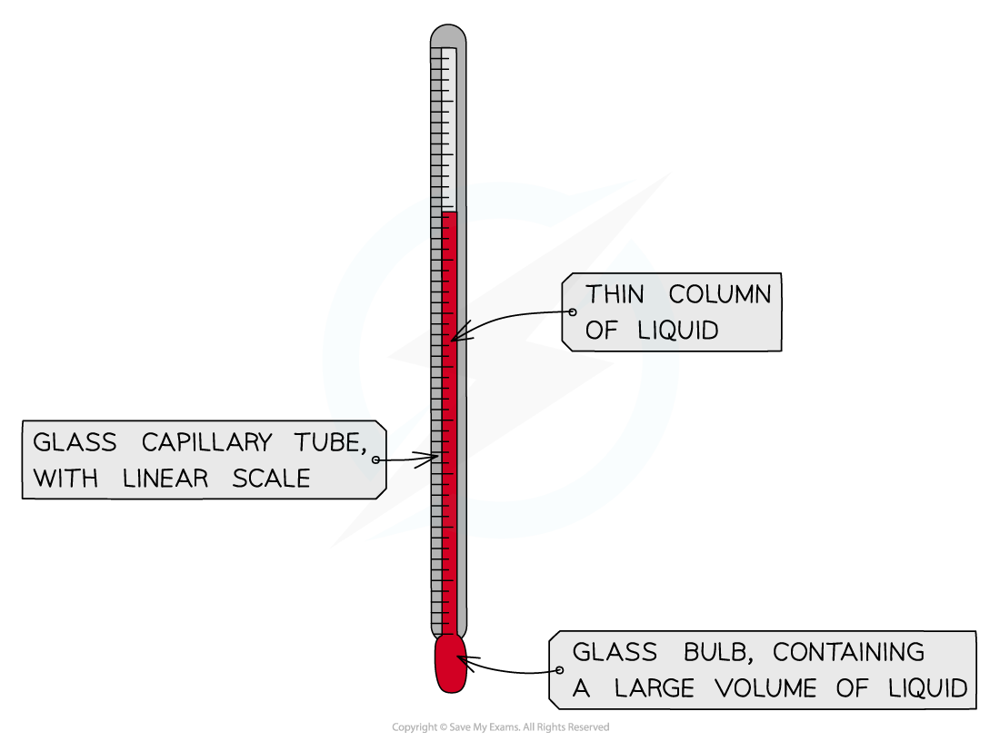
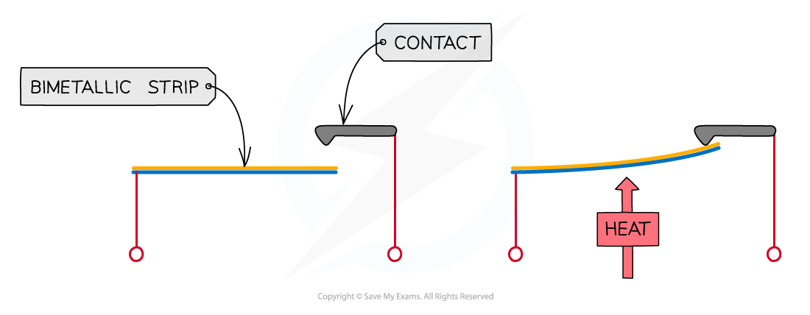

# Thermal Expansion 

## Thermal expansion

> **Spec point** — `spcpt_SfsShwDGjhXrjfSt`

## Thermal expansion

- When a material is heated at constant pressure:

  - Its temperature increases
  - Its overall volume increases (it **expands**)
  - Its density decreases

- This expansion happens because:

  - The molecules start to move around (or vibrate) faster as they gain kinetic energy
  - This causes them to collide with each other more often and push each other apart

#### Thermal expansion diagram

***When a solid is heated, the molecules vibrate more, pushing each other apart***

- Thermal expansion occurs in solids, liquids and gases
- When temperature is increased (at constant pressure):

  - Solids will tend to expand the least
  - Gases expand the most
  - Liquids fall in between the two

## Uses & consequences of thermal expansion

> **Spec point** — `spcpt_8SbsPPRcK9Hb8Yk3`

## Uses & consequences of thermal expansion

### Extended Tier Only

- The thermal expansion of materials can have some **useful applications** as well as some **undesirable consequences**

### Applications of thermal expansion

- Useful applications of thermal expansion include:

  - Liquid-in-glass thermometers
  - Temperature-activated switches

#### Liquid-in-glass thermometer

- A liquid-in-glass thermometer relies on the expansion of liquids to measure temperature
- It consists of a thin glass capillary tube containing a liquid that expands with temperature

  - At one end of the tube is a glass bulb, containing a large volume of the liquid which expands into the narrow tube when heated
  - A scale along the side of the tube allows the temperature to be measured based on the length of liquid within the tube

#### Liquid-in-glass thermometer

***As the bulb is heated, the liquid expands and moves along the capillary tube***

#### Temperature-activated switches

- Temperature-activated switches utilise a **bimetallic **(made from two types of metal) strip
- It consists of two metals that expand at different rates and bends by a predictable amount at a given temperature

***The bimetallic strip will bend upwards when heated, closing the circuit***

### Consequences of thermal expansion

- The expansion of solid materials can cause them to buckle if they get too hot
- This could include:

  - Metal railway tracks
  - Road surfaces
  - Bridges

- Objects that are prone to buckling in this way have gaps built in to creates space for the expansion to happen without causing damage

> **Exam Hint**
> Remember that it is **the material that expands, not the molecules**. This trips up many students, losing marks.
> 
> As heat is added;
> 
> 1. The increase in temperature...
> 2. Leads to an increase in kinetic energy, so that...
> 3. Molecules and atoms move more quickly...
> 4. And move apart
> 
>   - This separation of the molecules makes the substance bigger!
