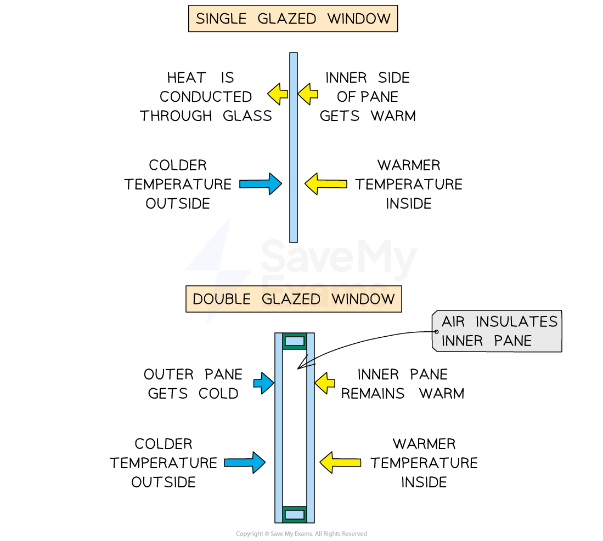
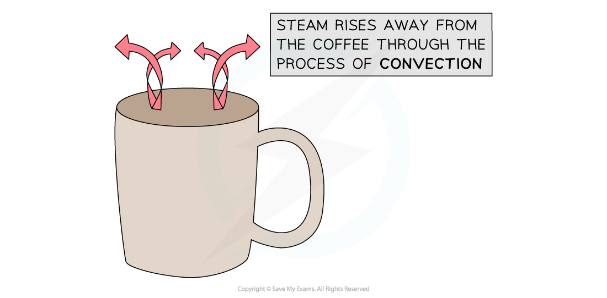

# Consequences of Thermal Energy Transfer

## Consequences of thermal energy transfer

> **Spec point** — `spcpt_Dzjjxdg7bZwqyfgb`

## Consequences of thermal energy transfer

- Conduction, convection and radiation have many everyday applications and consequences

### Examples of conduction

- Good conductors help transfer thermal energy **quickly**
- Examples include:

  - Metal pans to heat food quickly
  - Metal radiators to transfer heat from water inside to the surrounding air quickly
- Bad conductors (insulators) help retain thermal energy as they transfer heat **slowly**
- Examples include:

  - Plastic handles of saucepans to slow thermal energy transferred to hands
  - Air spaces in the walls or windows of some houses help to retain heat, as air is a poor conductor

#### Double-glazed windows

***Double-glazed windows use a layer of air to act as an insulator and slow the transfer of thermal energy out of the house***

### Examples of convection

- Common applications of convection are:

  - heating a room with a radiator
  - steam rising which cools a hot liquid
- Radiators use convection to raise the temperature of a room in a building:

  1. The metal radiator is hot and transfers thermal energy to air nearby
  2. The particles of this hot air spread out, making it less dense
  3. The spread-out air is less dense than the air above it, so this hot air rises
  4. The radiator heats the cold air which replaces the hot air
  5. The newly heated air also rises, cools and sinks (as it contracts and increases in density)

#### Convection in steam from coffee

***Thermal energy is transferred from the hot coffee to the air by convection currents rising from the surface***

### Examples of thermal radiation

- A black car becoming hot to the touch on a sunny day is an example of heating by radiation

  - Energy from the Sun is transferred by thermal radiation to the car
  - The car is black and therefore a good absorber of thermal radiation
- A fire becoming hotter as you approach it

  - The amount of thermal energy transferred by a flame increases as the distance decreases
  - As your hand moves closer to a flame the temperature increases and this increase is mostly caused by an increase in the amount of thermal radiation absorbed by your hand (convection has a much smaller effect)

> **Exam Hint**
> Don't let the name 'radiator' confuse you, these should really be called 'convection heaters'. Their heating ability comes almost exclusively through convection, radiation plays a very small part.
