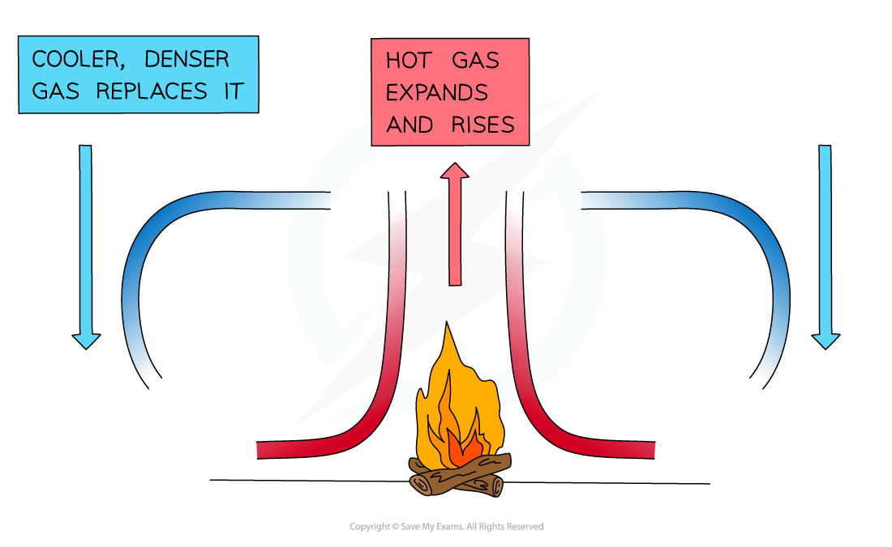

# Convection

## Convection

> **Spec point** — `spcpt_7q2VDxqG25dnmKjd`

## Convection

- Convection is the main way that heat travels through **liquids and gases**

  - Convection **only **occurs in fluids
  - Convection **cannot **happen in solids
- In convection, the fluid near to the heat source is heated first

  - This heated fluid then **rises** and is replaced by cooler fluid
- The cooler fluid is, similarly, heated and then rises, being replaced by cold fluid

  - In this way, a **convection current** is formed and the entirety of the fluid is heated

## Explaining convection

> **Spec point** — `spcpt_pdJKtsR9snzb3mfm`

## Explaining convection

### Extended Tier Only

### Density & convection

- Descriptions of convection currents always need to refer to changes in temperature causing changes in **density**
- The temperature may fall or rise, both can create a convection current
- **When a liquid (or gas) is heated (for example by a radiator near the floor)**:
- The heated molecules vibrate and push each other apart, **making the liquid/gas expand**

  - This makes the hot liquid/gas **less dense** than the surroundings
  - The **hot liquid/gas rises**, and the cooler (surrounding) liquid/gas moves in to take its place
  - Eventually the hot liquid/gas cools and contracts, increasing in density, and sinks back down again
  - The resulting motion is called a **convection current**

#### Simple convection current diagram

***When a liquid or gas is heated, it becomes less dense and rises***

- **When a liquid (or gas) is cooled (for example by an A.C. unit high up on a wall)**:

  - The molecules lose energy and collide less, **making the liquid/gas contract**
  - This makes the cold liquid/gas **more dense** than the surroundings
  - The **cold liquid/gas falls**, so that warmer, less dense, liquid or gas can move into the space created
  - The warmer liquid/gas gets cooled and also contracts and falls down
  - The resulting motion is called a **convection current**

> **Exam Hint**
> If a question on heat mentions **liquids or gases** the answer will probably be about **convection**.
> 
> **Heat does not rise** - it is the hot gases or liquids which rise due to the change in density when they were heated.

## Video of Explaining convection

> **Spec point** — `spcpt_VHkyhcdW96Wb2Fjh`

##
